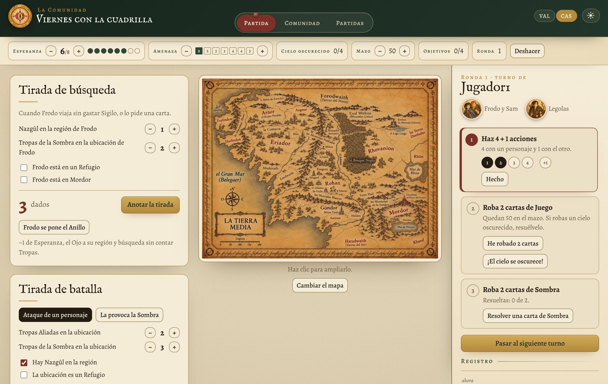
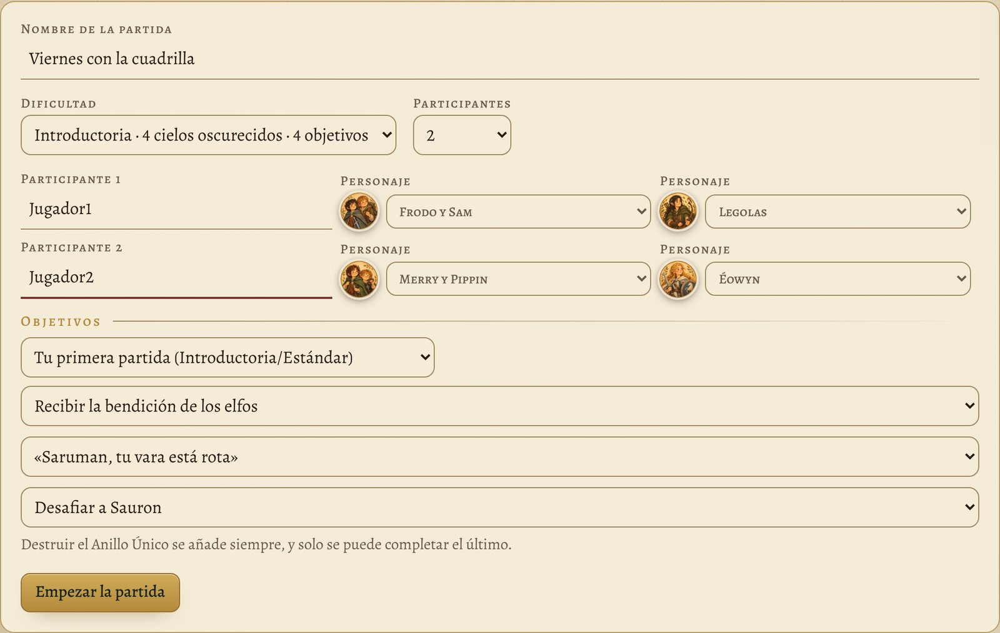
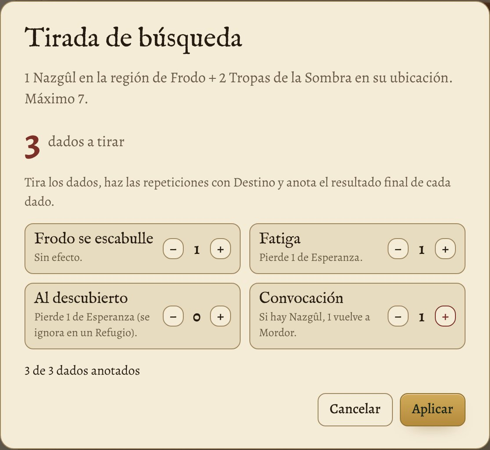
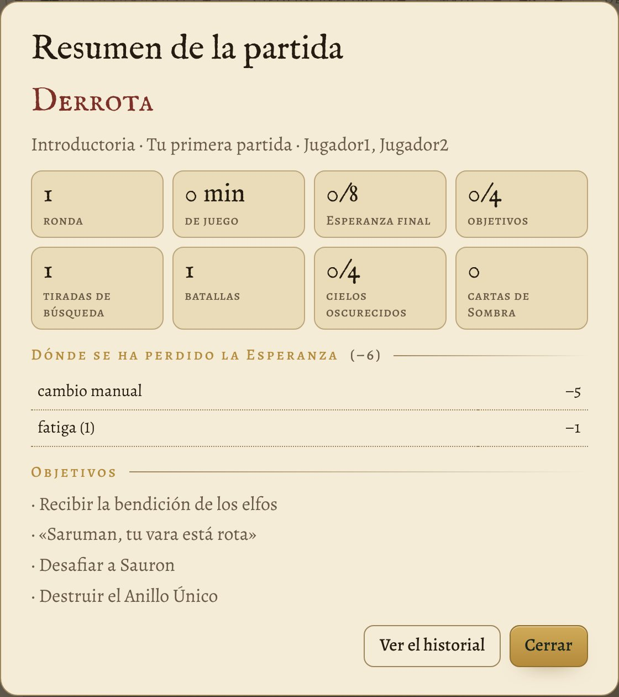
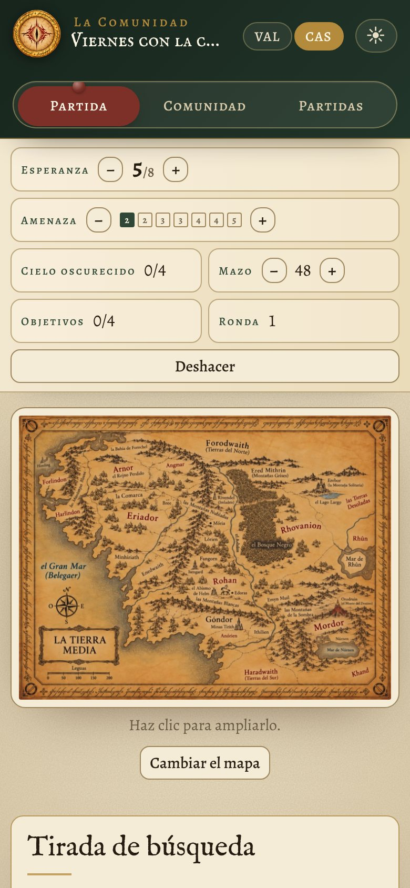
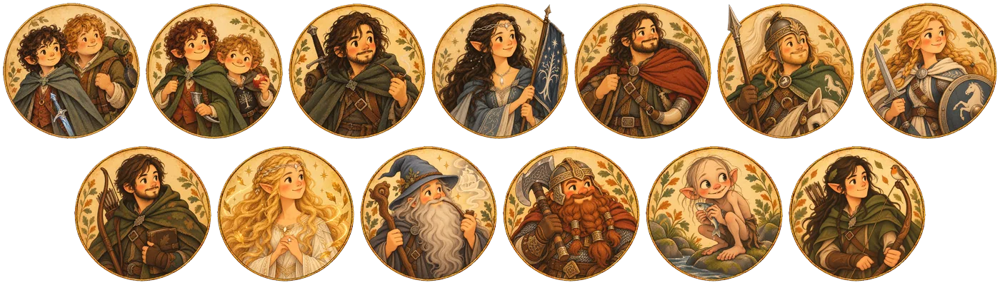

<p align="center"></p>

<p align="center">
  <a href="../../releases/latest"></a>
  <a href="LICENSE"></a>
  
  
  
  <a href="../../actions/workflows/proves.yml"></a>
</p>

[Valencià](README.md) · **Castellano**

# La Comunidad

**Ayudante libre para llevar las partidas de «El Señor de los Anillos: El Destino de la Comunidad».** El tablero y las piezas los tenéis en la mesa; la app lleva las cuentas: la Esperanza, la Amenaza, el turno paso a paso, cuántos dados tirar en cada tirada y qué se pierde con el resultado. Una persona la lleva y el resto jugáis en el tablero. En castellano y valenciano, y sin Internet.

Es **la misma app en Windows, en Linux, en Android y en el navegador**. En el ordenador se abre en una ventana propia; en Android, como cualquier otra app; y en el navegador funciona también sin conexión. Las partidas se quedan en el dispositivo y no se conecta a ningún servidor de fuera.

🌐 **Web:** [jossanmar9.github.io/comunitat-del-anell](https://jossanmar9.github.io/comunitat-del-anell/es/) · 📱 **Úsala:** [en el navegador](https://jossanmar9.github.io/comunitat-del-anell/app/) · ⬇️ **Descarga:** [última versión](../../releases/latest) · 📖 **Manual:** [en línea](docs/manual-usuario.md) y en PDF en cada versión



## Contenido

- [Qué hace](#qué-hace)
- [Capturas](#capturas)
- [Instalación](#instalación)
- [Primeros pasos](#primeros-pasos)
- [Datos y copias de seguridad](#datos-y-copias-de-seguridad)
- [Documentación](#documentación)
- [Para desarrollar](#para-desarrollar)
- [Publicar una versión](#publicar-una-versión)
- [Colaborar](#colaborar)
- [Uso de inteligencia artificial](#uso-de-inteligencia-artificial)
- [Licencia](#licencia)

## Qué hace

| Sección | Qué hace |
|---|---|
| **Marcadores** | Esperanza (de 0 a 8), nivel de Amenaza (cuántas cartas de Sombra se roban), cartas «El cielo se oscurece» salidas, cartas que quedan en el mazo, objetivos completados y ronda. Se corrigen a mano y todo se puede **deshacer** hasta 30 pasos. |
| **El turno paso a paso** | Las 4 + 1 acciones, robar 2 cartas (descuenta el mazo y resta Esperanza si se acaba) y resolver las cartas de Sombra que tocan, en el orden del reglamento. |
| **Tiradas de búsqueda** | Cuántos dados tirar según los Nazgûl y las Tropas de la Sombra, y qué se pierde con el resultado. Tiene en cuenta los Refugios, Mordor y ponerse el Anillo. |
| **Batallas** | Ataque de un personaje o provocada por la Sombra: cuántos dados, la Heroicidad gastada y cuántas Tropas hay que quitar de cada bando. Avisa si se pierde un Refugio. |
| **Cartas especiales** | *El cielo se oscurece* con sus cuatro pasos («¡Te veo!» incluido), la carta de Sombra y destruir el Anillo Único. |
| **Preparación** | Cinco niveles de dificultad, escenarios sugeridos, los 24 objetivos, los 13 personajes con retrato y la lista de preparación del tablero, paso a paso. |
| **Resumen e historial** | Al terminar, dónde se ha perdido la Esperanza, rondas, duración y tiradas. El historial guarda todas las partidas terminadas, con victorias y derrotas por dificultad. |
| **Partidas y copias** | Varias partidas guardadas, que se pueden duplicar, exportar, importar en otro dispositivo y borrar (van a la papelera). **Copias de seguridad automáticas** de cada partida, para volver a un momento anterior. |

Además: un **registro** de todo lo que pasa, **modo oscuro**, adaptada al **móvil** y un **mapa** de la Tierra Media que puedes cambiar por el tuyo desde la misma app. Todo el programa está en **castellano y valenciano**.

## Capturas

| | |
|---|---|
|  |  |
| La preparación: dificultad, participantes, personajes y objetivos. | Una tirada de búsqueda: la app dice cuántos dados tirar y aplica el resultado. |
|  |  |
| El resumen al terminar la partida. | En el móvil o en la app de Android, en una sola columna. |

<p align="center"></p>

Hay más capturas, paso a paso, en el [manual de usuario](docs/manual-usuario.md).

## Instalación

**Requisitos:** Windows 10 u 11 de 64 bits, Linux con escritorio, Android 5.1 o posterior, o un navegador actual. No hace falta Internet para jugar. Y el juego de mesa, claro: la app no incluye ningún componente del juego.

Descarga la [última versión](../../releases/latest):

| Sistema | Archivo |
|---|---|
| **Windows** (recomendado) | `LaComunitat-X.Y.Z-installador.exe`. No pide permisos de administrador; crea el acceso en el menú Inicio y, si quieres, en el escritorio. |
| **Windows** portable | `LaComunitat-X.Y.Z-windows-portable.zip`. Descomprímelo donde quieras (también en una memoria USB) y abre `LaComunitat.exe`. |
| **Ubuntu, Debian, Linux Mint…** | `comunitat-del-anell_X.Y.Z_all.deb`. Doble clic para instalarlo, o `sudo apt install ./comunitat-del-anell_X.Y.Z_all.deb`. |
| **Otros Linux** | `LaComunitat-X.Y.Z-linux.tar.gz`. Descomprímelo y abre `comunitat-del-anell.sh`; `./installa.sh` lo añade al menú. Hace falta Python 3 y, para la ventana propia, GTK y WebKitGTK. |
| **Android** | `LaComunitat-X.Y.Z-android.apk`. Ábrelo desde el móvil y permite «Instalar aplicaciones desconocidas» si te lo pide. |
| **Sin instalar nada** | La [app web](https://jossanmar9.github.io/comunitat-del-anell/app/): desde el menú del navegador la puedes añadir a la pantalla de inicio, y funciona sin conexión. También en el iPhone y el iPad. |

El programa de Windows no está firmado digitalmente: SmartScreen puede avisar. Pulsa **Más información → Ejecutar de todas formas**.

Más detalles y cómo pasar las partidas de versiones anteriores, en la [guía de instalación](docs/guia-instalacion.md).

**Con Python** (Linux, Mac o Windows con Python 3.8 o más nuevo): descarga [`comunitat.py`](comunitat.py) y ejecuta `python3 comunitat.py`. Para tenerla en una ventana propia, en Windows y Mac hace falta [pywebview](https://pywebview.flowrl.com/) (`pip install pywebview`) y en Linux, GTK y WebKitGTK; si no, se abre en el navegador.

## Primeros pasos

1. Abre **La Comunidad**. En el ordenador se abre en una ventana propia, sin navegador (en Windows con WebView2, en Linux con WebKitGTK); al cerrarla, ya está todo guardado.
2. Pulsa **Crear partida**, ponle un nombre y rellena la preparación: dificultad, participantes, personajes y objetivos.
3. Preparad el tablero con la lista de la pestaña **Comunidad** y a jugar. Cada cambio se guarda solo.

Opciones para el terminal (programa de escritorio):

```bash
comunitat-del-anell --dades ~/Partidas      # guarda los datos en otra carpeta
comunitat-del-anell --navegador             # la app en el navegador, en lugar de la ventana propia
comunitat-del-anell --sense-finestra        # sin ventanas: la dirección sale en el terminal
comunitat-del-anell --port 9001             # otro puerto local (el normal es el 8766)
comunitat-del-anell --idioma es             # los avisos de las ventanas en castellano (por defecto, en valenciano)
```

(En Windows, `LaComunitat.exe`; con el `.tar.gz`, `./comunitat-del-anell.sh`; con Python, `python3 comunitat.py`.) El programa solo acepta conexiones del mismo ordenador.

## Datos y copias de seguridad

| Dónde | Dónde se guardan los datos |
|---|---|
| Windows, con el instalador | `%APPDATA%\LaComunitat` |
| Linux, con el `.deb` | `~/.local/share/comunitat-del-anell` |
| Windows portable, `.tar.gz` o `python3 comunitat.py` | La carpeta del programa |
| Android y app web | Dentro de la app o del navegador |

En el ordenador, cada partida se guarda en `partides/<nombre>.json`, sus copias de seguridad en `copies/<nombre>/`, las partidas terminadas en `historial.json` y el mapa propio en `mapa.json`. El botón **Abrir la carpeta de datos** de la pestaña Partidas la abre directamente; para guardarlo todo aparte, cierra la app y copia la carpeta entera. Al desinstalar, las partidas no se borran.

En Android y en el navegador, la app guarda los mismos archivos dentro de ella. Si desinstalas la app o borras los datos del navegador, se pierden: **exporta** las partidas que quieras conservar. Exportar e importar es también la manera de pasar una partida de un dispositivo a otro.

La Comunidad hace una copia de cada partida al abrirla y cada media hora mientras se juega, y guarda las 15 últimas; se restauran desde **Partidas → Copias**.

## Documentación

- [Registro de cambios](CHANGELOG.md) (en valenciano)

| Documento | Valencià | Castellano |
|---|---|---|
| Manual de usuario | [manual-usuari.md](docs/manual-usuari.md) | [manual-usuario.md](docs/manual-usuario.md) |
| Guía de instalación | [guia-installacio.md](docs/guia-installacio.md) | [guia-instalacion.md](docs/guia-instalacion.md) |
| Arquitectura y pruebas | [arquitectura.md](docs/arquitectura.md) | |

Los PDF se generan solos a partir de estos archivos y van adjuntos a cada [versión](../../releases/latest), dentro de los paquetes y en la [web](https://jossanmar9.github.io/comunitat-del-anell/es/).

## Para desarrollar

Para el programa de escritorio solo hace falta **Python 3.8 o más nuevo**, sin dependencias. `comunitat.py` y la app web se generan a partir de `src/`:

| Archivo | Qué hay |
|---|---|
| `src/web/app.js` | La app: marcadores, turno, tiradas, preparación, resumen y partidas |
| `src/web/magatzem.js` | Dónde se guarda todo: partidas, historial, copias, exportar e importar. En el ordenador, a través del programa; en Android y en el navegador, en IndexedDB |
| `src/web/dades.js` | Personajes, objetivos, escenarios y preparación del tablero |
| `src/web/i18n.js` | Las traducciones al castellano |
| `src/web/cos.html`, `estil-base.css`, `estil.css` | La estructura y el estilo de la página |
| `src/web/personatges/`, `src/web/fonts/` | Los retratos (WebP de 200 px) y las tipografías (Alegreya e IM Fell English, OFL) |
| `src/servidor.py` | El programa de escritorio: un servidor solo para este ordenador que lee y escribe los archivos de datos |
| `src/persistencia.py` | Escritura segura, bloqueo de la carpeta de datos y paso de los datos de la v2 |
| `src/finestra.py` | La ventana propia (pywebview en Windows, WebKitGTK en Linux) y la de reserva (Tk) |
| `src/mapes/` | Los mapas de ejemplo, en valenciano y castellano |
| `tests/` | Las pruebas: programa, persistencia, almacén y la app en un navegador |
| `docs/` | Los manuales en Markdown y las capturas |
| `paquets/` | El instalador de Windows (Inno Setup), los archivos de Linux y el proyecto de Android (Capacitor) |
| `eines/` | Comprobar traducciones, manuales en PDF, paquetes de Linux, Android, capturas y la web |

Después de cambiar algo:

```bash
python3 build.py                          # vuelve a generar comunitat.py
python3 eines/comprova-traduccions.py     # comprueba que no falta ninguna traducción
python3 tests/prova_servidor.py           # el programa de escritorio
python3 tests/prova_persistencia.py       # escritura segura y datos de la v2
python3 tests/prova_magatzem.py           # partidas, historial y copias (hace falta Node.js)
python3 tests/prova_app.py                # la app en Chromium, escritorio y web (hace falta Playwright)
python3 comunitat.py                      # pruébalo
```

Otras herramientas:

```bash
python3 build.py --web dist/web           # la app web (hace falta Pillow para los iconos)
python3 eines/paquet-linux.py             # hace el .deb y el .tar.gz en dist/
sh eines/manuals-pdf.sh dist/manuals      # hace los manuales en PDF (hace falta Chrome o Chromium)
python3 eines/web.py _site                # genera la web, con la app web en app/
python3 eines/captures.py                 # vuelve a hacer las capturas de los manuales (hace falta Playwright)
```

El APK de Android se hace en GitHub Actions; para hacerlo a mano, ver [paquets/android/README.md](paquets/android/README.md).

## Publicar una versión

Cada vez que se suben cambios a `main`, [`.github/workflows/proves.yml`](.github/workflows/proves.yml) genera el programa y pasa las pruebas en Windows y Linux. Para publicar, GitHub lo hace todo solo con [`.github/workflows/publica.yml`](.github/workflows/publica.yml): prueba el programa (también la ventana propia), hace el instalador y el portable de Windows, el `.deb` y el `.tar.gz` de Linux, el APK de Android y los manuales en PDF, y lo publica en [Releases](../../releases).

1. Cambia `VERSION` en `src/servidor.py` (por ejemplo, `"3.0.1"`) y vuelve a generar `comunitat.py` con `python3 build.py`.
2. Sube los cambios y una etiqueta en minúscula con el mismo número:

```bash
git tag v3.0.1
git push origin main v3.0.1
```

Al cabo de unos minutos, la versión nueva aparece en [Releases](../../releases). Si la etiqueta y `VERSION` no coinciden, la publicación se detiene y lo avisa.

El APK se firma con una clave guardada en dos secretos del repositorio, `ANDROID_KEYSTORE` y `ANDROID_KEYSTORE_PASSWORD` ([paquets/android/README.md](paquets/android/README.md)). Tiene que ser siempre la misma: si no, Android no deja actualizar la app.

La [web](https://jossanmar9.github.io/comunitat-del-anell/es/) y la app web se publican solas con [`.github/workflows/web.yml`](.github/workflows/web.yml) cada vez que se suben cambios a `main` (hace falta **Settings → Pages → Source: GitHub Actions**).

## Colaborar

Las propuestas de mejora y las correcciones son bienvenidas. Si has encontrado un error o tienes una idea, abre una [incidencia](../../issues).

## Uso de inteligencia artificial

Este proyecto se ha hecho con ayuda de IA:
- **Imágenes:** el mapa de ejemplo (en valenciano y en castellano), el logo y los retratos de los personajes se han generado con IA. Los retratos parten de las descripciones de los libros, con un estilo propio, y no reproducen a ningún actor ni las ilustraciones oficiales del juego.
- **Código y documentación:** el programa, la app de Android, las traducciones, los README, los manuales, los paquetes y la web se han escrito con un asistente de IA (Claude, de Anthropic) y se han revisado a mano.

## Licencia

[GPL-3.0](LICENSE) o posterior. Lo podéis usar, copiar, modificar y compartir libremente. Si publicáis una versión modificada, también tiene que ser libre y con el código abierto.

Las tipografías [Alegreya](https://github.com/huertatipografica/Alegreya) e [IM Fell English](https://iginomarini.com/fell/) son libres, con la licencia SIL Open Font License ([`src/web/fonts/`](src/web/fonts/)). En Windows, la ventana usa [pywebview](https://pywebview.flowrl.com/) (licencia BSD). La app de Android se hace con [Capacitor](https://capacitorjs.com/) (licencia MIT).

**Aviso:** proyecto de fans **no oficial**, sin relación con Z-Man Games, Asmodee ni Middle-earth Enterprises. «El Señor de los Anillos» y los nombres relacionados son marcas de sus propietarios. Este programa no incluye ningún componente del juego: para jugar hay que tenerlo.

Ver también [NOTICE.md](NOTICE.md) para los avisos sobre marcas y materiales de terceros.
