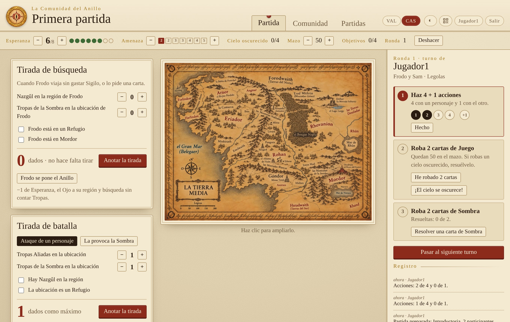
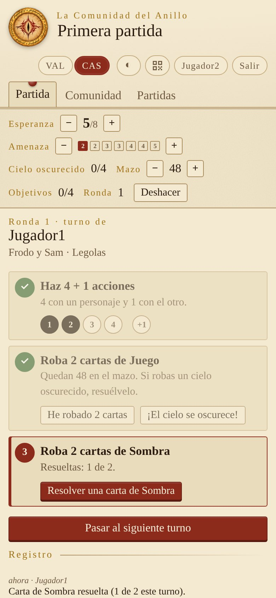
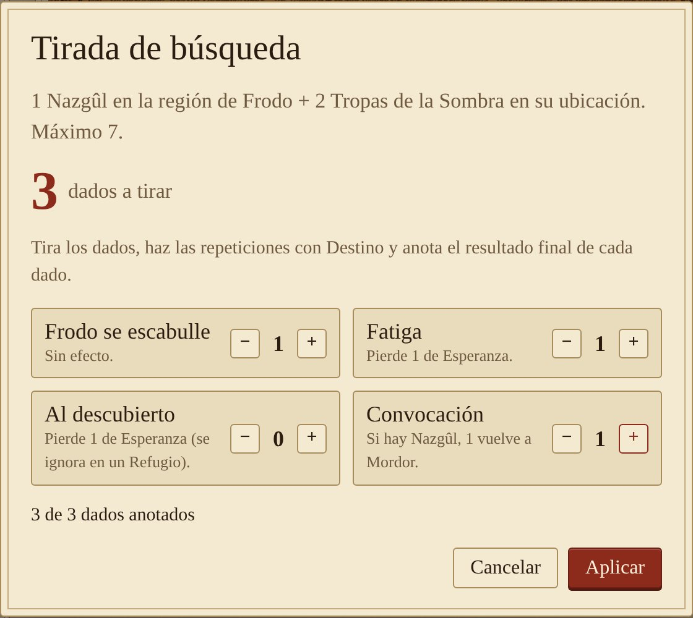
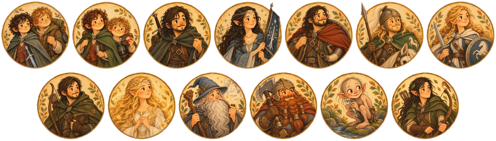

<p align="center"></p>

# La Comunidad del Anillo

[Valencià](README.md) · **Castellano**

Ayudante de mesa, libre y en castellano y valenciano, para llevar las partidas de **«El Señor de los Anillos: El Destino de la Comunidad»**.

El tablero y las piezas los tenéis en la mesa. La app lleva las cuentas:
- la Esperanza y la Amenaza;
- los pasos del turno;
- cuántos dados tenéis que tirar en cada tirada y qué perdéis con el resultado;
- los objetivos, con un registro de todo lo que pasa y un botón para deshacer.

Un ordenador hace de servidor y los demás entran desde el navegador, móviles incluidos.



## Qué hace

- **Marcadores:**
  - Esperanza (de 0 a 8);
  - nivel de Amenaza, que dice cuántas cartas de Sombra se roban;
  - las cartas «El cielo se oscurece» que han salido;
  - las cartas que quedan en el mazo de Juego;
  - los objetivos completados;
  - la ronda.
- **El turno paso a paso:** las 4 + 1 acciones, robar 2 cartas (descuenta el mazo y resta Esperanza si se acaba) y resolver las cartas de Sombra que tocan.
- **Tiradas de búsqueda y de batalla:** dice cuántos dados hay que tirar. Cuando anotáis el resultado, aplica la pérdida de Esperanza y dice cuántas Tropas hay que quitar de cada bando. Tiene en cuenta los Refugios, los Nazgûl y la Heroicidad gastada.
- **El cielo se oscurece, ponerse el Anillo y destruir el Anillo Único**, cada uno con su cálculo.
- **Preparación:**
  - niveles de dificultad;
  - escenarios sugeridos;
  - los 24 objetivos;
  - la lista de preparación del tablero, paso a paso.
- **Registro** de todo lo que pasa y **deshacer** hasta 30 pasos.
- **Resumen al terminar:** rondas, duración, dónde se ha perdido la Esperanza, tiradas y objetivos.
- **Historial** de todas las partidas terminadas, con victorias y derrotas por dificultad.
- **Varias partidas guardadas.**
- **Retratos ilustrados** de los 13 personajes jugables.
- **Entrar con un QR:** el servidor lo muestra al arrancar, y también desde el botón de la app.
- **Modo oscuro**, automático o elegido a mano.
- **Adaptada al móvil.** Todos los dispositivos conectados ven los cambios al momento.
- **En castellano y en valenciano.** Cada jugador elige el idioma con los botones CAS y VAL, y el registro, los objetivos y el mapa cambian con él.

<p>
  
  
</p>

<p align="center"></p>

## Cómo se usa

### En Windows, sin instalar nada

Descarga `LaComunitat-windows.zip` de la sección [Releases](../../releases), descomprímelo y haz doble clic en `LaComunitat.exe`. Se abre una ventana con la dirección y el QR, y el navegador ya con la app. Windows puede avisar de que es un programa de un editor desconocido: pulsa «Más información» y «Ejecutar de todas formas».

### Con Python (Linux, Mac o Windows)

Solo hace falta **Python 3.8 o más nuevo**. No hay que instalar nada más.

```bash
python3 comunitat.py
```

En Windows, haz doble clic en `arrancar-windows.bat`. Antes tienes que instalar Python desde python.org y marcar «Add python.exe to PATH».

Al arrancar, el servidor muestra la dirección para los demás, por ejemplo `http://192.168.1.40:8766` (los mensajes de la terminal están en valenciano: es la línea «Des de la xarxa»). Debajo sale un **código QR**: cada jugador lo escanea con el móvil (o escribe la dirección) y entra con su nombre. El botón del QR, arriba a la derecha de la app, lo vuelve a mostrar.

Opciones:

```bash
python3 comunitat.py --port 9001           # otro puerto
python3 comunitat.py --partida "Viernes"   # abre (o crea) esa partida
python3 comunitat.py --sense-qr            # no muestra el QR en la terminal
```

En el archivo [docs/Guia-La-Comunidad.pdf](docs/Guia-La-Comunidad.pdf) tienes la **guía de uso completa**, con capturas de todas las pantallas.

## El mapa

En el centro de la pantalla se muestra un mapa ilustrado de la Tierra Media: `mapa-exemple-es.jpg` en castellano o `mapa-exemple-val.jpg` en valenciano, según el idioma de cada jugador.

Para poner el tuyo, copia la imagen junto a `comunitat.py` con el nombre `mapa.jpg` (o `mapa.png`). Si lo tienes en los dos idiomas, llámalos `mapa-es.jpg` y `mapa-val.jpg`. El `.gitignore` hace que tu mapa no se suba al repositorio.

## Los datos

Las partidas se guardan en la carpeta `partides/`, los jugadores y las sesiones en `comunitat.json`, y las partidas terminadas en `historial.json`. Para hacer una copia de seguridad, cópialo todo.

## Modificar el programa

`comunitat.py` se genera a partir de los archivos de `src/`:

| Archivo | Qué contiene |
|---|---|
| `src/servidor.py` | El servidor (Python, sin dependencias) |
| `src/web/app.js` | La lógica de la página |
| `src/web/dades.js` | Personajes, objetivos, escenarios y preparación |
| `src/web/personatges/` | Los retratos de los personajes (WebP de 200 px) |
| `src/web/i18n.js` | Las traducciones al castellano (para añadir un idioma, copia el bloque `es`) |
| `src/web/estil-base.css`, `src/web/estil.css` | El estilo |
| `src/web/cos.html` | La estructura de la página |

Después de cambiar algo, vuelve a generar el programa con:

```bash
python3 build.py
```

### Publicar una versión para Windows

El ejecutable lo hace GitHub automáticamente ([`.github/workflows/windows-exe.yml`](.github/workflows/windows-exe.yml)). Solo hay que subir una etiqueta:

```bash
git tag v1.5
git push origin v1.5
```

Al cabo de unos minutos, `LaComunitat-windows.zip` aparece en [Releases](../../releases).

Las propuestas de mejora y las correcciones son bienvenidas.

## Licencia

[GPL-3.0](LICENSE) o posterior. Lo podéis usar, copiar, modificar y compartir libremente. Si publicáis una versión modificada, también tiene que ser libre y con el código abierto.

## Uso de inteligencia artificial

Este proyecto se ha hecho con ayuda de IA:
- **Imágenes:** el mapa de ejemplo (en valenciano y en castellano), el logo y los retratos de los personajes se han generado con IA. Los retratos parten de las descripciones de los libros, con un estilo propio, y no reproducen a ningún actor ni las ilustraciones oficiales del juego.
- **Código y documentación:** el programa, las traducciones, los README y las guías se han escrito con un asistente de IA y se han revisado a mano.

## Aviso

Proyecto de fans **no oficial**, sin relación con Z-Man Games, Asmodee ni Middle-earth Enterprises. «El Señor de los Anillos» y los nombres relacionados son marcas de sus propietarios. Este programa no incluye ningún componente del juego: para jugar hay que tenerlo.
