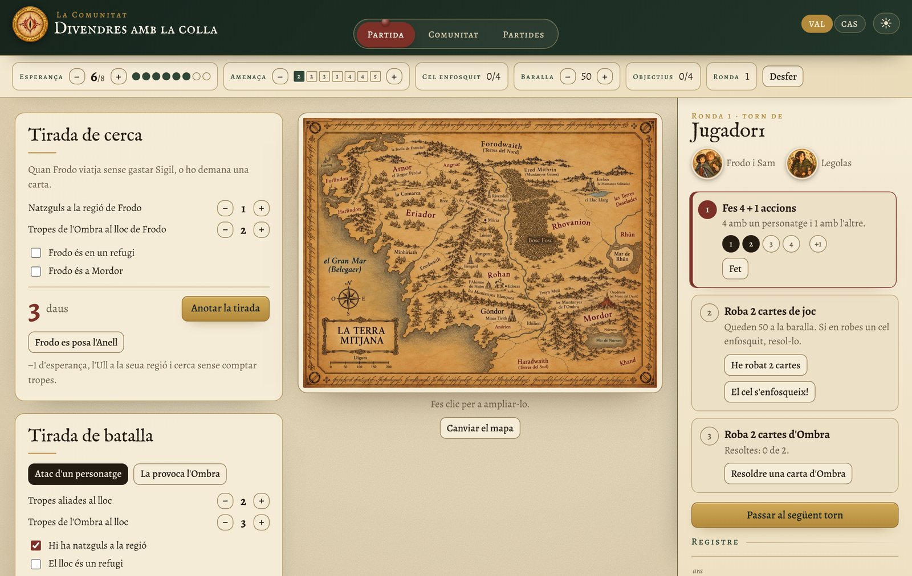
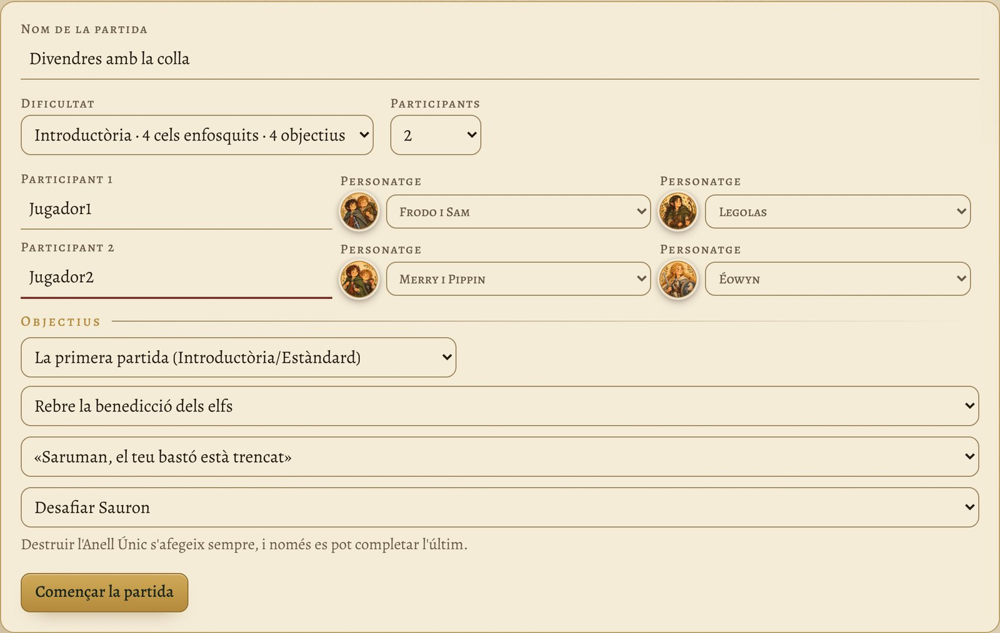
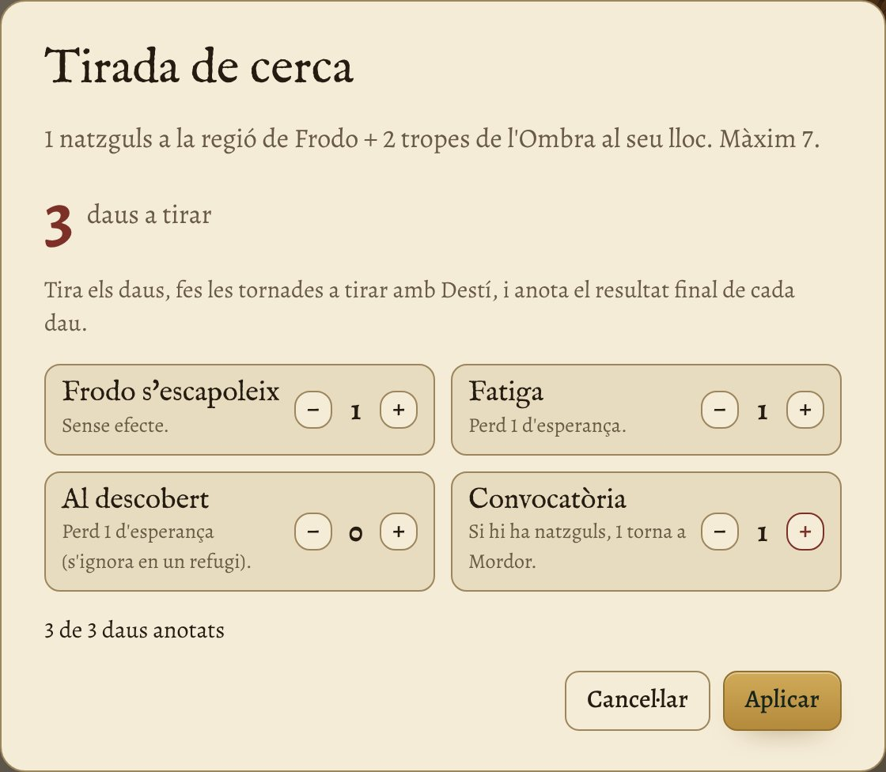
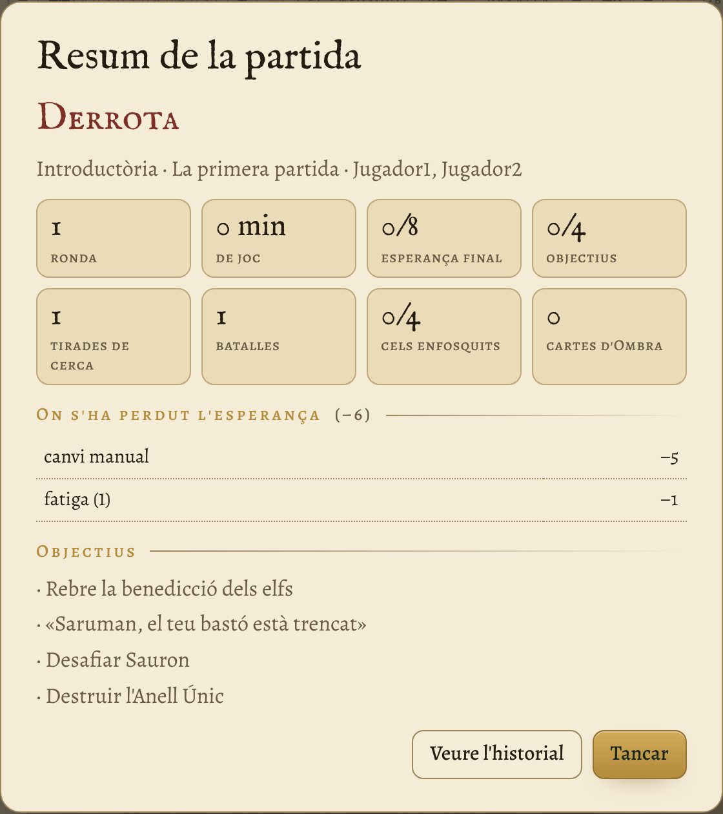
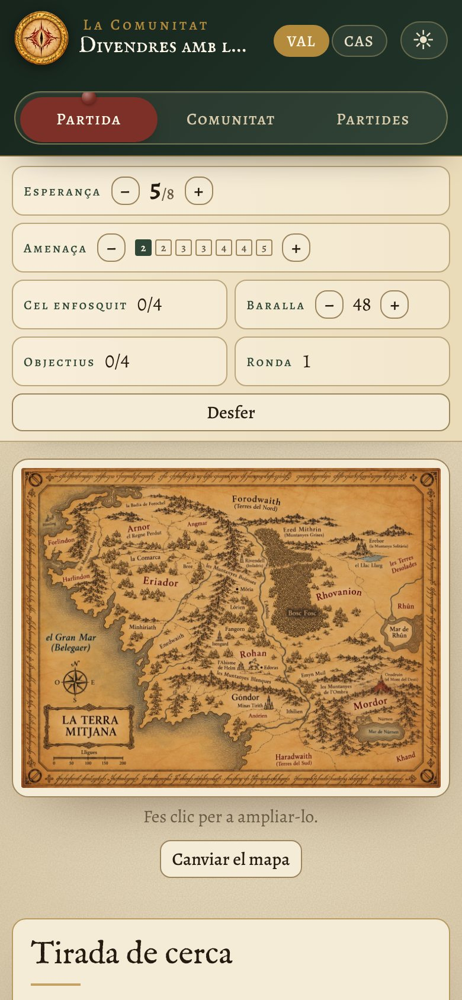
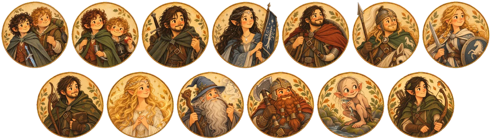

<p align="center"></p>

<p align="center">
  <a href="../../releases/latest"></a>
  <a href="LICENSE"></a>
  
  
  
  <a href="../../actions/workflows/proves.yml"></a>
</p>

**Valencià** · [Castellano](README.es.md)

# La Comunitat

**Ajudant lliure per a portar les partides d'«El Señor de los Anillos: El Destino de la Comunidad».** El tauler i les peces els teniu a la taula; l'app porta els comptes: l'esperança, l'amenaça, el torn pas a pas, quants daus tirar en cada tirada i què es perd amb el resultat. Una persona la porta i la resta jugueu al tauler. En valencià i castellà, i sense Internet.

És **la mateixa app a Windows, a Linux, a Android i al navegador**. A l'ordinador s'obri en una finestra pròpia; a Android, com qualsevol altra app; i al navegador funciona també sense connexió. Les partides es queden a l'aparell i no es connecta a cap servidor de fora.

🌐 **Web:** [jossanmar9.github.io/comunitat-del-anell](https://jossanmar9.github.io/comunitat-del-anell/) · 📱 **Usa-la:** [al navegador](https://jossanmar9.github.io/comunitat-del-anell/app/) · ⬇️ **Descàrrega:** [última versió](../../releases/latest) · 📖 **Manual:** [en línia](docs/manual-usuari.md) i en PDF a cada versió



## Contingut

- [Què fa](#què-fa)
- [Captures](#captures)
- [Instal·lació](#installació)
- [Primers passos](#primers-passos)
- [Dades i còpies de seguretat](#dades-i-còpies-de-seguretat)
- [Documentació](#documentació)
- [Per a desenvolupar](#per-a-desenvolupar)
- [Publicar una versió](#publicar-una-versió)
- [Col·laborar](#collaborar)
- [Ús d'intel·ligència artificial](#ús-dintelligència-artificial)
- [Llicència](#llicència)

## Què fa

| Secció | Què fa |
|---|---|
| **Pistes** | Esperança (de 0 a 8), nivell d'amenaça (quantes cartes d'Ombra es roben), cartes «El cel s'enfosqueix» eixides, cartes que queden a la baralla, objectius completats i ronda. Es corregeixen a mà i tot es pot **desfer** fins a 30 passos. |
| **El torn pas a pas** | Les 4 + 1 accions, robar 2 cartes (descompta la baralla i resta esperança si s'acaba) i resoldre les cartes d'Ombra que toquen, en l'ordre del manual del joc. |
| **Tirades de cerca** | Quants daus tirar segons els natzguls i les tropes de l'Ombra, i què es perd amb el resultat. Té en compte els refugis, Mordor i posar-se l'Anell. |
| **Batalles** | Atac d'un personatge o provocada per l'Ombra: quants daus, el valor gastat i quantes tropes s'han de llevar de cada bàndol. Avisa si es perd un refugi. |
| **Cartes especials** | *El cel s'enfosqueix* amb els seus quatre passos («Et veig!» inclòs), la carta d'Ombra i destruir l'Anell Únic. |
| **Preparació** | Cinc nivells de dificultat, escenaris suggerits, els 24 objectius, els 13 personatges amb retrat i la llista de preparació del tauler, pas a pas. |
| **Resum i historial** | En acabar, on s'ha perdut l'esperança, rondes, durada i tirades. L'historial guarda totes les partides acabades, amb victòries i derrotes per dificultat. |
| **Partides i còpies** | Diverses partides guardades, que es poden duplicar, exportar, importar en un altre aparell i esborrar (van a la paperera). **Còpies de seguretat automàtiques** de cada partida, per a tornar a un moment d'abans. |

A més: un **registre** de tot el que passa, **mode fosc**, adaptada al **mòbil** i un **mapa** de la Terra Mitjana que pots canviar pel teu des de la mateixa app. Tot el programa està en **valencià i castellà**.

## Captures

| | |
|---|---|
|  |  |
| La preparació: dificultat, participants, personatges i objectius. | Una tirada de cerca: l'app diu quants daus tirar i aplica el resultat. |
|  |  |
| El resum en acabar la partida. | Al mòbil o a l'app d'Android, en una sola columna. |

<p align="center"></p>

Hi ha més captures, pas a pas, al [manual d'usuari](docs/manual-usuari.md).

## Instal·lació

**Requisits:** Windows 10 o 11 de 64 bits, Linux amb escriptori, Android 5.1 o més nou, o un navegador actual. No cal Internet per a jugar. I el joc de taula, és clar: l'app no inclou cap component del joc.

Baixa l'[última versió](../../releases/latest):

| Sistema | Fitxer |
|---|---|
| **Windows** (recomanat) | `LaComunitat-X.Y.Z-installador.exe`. No demana permisos d'administrador; crea l'accés al menú Inici i, si vols, a l'escriptori. |
| **Windows** portable | `LaComunitat-X.Y.Z-windows-portable.zip`. Descomprimeix-lo on vulgues (també en una memòria USB) i obri `LaComunitat.exe`. |
| **Ubuntu, Debian, Linux Mint…** | `comunitat-del-anell_X.Y.Z_all.deb`. Doble clic per a instal·lar-lo, o `sudo apt install ./comunitat-del-anell_X.Y.Z_all.deb`. |
| **Altres Linux** | `LaComunitat-X.Y.Z-linux.tar.gz`. Descomprimeix-lo i obri `comunitat-del-anell.sh`; `./installa.sh` l'afig al menú. Cal Python 3 i, per a la finestra pròpia, GTK i WebKitGTK. |
| **Android** | `LaComunitat-X.Y.Z-android.apk`. Obri'l des del mòbil i permet «Instal·lar apps desconegudes» si t'ho demana. |
| **Sense instal·lar res** | L'[app web](https://jossanmar9.github.io/comunitat-del-anell/app/): des del menú del navegador la pots afegir a la pantalla d'inici, i funciona sense connexió. També a l'iPhone i a l'iPad. |

El programa de Windows no està signat digitalment: SmartScreen pot avisar. Prem **Més informació → Executa igualment**.

Més detalls i com passar les partides de versions anteriors, a la [guia d'instal·lació](docs/guia-installacio.md).

**Amb Python** (Linux, Mac o Windows amb Python 3.8 o més nou): baixa [`comunitat.py`](comunitat.py) i executa `python3 comunitat.py`. Per a tindre-la en una finestra pròpia, a Windows i Mac cal [pywebview](https://pywebview.flowrl.com/) (`pip install pywebview`) i a Linux, GTK i WebKitGTK; si no, s'obri al navegador.

## Primers passos

1. Obri **La Comunitat**. A l'ordinador s'obri en una finestra pròpia, sense navegador (a Windows amb WebView2, a Linux amb WebKitGTK); en tancar-la, ja està tot guardat.
2. Prem **Crear partida**, posa-li un nom i ompli la preparació: dificultat, participants, personatges i objectius.
3. Prepareu el tauler amb la llista de la pestanya **Comunitat** i a jugar. Cada canvi es guarda sol.

Opcions per al terminal (programa d'escriptori):

```bash
comunitat-del-anell --dades ~/Partides      # guarda les dades en una altra carpeta
comunitat-del-anell --navegador             # l'app al navegador, en compte de la finestra pròpia
comunitat-del-anell --sense-finestra        # sense finestres: l'adreça ix al terminal
comunitat-del-anell --port 9001             # un altre port local (el normal és el 8766)
comunitat-del-anell --idioma es             # els avisos de les finestres en castellà (per defecte, en valencià)
```

(A Windows, `LaComunitat.exe`; amb el `.tar.gz`, `./comunitat-del-anell.sh`; amb Python, `python3 comunitat.py`.) El programa només accepta connexions del mateix ordinador.

## Dades i còpies de seguretat

| On | On es guarden les dades |
|---|---|
| Windows, amb l'instal·lador | `%APPDATA%\LaComunitat` |
| Linux, amb el `.deb` | `~/.local/share/comunitat-del-anell` |
| Windows portable, `.tar.gz` o `python3 comunitat.py` | La carpeta del programa |
| Android i app web | Dins de l'app o del navegador |

A l'ordinador, cada partida es guarda a `partides/<nom>.json`, les seues còpies de seguretat a `copies/<nom>/`, les partides acabades a `historial.json` i el mapa propi a `mapa.json`. El botó **Obrir la carpeta de dades** de la pestanya Partides l'obri directament; per a guardar-ho tot a part, tanca l'app i copia la carpeta sencera. En desinstal·lar, les partides no s'esborren.

A Android i al navegador, l'app guarda els mateixos fitxers dins seu. Si desinstal·les l'app o esborres les dades del navegador, es perden: **exporta** les partides que vulgues conservar. Exportar i importar és també la manera de passar una partida d'un aparell a un altre.

L'app no recull cap dada personal: vegeu la [política de privacitat](https://jossanmar9.github.io/comunitat-del-anell/privacitat.html).

La Comunitat fa una còpia de cada partida en obrir-la i cada mitja hora mentre es juga, i en guarda les 15 últimes; es restauren des de **Partides → Còpies**.

## Documentació

- [Registre de canvis](CHANGELOG.md)

| Document | Valencià | Castellano |
|---|---|---|
| Manual d'usuari | [manual-usuari.md](docs/manual-usuari.md) | [manual-usuario.md](docs/manual-usuario.md) |
| Guia d'instal·lació | [guia-installacio.md](docs/guia-installacio.md) | [guia-instalacion.md](docs/guia-instalacion.md) |
| Arquitectura i proves | [arquitectura.md](docs/arquitectura.md) | |

Els PDF es generen sols a partir d'aquests fitxers i van adjunts a cada [versió](../../releases/latest), dins dels paquets i a la [web](https://jossanmar9.github.io/comunitat-del-anell/).

## Per a desenvolupar

Per al programa d'escriptori només cal **Python 3.8 o més nou**, sense dependències. `comunitat.py` i l'app web es generen a partir de `src/`:

| Fitxer | Què hi ha |
|---|---|
| `src/web/app.js` | L'app: pistes, torn, tirades, preparació, resum i partides |
| `src/web/magatzem.js` | On es guarda tot: partides, historial, còpies, exportar i importar. A l'ordinador, a través del programa; a Android i al navegador, en IndexedDB |
| `src/web/dades.js` | Personatges, objectius, escenaris i preparació del tauler |
| `src/web/i18n.js` | Les traduccions al castellà |
| `src/web/cos.html`, `estil-base.css`, `estil.css` | L'estructura i l'estil de la pàgina |
| `src/web/personatges/`, `src/web/fonts/` | Els retrats (WebP de 200 px) i les tipografies (Alegreya i IM Fell English, OFL) |
| `src/servidor.py` | El programa d'escriptori: un servidor només per a aquest ordinador que llig i escriu els fitxers de dades |
| `src/persistencia.py` | Escriptura segura, bloqueig de la carpeta de dades i pas de les dades de la v2 |
| `src/finestra.py` | La finestra pròpia (pywebview a Windows, WebKitGTK a Linux) i la de reserva (Tk) |
| `src/mapes/` | Els mapes d'exemple, en valencià i castellà |
| `tests/` | Les proves: programa, persistència, magatzem i l'app en un navegador |
| `docs/` | Els manuals en Markdown i les captures |
| `paquets/` | L'instal·lador de Windows (Inno Setup), els fitxers de Linux i el projecte d'Android (Capacitor) |
| `eines/` | Comprovar traduccions, manuals en PDF, paquets de Linux, Android, captures i la web |

Després de canviar alguna cosa:

```bash
python3 build.py                          # torna a generar comunitat.py
python3 eines/comprova-traduccions.py     # comprova que no falta cap traducció
python3 tests/prova_servidor.py           # el programa d'escriptori
python3 tests/prova_persistencia.py       # escriptura segura i dades de la v2
python3 tests/prova_magatzem.py           # partides, historial i còpies (cal Node.js)
python3 tests/prova_app.py                # l'app en Chromium, escriptori i web (cal Playwright)
python3 comunitat.py                      # prova-ho
```

Altres eines:

```bash
python3 build.py --web dist/web           # l'app web (cal Pillow per a les icones)
python3 eines/paquet-linux.py             # fa el .deb i el .tar.gz a dist/
sh eines/manuals-pdf.sh dist/manuals      # fa els manuals en PDF (cal Chrome o Chromium)
python3 eines/web.py _site                # genera la web, amb l'app web a app/
python3 eines/captures.py                 # torna a fer les captures dels manuals (cal Playwright)
```

L'APK d'Android es fa a GitHub Actions; per a fer-lo a mà, vegeu [paquets/android/README.md](paquets/android/README.md).

## Publicar una versió

Cada vegada que es pugen canvis a `main`, [`.github/workflows/proves.yml`](.github/workflows/proves.yml) genera el programa i passa les proves a Windows i Linux. Per a publicar, GitHub ho fa tot sol amb [`.github/workflows/publica.yml`](.github/workflows/publica.yml): prova el programa (també la finestra pròpia), fa l'instal·lador i el portable de Windows, el `.deb` i el `.tar.gz` de Linux, l'APK d'Android i els manuals en PDF, i ho publica a [Releases](../../releases).

1. Canvia `VERSION` a `src/servidor.py` (per exemple, `"3.0.1"`) i torna a generar `comunitat.py` amb `python3 build.py`.
2. Puja els canvis i una etiqueta en minúscula amb el mateix número:

```bash
git tag v3.0.1
git push origin main v3.0.1
```

Al cap d'uns minuts, la versió nova apareix a [Releases](../../releases). Si l'etiqueta i `VERSION` no coincideixen, la publicació s'atura i ho avisa.

L'APK es signa amb una clau guardada en dos secrets del repositori, `ANDROID_KEYSTORE` i `ANDROID_KEYSTORE_PASSWORD` ([paquets/android/README.md](paquets/android/README.md)). Ha de ser sempre la mateixa: si no, Android no deixa actualitzar l'app.

La [web](https://jossanmar9.github.io/comunitat-del-anell/) i l'app web es publiquen soles amb [`.github/workflows/web.yml`](.github/workflows/web.yml) cada vegada que es pugen canvis a `main` (cal **Settings → Pages → Source: GitHub Actions**).

## Col·laborar

Les propostes de millora i les correccions són benvingudes. Si has trobat una errada o tens una idea, obri una [incidència](../../issues).

## Ús d'intel·ligència artificial

Aquest projecte s'ha fet amb ajuda d'IA:
- **Imatges:** el mapa d'exemple (en valencià i en castellà), el logo i els retrats dels personatges s'han generat amb IA. Els retrats parteixen de les descripcions dels llibres, amb un estil propi, i no reprodueixen cap actor ni les il·lustracions oficials del joc.
- **Codi i documentació:** el programa, l'app d'Android, les traduccions, els README, els manuals, els paquets i la web s'han escrit amb un assistent d'IA (Claude, d'Anthropic) i s'han revisat a mà.

## Llicència

[GPL-3.0](LICENSE) o posterior. El podeu usar, copiar, modificar i compartir lliurement. Si en publiqueu una versió modificada, també ha de ser lliure i amb el codi obert.

Les tipografies [Alegreya](https://github.com/huertatipografica/Alegreya) i [IM Fell English](https://iginomarini.com/fell/) són lliures, amb la llicència SIL Open Font License ([`src/web/fonts/`](src/web/fonts/)). A Windows, la finestra fa servir [pywebview](https://pywebview.flowrl.com/) (llicència BSD). L'app d'Android es fa amb [Capacitor](https://capacitorjs.com/) (llicència MIT).

**Avís:** projecte de fans **no oficial**, sense relació amb Z-Man Games, Asmodee ni Middle-earth Enterprises. «El Señor de los Anillos» i els noms relacionats són marques dels seus propietaris. Aquest programa no inclou cap component del joc: per a jugar cal tindre'l.

Vegeu també [NOTICE.md](NOTICE.md) per als avisos sobre marques i materials de tercers.
