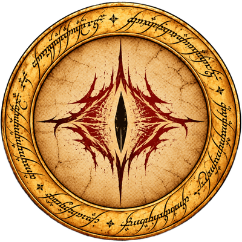
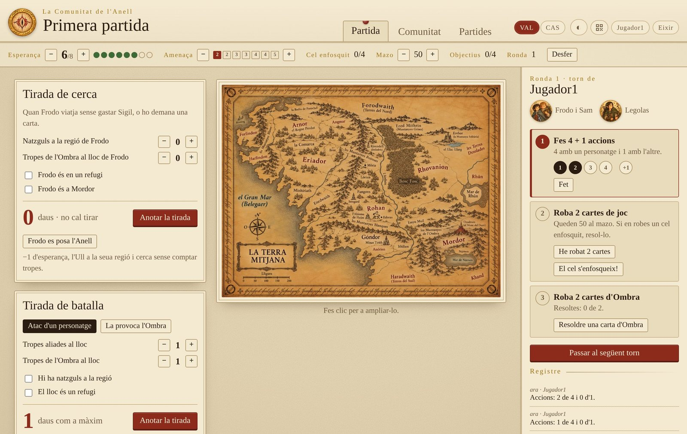
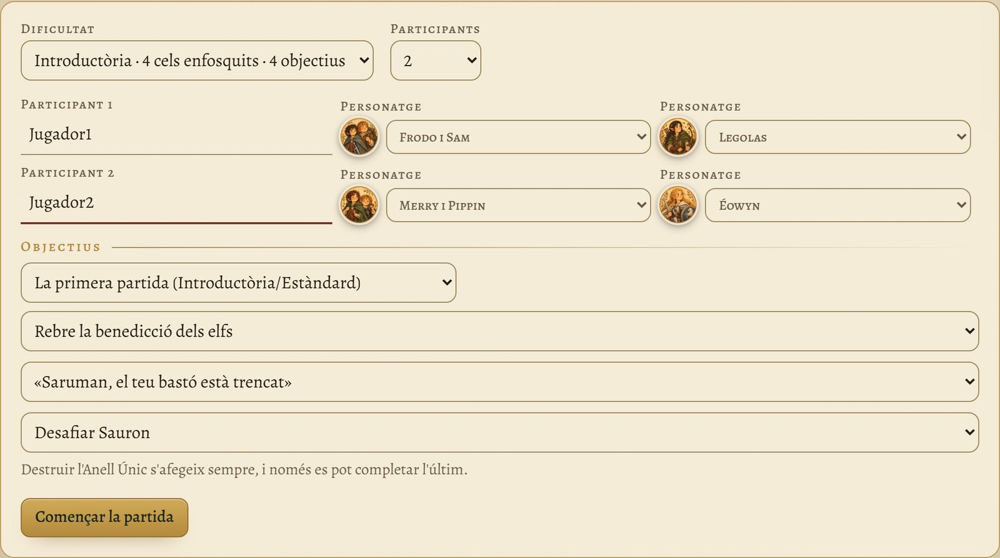
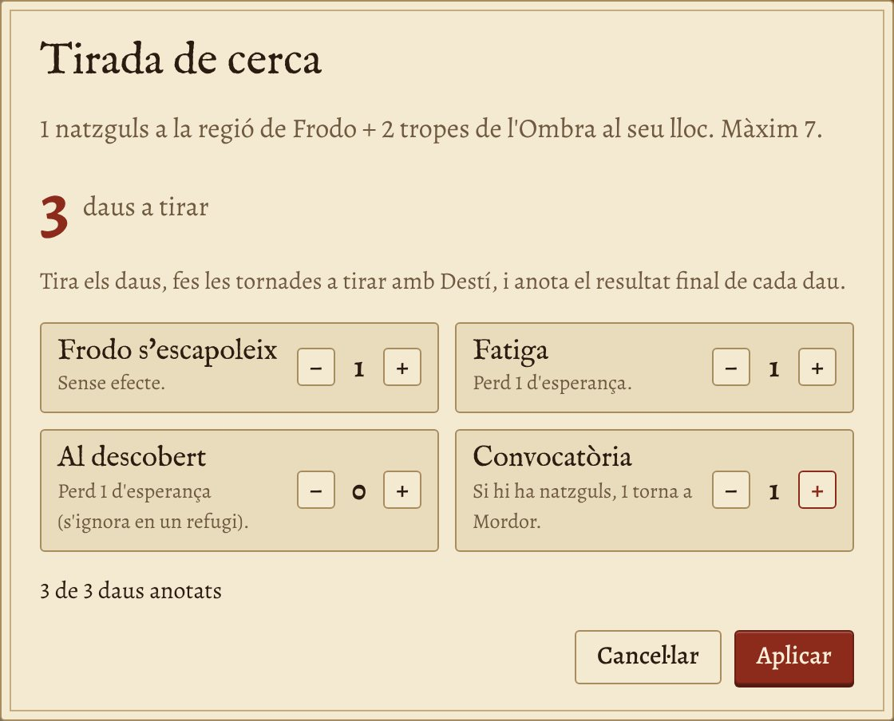
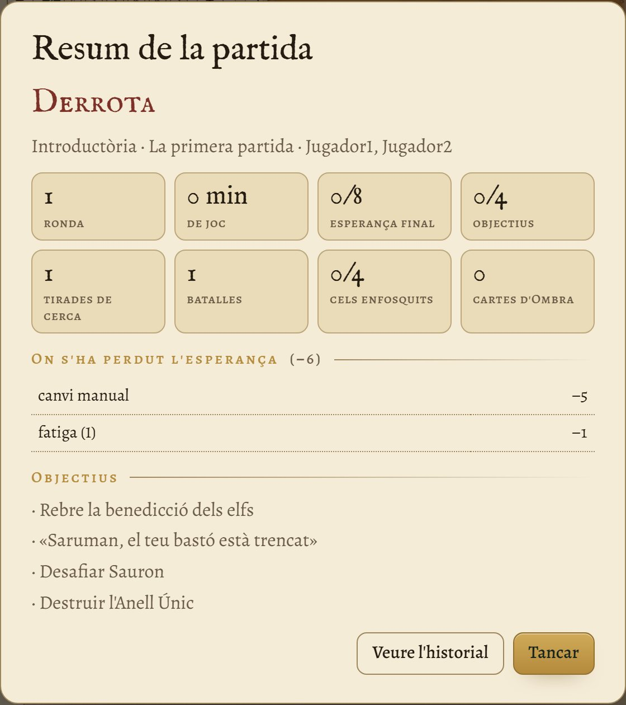

<p align="center"></p>

<p align="center">
  <a href="../../releases/latest"></a>
  <a href="LICENSE"></a>
  
  
  <a href="../../actions/workflows/proves.yml"></a>
</p>

**Valencià** · [Castellano](README.es.md)

# La Comunitat

**Ajudant lliure per a portar les partides d'«El Señor de los Anillos: El Destino de la Comunidad».** El tauler i les peces els teniu a la taula; l'app porta els comptes: l'esperança, l'amenaça, el torn pas a pas, quants daus tirar en cada tirada i què es perd amb el resultat. Un ordinador fa de servidor i la resta de la taula hi entra des del navegador, mòbils inclosos. En valencià i castellà, i sense Internet.

Funciona a **Windows i Linux**. S'instal·la com qualsevol altre programa i, a l'ordinador principal, s'obri en **una finestra pròpia**, sense navegador. Les partides es queden a l'ordinador de casa i no es connecta a cap servidor de fora.

🌐 **Web:** [jossanmar9.github.io/comunitat-del-anell](https://jossanmar9.github.io/comunitat-del-anell/) · 🎲 **Prova-la:** [al navegador](https://jossanmar9.github.io/comunitat-del-anell/prova/) · ⬇️ **Descàrrega:** [última versió](../../releases/latest) · 📖 **Manual:** [en línia](docs/manual-usuari.md) i en PDF a cada versió



## Guardats i recuperació — v2.7.0

La partida activa, les identitats, els hash de PIN, les sessions i l’historial es confirmen conjuntament en **`comunitat.sqlite3`**, amb transaccions SQLite. Els JSON existents continuen com a còpies compatibles per a les partides guardades, la configuració i l’historial. Les partides inactives i les còpies de partida continuen en JSON; esta versió reforça el guardat conjunt de l’estat actiu.

En actualitzar, la primera lectura importa la configuració i l’historial existents sense eliminar-los. Quan hi ha una base SQLite, és la font de l’últim estat confirmat: no edites a mà els seus JSON de configuració, historial o partida activa; usa les opcions d’importar i restaurar. Si falla la projecció JSON, la jugada confirmada continua en SQLite i es recupera en el pròxim inici. Si falla la transacció, l’app no confirma la jugada. Les dades corruptes no se substitueixen silenciosament per dades buides.

Abans de recuperar un inici, es guarda una còpia coherent de SQLite en **`copies/estat/comunitat.sqlite3`**. Per a una còpia completa, tanca l’app i copia **tota la carpeta de dades**, incloent la base, els JSON, les partides i les còpies. La còpia de l’estat conté credencials i sessions: conserva-la en privat. Per a tornar a una versió anterior, tanca l’app i treballa sobre una còpia de la carpeta; els JSON han d’estar actualitzats. No es permeten dos servidors en la mateixa carpeta de dades, encara que usen ports distints.

Si una base queda danyada, tanca l’app, conserva tota la carpeta i restaura una còpia coherent de `comunitat.sqlite3`; després l’app recuperarà els seus JSON. La còpia d’estat correspon a l’anterior inici correcte, no necessàriament a l’última jugada. Les còpies de partida i l’exportació JSON continuen disponibles.


## Sala de partida — v2.6.0

**Àlies masculins i femenins:** en escriure un nom, l’app proposa un tipus d’àlies amb una llista local de noms habituals; no fa consultes a Internet. Pots corregir-lo amb **Tipus d’àlies → Masculí / Femení / Neutre**. Els noms desconeguts o ambigus es proposen com a neutres. És una ajuda lingüística per a l’àlies, no una determinació del gènere de la persona. Cada raça té noms inventats diferenciats. La preferència manual es conserva; canviar-la des de **Sala de partida → Editar** genera un altre àlies sense canviar el PIN ni tancar la sessió. Els jugadors antics conserven l’àlies existent fins que el màster el canvie.

L’aplicació arranca sense cap partida carregada. Tria **Crear partida**, escriu el nom de la partida i els noms i les races dels participants, i prepara-la. En confirmar, els jugadors s’incorporen automàticament a **Sala de partida**, amb àlies i PIN. Els PIN nous es mostren una sola vegada al màster. Si un nom ja correspon a un jugador registrat, es reutilitza la seua identitat i el PIN existent. Els noms dels participants d’una mateixa partida no es poden repetir, ignorant accents, majúscules i espais sobrants.

**Obrir partida guardada** recupera la partida i incorpora els seus jugadors a la sala sense duplicar-los. Les partides noves guarden UID, nom, raça i àlies, però no el PIN ni el seu hash dins del fitxer de partida. Els PIN i sessions continuen en la configuració local. Si importes una partida a un altre ordinador o recuperes jugadors eliminats, el màster haurà de generar-los PIN nous. Les partides antigues recuperen els jugadors pel nom. No s’obri l’última partida en reiniciar; l’opció explícita de terminal `--partida` continua disponible.

El màster obri l’app en el PC amb `http://localhost:8766` (o el port triat). El botó **Sala de partida** permet crear jugadors amb nom i raça, editar-los, generar un altre àlies, eliminar-los, regenerar el PIN i desvincular sessions. Les accions destructives demanen una segona pulsació. Els àlies són inventats; no són personatges del joc.

En crear o regenerar un PIN de quatre dígits, anota’l i comunica’l al jugador: només es mostra una vegada i després apareix com **••••**. Es guarda amb salt aleatori i PBKDF2-HMAC-SHA256 (200.000 iteracions), sense PIN en clar. Regenerar-lo revoca la sessió anterior.

El jugador escaneja el QR comú de la taula, tria **Qui eres? → jugador → PIN → Entrar**. Només apareixen jugadors amb PIN i sense vinculació. Un jugador té una sessió autoritzada; el navegador la recorda i reconnecta després de recarregar, d’un tall de wifi o de reiniciar el servidor. **Eixir** revoca la sessió; tancar una pestanya no la desvincula. Si es perd el dispositiu o les dades del navegador, el màster ha de prémer **Desvincular**. La possessió del token autoritza la sessió: no el compartisques.

**Bloquejar noves connexions** impedeix noves vinculacions; les sessions autoritzades poden continuar i reconnectar. El panell mostra connexió SSE, vinculació i última petició autenticada. Sense partida preparada, el jugador espera. Les jugades continuen sent cooperatives; l’administració de jugadors, partides i historial correspon al màster local. En mode de sondeig, un dispositiu pot aparéixer desconnectat encara que continue autoritzat; consulta també l’última connexió.

En actualitzar des de v2.5 o anteriors es conserven partides, configuració i UID. Els noms duplicats reben un sufix, els àlies antics se substitueixen prudentment i es revoquen les sessions sense autenticació. El màster ha de generar PIN per als jugadors migrats. Fes una còpia de la carpeta de dades abans d’actualitzar. La sala de jugadors és comuna a les partides guardades, com en la v2.5.

Funciona en una LAN de confiança amb HTTP; el PIN i els tokens viatgen sense xifrat de transport. No exposes el port a Internet. Després de cinc intents de PIN fallits per IP en un minut, cal esperar. El màster només s’autoritza des de loopback amb Host local i es rebutgen escriptures entre orígens.

## Contingut

- [Què fa](#què-fa)
- [Captures](#captures)
- [Instal·lació](#installació)
- [Primers passos](#primers-passos)
- [Dades i còpies de seguretat](#dades-i-còpies-de-seguretat)
- [Documentació](#documentació)
- [Per a desenvolupar](#per-a-desenvolupar)
- [Publicar una versió](#publicar-una-versió)
- [Col·laborar](#col·laborar)
- [Ús d'intel·ligència artificial](#ús-dintel·ligència-artificial)
- [Llicència](#llicència)

## Què fa

| Secció | Què fa |
|---|---|
| **Pistes** | Esperança (de 0 a 8), nivell d'amenaça (quantes cartes d'Ombra es roben), cartes «El cel s'enfosqueix» eixides, cartes que queden a la baralla, objectius completats i ronda. Es corregeixen a mà i tot es pot **desfer** fins a 30 passos. |
| **El torn pas a pas** | Les 4 + 1 accions, robar 2 cartes (descompta la baralla i resta esperança si s'acaba) i resoldre les cartes d'Ombra que toquen, en l'ordre del manual del joc. |
| **Tirades de cerca** | Quants daus tirar segons els natzguls i les tropes de l'Ombra, i què es perd amb el resultat. Té en compte els refugis, Mordor i posar-se l'Anell. |
| **Batalles** | Atac d'un personatge o provocada per l'Ombra: quants daus, el valor gastat i quantes tropes s'han de llevar de cada bàndol. Avisa si es perd un refugi. |
| **Cartes especials** | *El cel s'enfosqueix* amb els seus quatre passos («Et veig!» inclòs), la carta d'Ombra i destruir l'Anell Únic. |
| **Preparació** | Cinc nivells de dificultat, escenaris suggerits, els 24 objectius, els 13 personatges amb retrat i la llista de preparació del tauler, pas a pas. |
| **Resum i historial** | En acabar, on s'ha perdut l'esperança, rondes, durada i tirades. L'historial guarda totes les partides acabades, amb victòries i derrotes per dificultat. |
| **Partides i còpies** | Diverses partides guardades, que es poden duplicar, exportar, importar en un altre ordinador i esborrar (sense perdre-les). **Còpies de seguretat automàtiques** de cada partida, per a tornar a un moment d'abans. |

A més: un **registre** de tot el que passa, entrada amb **QR**, **mode fosc**, adaptada al **mòbil** i un **mapa** de la Terra Mitjana que es pot canviar pel teu. Tot el programa està en **valencià i castellà**, i cada jugador tria el seu idioma.

## Captures

| | |
|---|---|
|  |  |
| La preparació: dificultat, participants, personatges i objectius. | Una tirada de cerca: l'app diu quants daus tirar i aplica el resultat. |
|  |  |
| El resum en acabar la partida. | Al mòbil, en una sola columna. |

<p align="center"></p>

Hi ha més captures, pas a pas, al [manual d'usuari](docs/manual-usuari.md).

## Instal·lació

**Requisits:** Windows 10 o 11 de 64 bits, o Linux amb escriptori, i uns 50 MB de disc. Els jugadors només necessiten un navegador i estar a la mateixa wifi. No cal Internet. I el joc de taula, és clar: l'app no inclou cap component del joc.

Baixa l'[última versió](../../releases/latest):

| Sistema | Fitxer |
|---|---|
| **Windows** (recomanat) | `LaComunitat-X.Y-installador.exe`. No demana permisos d'administrador; crea l'accés al menú Inici i, si vols, a l'escriptori. |
| **Windows** portable | `LaComunitat-X.Y-windows-portable.zip`. Descomprimeix-lo on vulgues (també en una memòria USB) i obri `LaComunitat.exe`. |
| **Ubuntu, Debian, Linux Mint…** | `comunitat-del-anell_X.Y_all.deb`. Doble clic per a instal·lar-lo, o `sudo apt install ./comunitat-del-anell_X.Y_all.deb`. |
| **Altres Linux** | `LaComunitat-X.Y-linux.tar.gz`. Descomprimeix-lo i obri `comunitat-del-anell.sh`; `./installa.sh` l'afig al menú. Cal Python 3 i, per a la finestra pròpia, GTK i WebKitGTK. |

El programa no està signat digitalment: a Windows, SmartScreen pot avisar. Prem **Més informació → Executa igualment**. La primera vegada, permet-li l'accés a les **xarxes privades** perquè hi puguen entrar els jugadors.

Més detalls, el tallafoc de Linux i com passar les partides de les versions 1.x, a la [guia d'instal·lació](docs/guia-installacio.md).

**Sense instal·lar res** (Linux, Mac o Windows amb Python 3.8 o més nou): baixa [`comunitat.py`](comunitat.py) i executa `python3 comunitat.py`. Per a tindre-la en una finestra pròpia, a Windows i Mac cal [pywebview](https://pywebview.flowrl.com/) (`pip install pywebview`) i a Linux, GTK i WebKitGTK; si no, s'obri al navegador.

## Primers passos

1. Obri **La Comunitat**. L'app s'obri en una finestra pròpia, sense navegador (a Windows amb WebView2, a Linux amb WebKitGTK). Mentre la finestra estiga oberta, La Comunitat funciona; en tancar-la, ho guarda tot i s'atura.
2. El botó **Convida** mostra l'adreça per als altres i un **codi QR**. El màster escriu els participants en crear la partida; apareixen automàticament en **Sala de partida**. Cada jugador escaneja el QR, selecciona el seu jugador i entra amb el PIN.
3. Ompliu el formulari de preparació, prepareu el tauler amb la llista de la pestanya **Comunitat** i a jugar.

Opcions per al terminal:

```bash
comunitat-del-anell --port 9001             # un altre port (el normal és el 8766)
comunitat-del-anell --partida "Divendres"   # obri (o crea) eixa partida
comunitat-del-anell --dades ~/Partides      # guarda les dades en una altra carpeta
comunitat-del-anell --navegador            # l'app al navegador, amb la finestreta de l'adreça i el QR
comunitat-del-anell --sense-finestra        # sense finestres: tot al terminal, amb el QR
comunitat-del-anell --idioma es             # els avisos de les finestres en castellà (per defecte, en valencià)
```

(A Windows, `LaComunitat.exe`; amb el `.tar.gz`, `./comunitat-del-anell.sh`; sense instal·lar, `python3 comunitat.py`.)

## Dades i còpies de seguretat

| Com està instal·lada | On es guarden les dades |
|---|---|
| Windows, amb l'instal·lador | `%APPDATA%\LaComunitat` |
| Linux, amb el `.deb` | `~/.local/share/comunitat-del-anell` |
| Windows portable, `.tar.gz` o `python3 comunitat.py` | La carpeta del programa |

Cada partida es guarda a `partides/<nom>.json`, les seues còpies de seguretat a `copies/<nom>/`, els jugadors a `comunitat.json` i les partides acabades a `historial.json`. La Comunitat fa una còpia de cada partida en obrir-la i cada mitja hora mentre es juga, i en guarda les 15 últimes; es restauren des de la pestanya **Partides → Còpies**. Per a guardar-ho tot a part, copia la carpeta sencera; el botó **Obrir la carpeta de dades** de la pestanya Partides l'obri directament. En desinstal·lar, les partides no s'esborren.

**El mapa:** per a posar el teu en compte del d'exemple, copia la imatge a eixa carpeta amb el nom `mapa.jpg` (o `mapa.png`). Si el tens en els dos idiomes, anomena'ls `mapa-val.jpg` i `mapa-es.jpg`.

## Documentació

- [Registre de canvis](CHANGELOG.md)
| Document | Valencià | Castellano |
|---|---|---|
| Manual d'usuari | [manual-usuari.md](docs/manual-usuari.md) | [manual-usuario.md](docs/manual-usuario.md) |
| Guia d'instal·lació | [guia-installacio.md](docs/guia-installacio.md) | [guia-instalacion.md](docs/guia-instalacion.md) |

Els PDF es generen sols a partir d'aquests fitxers i van adjunts a cada [versió](../../releases/latest), dins dels paquets i a la [web](https://jossanmar9.github.io/comunitat-del-anell/).

## Per a desenvolupar

Només cal **Python 3.8 o més nou**, sense dependències. `comunitat.py` es genera a partir de `src/`:

| Fitxer | Què hi ha |
|---|---|
| `src/servidor.py` | HTTP, permisos, revisions i coordinació de la partida |
| `src/identitats.py` | Identitats, àlies, PIN i sessions |
| `src/persistencia.py` | SQLite, projeccions JSON, còpies i bloqueig de dades |
| `src/finestra.py` | La finestreta amb l'adreça i el QR (Tk) |
| `src/qr.py` | El generador de codis QR |
| `src/mapes/` | Els mapes d'exemple, en valencià i castellà, que van dins del programa |
| `src/web/app.js` | La lògica de la pàgina: pistes, torn, tirades, preparació, resum i partides |
| `src/web/dades.js` | Personatges, objectius, escenaris i preparació del tauler |
| `src/web/personatges/` | Els retrats dels personatges (WebP de 200 px) |
| `src/web/i18n.js` | Les traduccions al castellà (per a afegir un idioma, copia el bloc `es`) |
| `src/web/cos.html`, `estil-base.css`, `estil.css` | L'estructura i l'estil de la pàgina |
| `src/web/fonts/` | Les tipografies (Alegreya i IM Fell English, llicència OFL), que van dins del programa |
| `tests/prova_servidor.py` | Les proves automàtiques del servidor |
| `docs/` | Els manuals en Markdown i les captures |
| `paquets/` | L'instal·lador de Windows (Inno Setup) i els fitxers del menú de Linux |
| `eines/` | Comprovar traduccions, fer els manuals en PDF, els paquets de Linux i la web |

Després de canviar alguna cosa:

```bash
python3 build.py                          # torna a generar comunitat.py
python3 eines/comprova-traduccions.py     # comprova que no falta cap traducció
python3 tests/prova_servidor.py           # passa les proves del servidor
python3 tests/prova_persistencia.py       # fallades i recuperació dels guardats
python3 comunitat.py                      # prova-ho
```

Altres eines:

```bash
python3 eines/paquet-linux.py             # fa el .deb i el .tar.gz a dist/
sh eines/manuals-pdf.sh dist/manuals      # fa els manuals en PDF (cal Chrome o Chromium)
python3 eines/web.py _site                # genera la web, amb la prova al navegador
python3 eines/captures.py                 # torna a fer les captures dels manuals (cal Playwright)
```

## Publicar una versió

Cada vegada que es pugen canvis a `main`, [`.github/workflows/proves.yml`](.github/workflows/proves.yml) genera el programa i passa les proves a Windows i Linux. Per a publicar, GitHub ho fa tot sol amb [`.github/workflows/publica.yml`](.github/workflows/publica.yml): prova el programa (també la finestra pròpia), fa l'instal·lador i el portable de Windows, el `.deb` i el `.tar.gz` de Linux i els manuals en PDF, i ho publica a [Releases](../../releases).

1. Canvia `VERSION` a `src/servidor.py` (per exemple, `"2.1"`) i torna a generar `comunitat.py` amb `python3 build.py`.
2. Puja els canvis i una etiqueta en minúscula amb el mateix número:

```bash
git tag v2.1
git push origin main v2.1
```

Al cap d'uns minuts, la versió nova apareix a [Releases](../../releases). Si l'etiqueta i `VERSION` no coincideixen, la publicació s'atura i ho avisa.

La [web](https://jossanmar9.github.io/comunitat-del-anell/) es publica sola amb [`.github/workflows/web.yml`](.github/workflows/web.yml) cada vegada que es pugen canvis a `main` (cal **Settings → Pages → Source: GitHub Actions**).

## Col·laborar

Les propostes de millora i les correccions són benvingudes. Si has trobat una errada o tens una idea, obri una [incidència](../../issues).

## Ús d'intel·ligència artificial

Aquest projecte s'ha fet amb ajuda d'IA:
- **Imatges:** el mapa d'exemple (en valencià i en castellà), el logo i els retrats dels personatges s'han generat amb IA. Els retrats parteixen de les descripcions dels llibres, amb un estil propi, i no reprodueixen cap actor ni les il·lustracions oficials del joc.
- **Codi i documentació:** el programa, les traduccions, els README, els manuals, els paquets i la web s'han escrit amb un assistent d'IA (Claude, d'Anthropic) i s'han revisat a mà.

## Llicència

[GPL-3.0](LICENSE) o posterior. El podeu usar, copiar, modificar i compartir lliurement. Si en publiqueu una versió modificada, també ha de ser lliure i amb el codi obert.

Les tipografies [Alegreya](https://github.com/huertatipografica/Alegreya) i [IM Fell English](https://iginomarini.com/fell/) són lliures, amb la llicència SIL Open Font License ([`src/web/fonts/`](src/web/fonts/)). A Windows, la finestra fa servir [pywebview](https://pywebview.flowrl.com/) (llicència BSD).

**Avís:** projecte de fans **no oficial**, sense relació amb Z-Man Games, Asmodee ni Middle-earth Enterprises. «El Señor de los Anillos» i els noms relacionats són marques dels seus propietaris. Aquest programa no inclou cap component del joc: per a jugar cal tindre'l.

Vegeu també [NOTICE.md](NOTICE.md) per als avisos sobre marques i materials de tercers.
