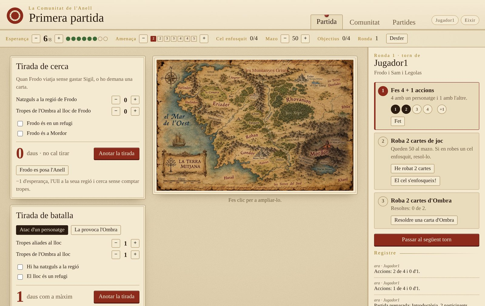
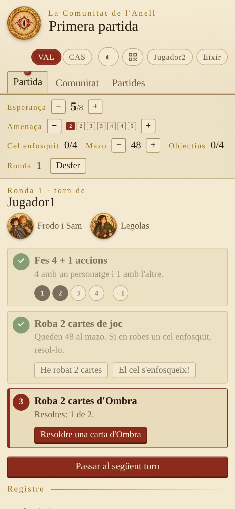
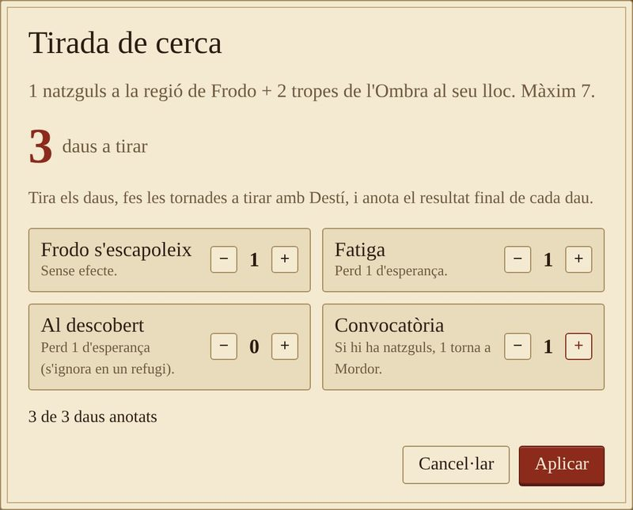

# La Comunitat de l'Anell

Ajudant de taula, lliure i en valencià, per a portar les partides d'**«El Señor de los Anillos: El Destino de la Comunidad»**.

El tauler i les peces els teniu a la taula. L'app porta els comptes:
- l'esperança i l'amenaça;
- els passos del torn;
- quants daus heu de tirar en cada tirada i què perdeu amb el resultat;
- els objectius, amb un registre de tot el que passa i un botó per a desfer.

Un ordinador fa de servidor i la resta hi entren des del navegador, mòbils inclosos.



## Què fa

- **Pistes:**
  - esperança (de 0 a 8);
  - nivell d'amenaça, que diu quantes cartes d'Ombra es roben;
  - les cartes «El cel s'enfosqueix» que han eixit;
  - les cartes que queden al mazo de joc;
  - els objectius completats;
  - la ronda.
- **El torn pas a pas:** les 4 + 1 accions, robar 2 cartes (descompta el mazo i resta esperança si s'acaba) i resoldre les cartes d'Ombra que toquen.
- **Tirades de cerca i de batalla:** diu quants daus s'han de tirar. Quan hi anoteu el resultat, aplica la pèrdua d'esperança i diu quantes tropes s'han de llevar de cada bàndol. Té en compte els refugis, els natzguls i el valor gastat.
- **El cel s'enfosqueix, posar-se l'Anell i destruir l'Anell Únic**, cadascun amb el seu càlcul.
- **Preparació:**
  - nivells de dificultat;
  - escenaris suggerits;
  - els 24 objectius;
  - la llista de preparació del tauler, pas a pas.
- **Registre** de tot el que passa i **desfer** fins a 30 passos.
- **Diverses partides guardades.**
- **Adaptada al mòbil.** Tots els aparells connectats veuen els canvis al moment.

<p>
  
  
</p>

## Com s'usa

Només cal **Python 3.8 o més nou**. No s'ha d'instal·lar res més.

```bash
python3 comunitat.py
```

A Windows, fes doble clic a `arrancar-windows.bat`. Abans has d'instal·lar Python des de python.org i marcar «Add python.exe to PATH».

En arrancar, el servidor mostra l'adreça per als altres, per exemple `http://192.168.1.40:8766`. Cada jugador l'obri al navegador i entra amb el seu nom.

Opcions:

```bash
python3 comunitat.py --port 9001             # un altre port
python3 comunitat.py --partida "Divendres"   # obri (o crea) eixa partida
```

Al fitxer [docs/Guia-La-Comunitat.pdf](docs/Guia-La-Comunitat.pdf) tens la **guia d'ús completa**, amb captures de totes les pantalles.

## El mapa

Al centre de la pantalla es mostra `mapa-exemple.jpg`, un mapa il·lustrat de la Terra Mitjana en valencià. Per a posar el teu, copia la imatge al costat de `comunitat.py` amb el nom `mapa.jpg` (o `mapa.png`). El `.gitignore` fa que el teu mapa no es puge al repositori.

## Les dades

Les partides es guarden a la carpeta `partides/`, i els jugadors i les sessions a `comunitat.json`. Per a fer una còpia de seguretat, copia-ho tot.

## Modificar el programa

`comunitat.py` es genera a partir dels fitxers de `src/`:

| Fitxer | Què hi ha |
|---|---|
| `src/servidor.py` | El servidor (Python, sense dependències) |
| `src/web/app.js` | La lògica de la pàgina |
| `src/web/dades.js` | Personatges, objectius, escenaris i preparació |
| `src/web/estil-base.css`, `src/web/estil.css` | L'estil |
| `src/web/cos.html` | L'estructura de la pàgina |

Després de canviar alguna cosa, torna a generar el programa amb:

```bash
python3 build.py
```

Les propostes de millora i les correccions són benvingudes.

## Llicència

[GPL-3.0](LICENSE) o posterior. El podeu usar, copiar, modificar i compartir lliurement. Si en publiqueu una versió modificada, també ha de ser lliure i amb el codi obert.

## Avís

Projecte de fans **no oficial**, sense relació amb Z-Man Games, Asmodee ni Middle-earth Enterprises. «El Señor de los Anillos» i els noms relacionats són marques dels seus propietaris. Aquest programa no inclou cap component del joc: per a jugar cal tindre'l.
