# Manual d'usuari

Guia d'ús de La Comunitat, l'ajudant lliure per a portar les partides d'«El Señor de los Anillos: El Destino de la Comunidad». El tauler i les peces els teniu a la taula; l'app porta els comptes.

Per a instal·lar-la, consulta la [guia d'instal·lació](guia-installacio.md).

## Què és i què necessites

La Comunitat porta els comptes d'una partida d'«El Destino de la Comunidad». **Una persona la porta** des de l'ordinador, la tauleta o el mòbil, i la resta jugueu al tauler, com sempre. No cal Internet ni crear cap compte.

L'app no substitueix el joc. Les cartes, les tropes, els natzguls i l'Ull de Sauron continuen al tauler de cartó. L'app s'encarrega dels comptes que s'oblidaven o feien perdre temps:

- l'esperança, l'amenaça, les cartes de la baralla i quantes vegades s'ha enfosquit el cel;
- els passos de cada torn i quantes cartes d'Ombra s'han de resoldre;
- quants daus s'han de tirar en una cerca o en una batalla, i què es perd amb el resultat;
- els objectius, la preparació del tauler i un registre de tot el que passa, amb un botó per a desfer.

| Pestanya | Què hi ha |
|---|---|
| **Partida** | Les pistes, les eines de tirades, el mapa i el torn pas a pas. |
| **Comunitat** | La preparació del tauler, qui porta cada personatge i el resum. |
| **Partides** | Les partides guardades, les còpies de seguretat i l'historial de les acabades. |

**On funciona:** és la mateixa app a tot arreu. Tria la que et vaja millor (la [guia d'instal·lació](guia-installacio.md) explica cada una):

| On | Com | On es guarden les partides |
|---|---|---|
| **Windows 10 o 11** | Instal·lador o versió portable, en una finestra pròpia | A la carpeta de dades de l'ordinador |
| **Linux** | Paquet `.deb` o `.tar.gz`, en una finestra pròpia | A la carpeta de dades de l'ordinador |
| **Android** | El fitxer `.apk` | Dins de l'app |
| **Qualsevol navegador** | L'app web, sense instal·lar res, també sense connexió | Dins del navegador |

Les partides **no es passen soles** d'un aparell a un altre: per a continuar-ne una en un altre lloc, exporta-la i importa-la (vegeu [Partides i historial](#partides-i-historial)).

## Obrir La Comunitat

- **Windows i Linux:** obri **La Comunitat** des del menú Inici o des del menú d'aplicacions. S'obri en **una finestra pròpia**, sense navegador. Quan la tanques, et pregunta si vols tancar-la; la partida ja està guardada.
- **Android:** toca la icona de **La Comunitat**. El botó «enrere» d'Android tanca la finestra oberta, torna a la pestanya Partida i, si ja hi eres, ix de l'app.
- **Navegador:** obri l'adreça de l'app web. Des del menú del navegador, **Afegir a la pantalla d'inici** (o **Instal·lar**) la deixa com una app més, que funciona també sense connexió.

La primera vegada no hi ha cap partida: prem **Crear partida**. Si ja en tens alguna, s'obri l'última que vas fer servir.

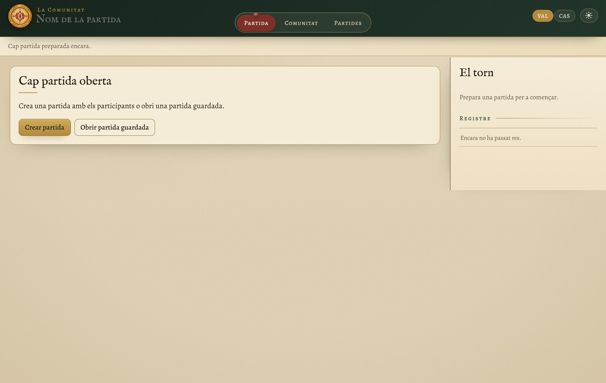

> A l'ordinador, si no es pot obrir la finestra pròpia (vegeu [Si alguna cosa no va](#si-alguna-cosa-no-va)), s'obri l'app al navegador i una finestreta per a tancar-la. També la pots triar a propòsit amb l'opció `--navegador`.

## Preparar una partida

Posa-li un nom a la partida (per exemple, «Divendres amb la colla»), ompli el formulari i prem **Començar la partida**. Per a tornar a preparar la partida oberta des de zero, a la pestanya Comunitat hi ha el botó **Preparar una partida nova**.

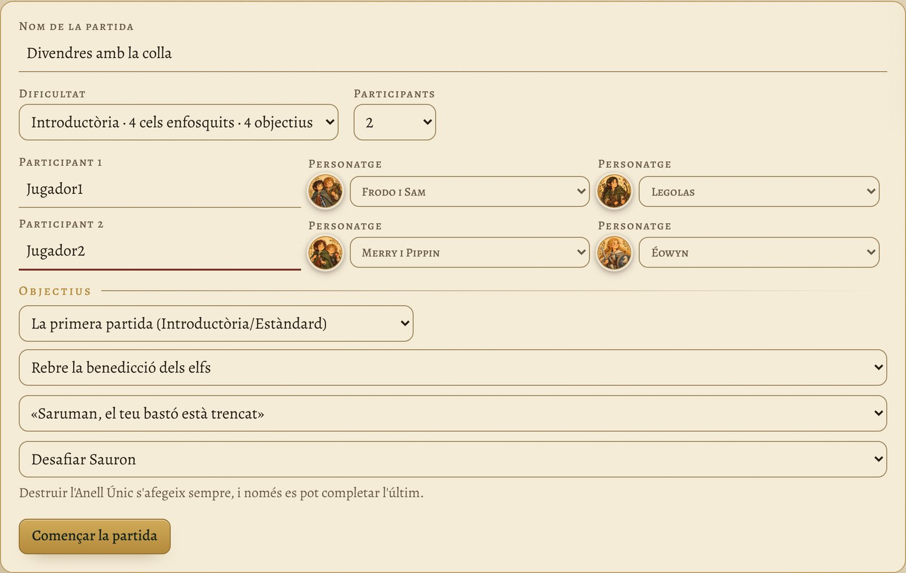

### Dificultat

| Nivell | Cel enfosquit | Objectius |
|---|---|---|
| Introductòria | 4 | 4 |
| Estàndard | 5 | 4 |
| Heroica | 5 | 5 |
| Èpica | 6 | 5 |
| Llegendària | 6 | 6 |

Els objectius inclouen sempre «Destruir l'Anell Únic», que s'afegeix sol.

### Participants i personatges

Escriu el nom de cada participant (l'app recorda els últims que has posat). Cada participant porta 2 personatges, i al costat de cada desplegable es veu el retrat del triat. Algú ha de portar Frodo i Sam. Les propostes que hi ha per defecte són les que suggereix el manual del joc per a la primera partida. En solitari portes Frodo i Sam i 4 personatges més.

### Objectius

Tria'ls de la llista o fes servir un escenari suggerit del manual del joc («La primera partida», «Genets de Rohan»…), que els omple tots alhora.

### La llista de preparació

En acabar, l'app passa a la pestanya **Comunitat**. Allí trobaràs els 10 passos de preparació del manual del joc, amb les tropes de cada lloc, els natzguls i on comença cada personatge. Ves marcant-los a mesura que prepareu el tauler.

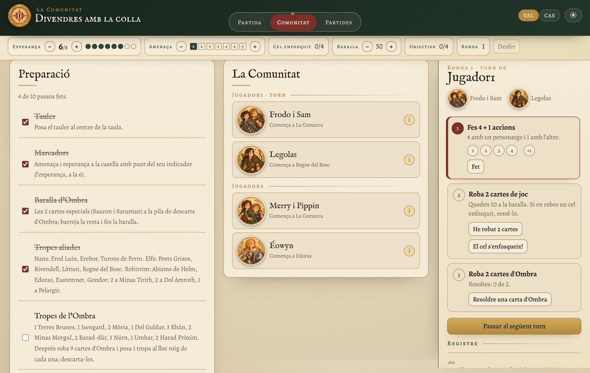

## La pantalla de joc

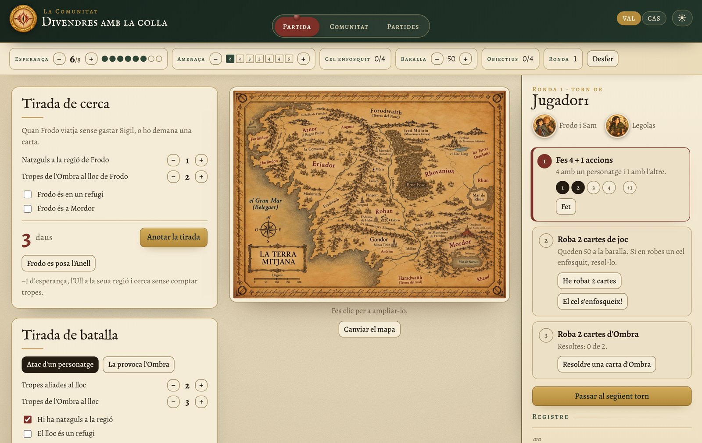

La barra de dalt porta les pistes:

| Pista | Què és |
|---|---|
| **Esperança** | Comença en 6, el màxim és 8. Si arriba a 0, perdeu. Els botons − i + la corregeixen a mà. |
| **Amenaça** | La casella marcada diu quantes cartes d'Ombra es roben en cada torn (2, 2, 3, 3, 4, 4, 5). Puja sola amb *El cel s'enfosqueix*. |
| **Cel enfosquit** | Quantes cartes d'*El cel s'enfosqueix* han eixit, del total que hi ha a la baralla. |
| **Baralla** | Les cartes que queden a la baralla de joc. Baixa sola quan robeu i es pot corregir. |
| **Objectius** | Completats del total. |
| **Desfer** | Anul·la l'últim canvi. Pots desfer fins a 30 passos enrere. |

Al mapa del centre, fes clic per a veure'l en gran.

## Un torn, pas a pas

La columna de la dreta (al mòbil, just davall de les pistes) segueix l'ordre de joc del manual. El pas actual es marca en roig.

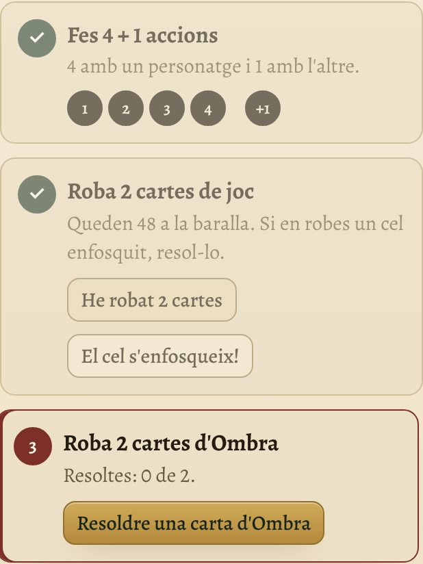

1. **Fes 4 + 1 accions.** Toca els cercles per a portar el compte: 4 amb un personatge i 1 amb l'altre. Quan acabes, prem **Fet**.
2. **Roba 2 cartes de joc.** Prem **He robat 2 cartes**: la baralla baixa 2. Si no en queden prou, resta 1 d'esperança per cada carta que falta.
3. Si robes *El cel s'enfosqueix*, prem el botó del mateix nom (vegeu més avall).
4. **Roba les cartes d'Ombra.** Resol-les al tauler i prem **Resoldre una carta d'Ombra** per a cada una. El comptador diu quantes en falten.
5. **Passa al següent torn.** Si encara queden cartes d'Ombra, el botó t'avisa i has de prémer-lo dues vegades.

### Carta d'Ombra

La finestra recorda com es resol cada mitat de la carta:

- **Bandera roja:** Avançar.
- **Bandera negra:** Reforçar, amb les tres ordres especials.

Si s'ha perdut un refugi, o no quedaven tropes de l'Ombra a la reserva, marca-ho ací i l'app restarà l'esperança que toca.

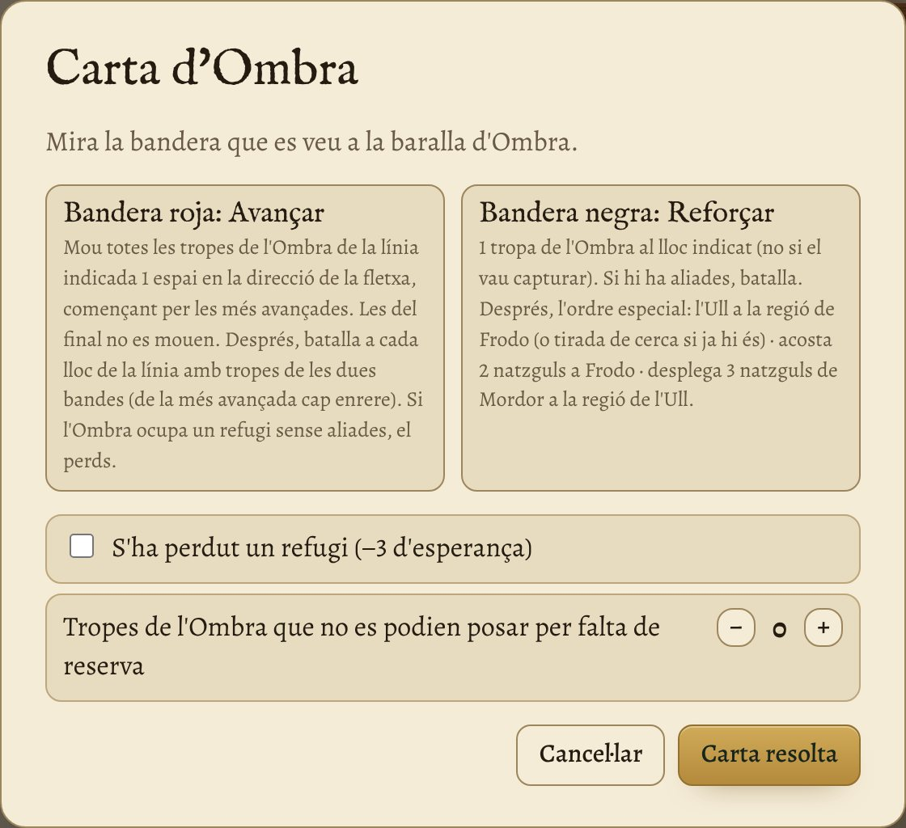

### El cel s'enfosqueix

Fa els quatre passos de la carta:

- Puja l'amenaça.
- **Et veig!** Contesta si l'Ull de Sauron ja és a la regió de Frodo: si ho és, resta 2 d'esperança.
- Si a l'hora de posar les 3 tropes de l'Ombra en falten a la reserva, resta 1 per cada una.
- Et recorda barrejar els descarts d'Ombra.

Si al lloc de la carta hi ha tropes aliades, fes després una tirada de batalla «La provoca l'Ombra».

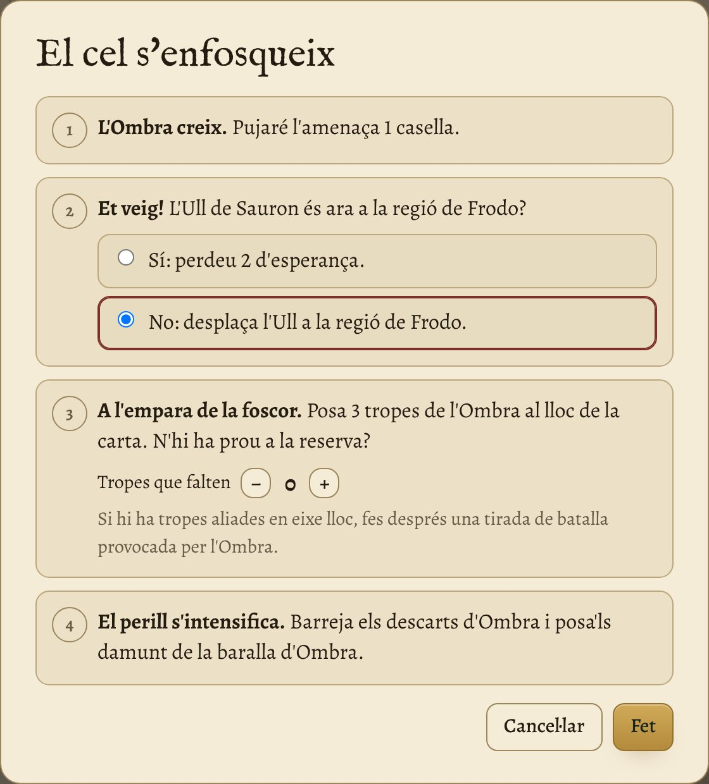

## Les tirades

Els daus els tireu de veritat. L'app diu quants n'heu de tirar i, quan hi anoteu el resultat de cada dau, aplica l'efecte. Les tornades a tirar amb Destí, feu-les abans d'anotar res: anoteu només el resultat final.

### Tirada de cerca

Indica quants natzguls hi ha a la regió de Frodo i quantes tropes de l'Ombra hi ha al seu lloc. L'app diu quants daus has de tirar: 1 per cada un, fins a un màxim de 7.

Marca si Frodo és en un refugi (s'ignora «Al descobert») o a Mordor (s'ignora «Convocatòria»).

**Frodo es posa l'Anell** resta 1 d'esperança i fa la cerca sense comptar les tropes.

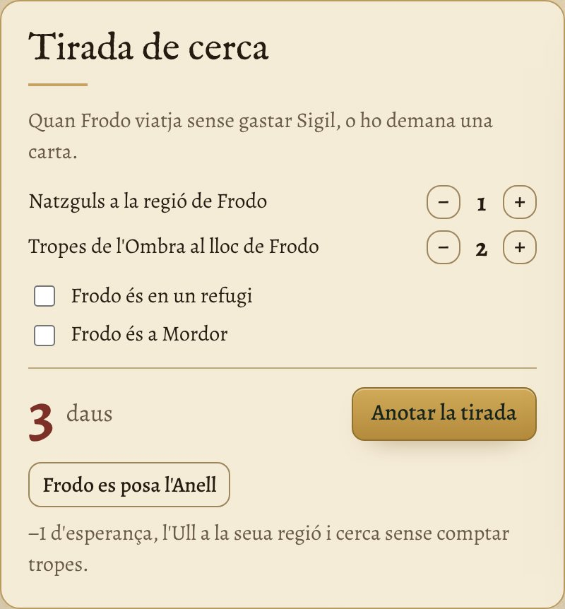

Anota quants daus han eixit de cada cara i prem **Aplicar**.

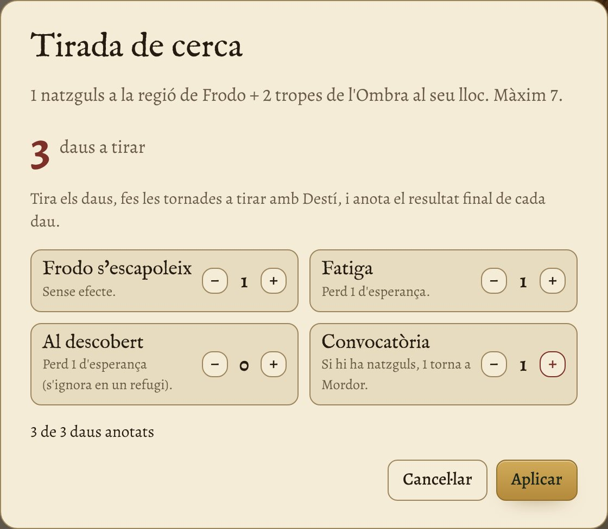

### Tirada de batalla

Tria si és un atac d'un personatge o si la provoca l'Ombra, i indica les tropes de cada bàndol al lloc.

- **Atac:** fins a 1 dau per tropa aliada (mínim 1, màxim 3). Pots tirar-ne menys. Recorda desplaçar l'Ull a la regió.
- **La provoca l'Ombra:** 1 dau per tropa de l'Ombra, màxim 3.

Marca si hi ha natzguls a la regió i si el lloc és un refugi. En anotar els resultats, hi pots afegir el **Valor** que gasteu: cada valor retira 1 tropa de l'Ombra.

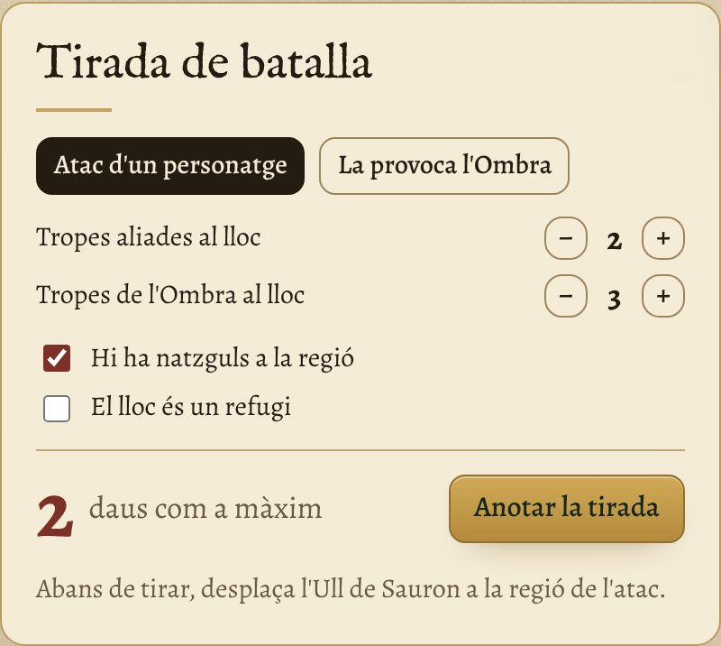

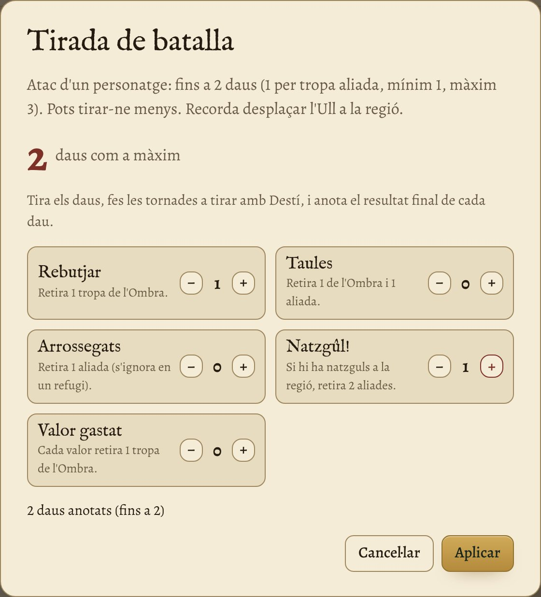

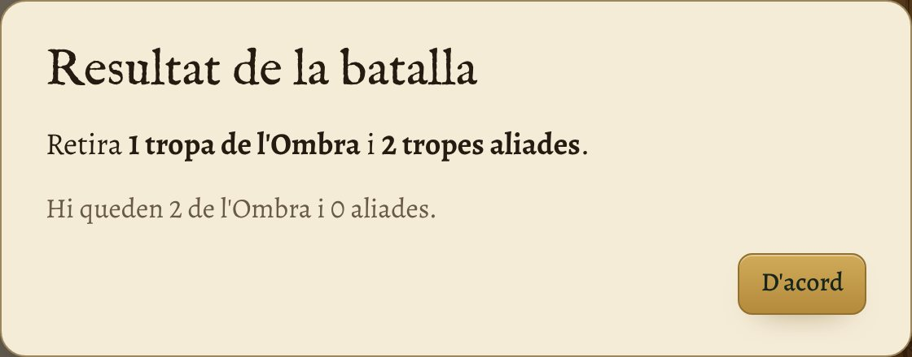

Si després de la batalla l'Ombra es queda sola en un refugi, l'app t'avisa que l'has perdut i resta les 3 d'esperança.

### Destruir l'Anell Únic

Només es pot intentar quan la resta d'objectius estan completats i Frodo és a la Muntanya del Destí, gastant 5 de Destí.

Els daus són els de la cerca, més 1 per cada casella que hi ha per damunt de l'esperança, fins a un màxim de 7. Si després de la tirada l'esperança és 1 o més, guanyeu.

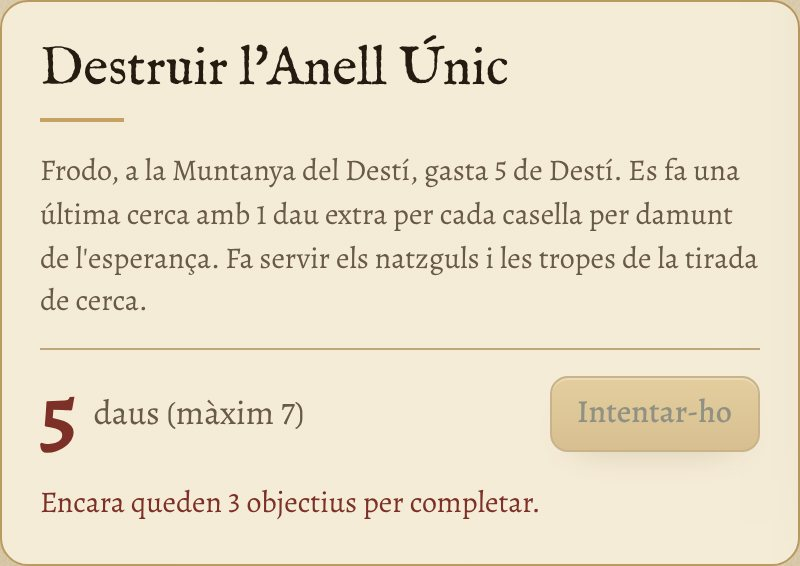

## Esperança, objectius i resum

### Botons d'esperança

Per als casos més habituals, amb el motiu, que queda apuntat al registre:

| Motiu | Esperança |
|---|---|
| Refugi perdut | −3 |
| Fortalesa capturada | +2 |
| Falta una tropa de l'Ombra | −1 |
| Falta una carta de joc | −1 |
| Altres (objectius, habilitats) | ±1 |

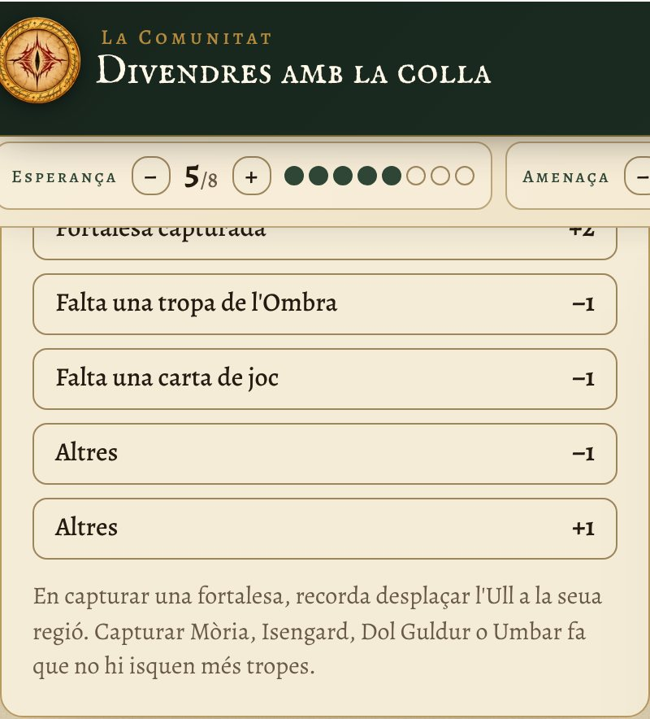

### Objectius

Marca'ls quan els completeu. L'app no aplica sola el text «En completar-lo» de cada carta: fes-ho amb els botons d'esperança o al tauler. «Destruir l'Anell Únic» es marca sol quan guanyeu.

### Desfer i registre

Tot el que passa queda al registre, amb l'hora. Les pèrdues d'esperança surten en roig i els guanys, en verd.

Si t'equivoques, **Desfer** torna enrere l'últim canvi. Es pot prémer diverses vegades.

> **Compte:** Desfer només canvia l'app. Si ja havíeu mogut peces al tauler, torneu-les a posar com estaven.

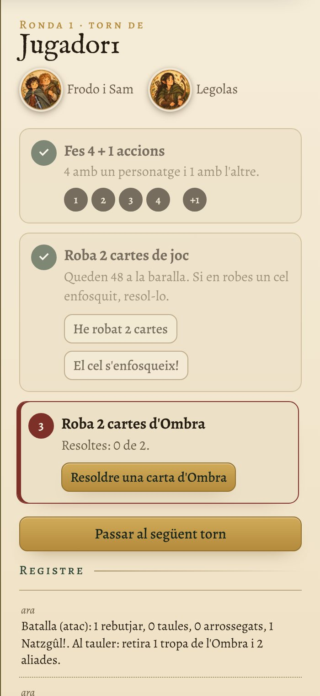

### En acabar: el resum

Quan guanyeu o perdeu, l'app mostra el resum de la partida:

- rondes jugades i quant de temps ha durat;
- l'esperança final i on s'ha perdut o guanyat;
- quantes tirades de cerca, batalles, cels enfosquits i cartes d'Ombra hi ha hagut;
- els objectius completats.

Es pot tornar a obrir amb el botó **Veure el resum** de la franja de dalt, i també apareix a la pestanya Comunitat.

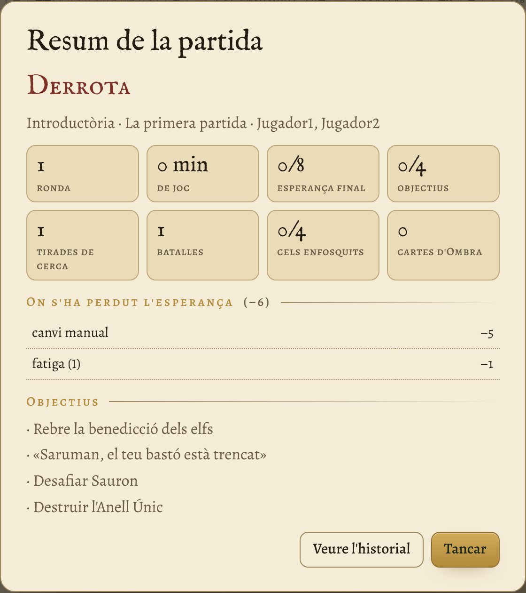

## Partides i historial

A la pestanya **Partides** pots tindre totes les que vulgues guardades:

- **Crear i obrir** una de nova.
- **Obrir** una altra.
- **Duplicar**, per a provar alguna cosa sense tocar l'original.
- **Còpies**: les còpies de seguretat de la partida, per a tornar a una d'abans (vegeu més avall).
- **Exportar**: guarda la partida en un fitxer `.json`, per a passar-la a un altre aparell o guardar-la a part. A l'ordinador, va a la carpeta **Baixades**; a Android, s'obri el menú **Compartir** per a guardar-la a Fitxers, a Drive, enviar-la…; al navegador, es baixa.
- **Esborrar**: va a la **Paperera**, d'on la pots recuperar. La partida oberta no es pot esborrar: obri'n una altra primer.

Amb **Importar → Triar el fitxer…** s'afig una partida exportada, d'aquest o d'un altre aparell. Es crea com a partida nova: no en substitueix cap. També es poden importar els fitxers de les carpetes `partides` i `copies` de la carpeta de dades.

El nom de la partida es canvia escrivint directament al títol de dalt.

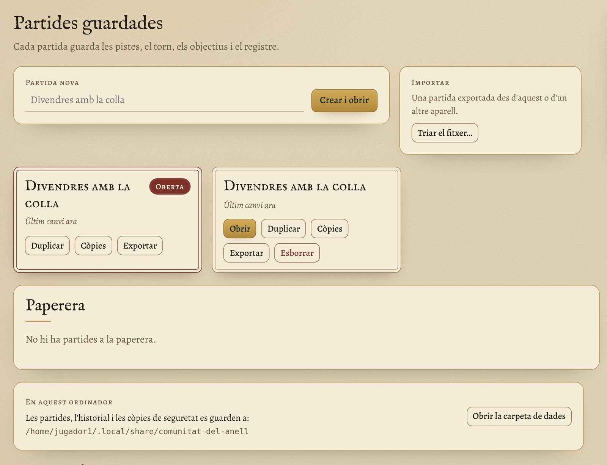

### Guardat

Cada canvi es guarda tot sol al moment: els comptadors, el registre i els passos per a desfer. Pots tancar l'app quan vulgues i continuar un altre dia. Si alguna vegada no es pot guardar (per exemple, si el disc està ple), dalt apareix un avís amb el botó **Tornar a provar**.

### Paperera

Les partides esborrades apareixen a **Partides → Paperera**. Prem **Recuperar** per a tornar-les a les partides guardades.

### Historial

Davall de les partides guardades hi ha l'historial: totes les partides acabades, de qualsevol partida guardada, amb el resultat, la dificultat, l'escenari, qui hi jugava i amb quins personatges. Dalt tens el total de victòries i derrotes, i una taula per dificultat.

Si una partida s'ha apuntat per error, **Llevar de l'historial** l'esborra. Si desfeu la jugada que l'ha acabada, també desapareix sola.

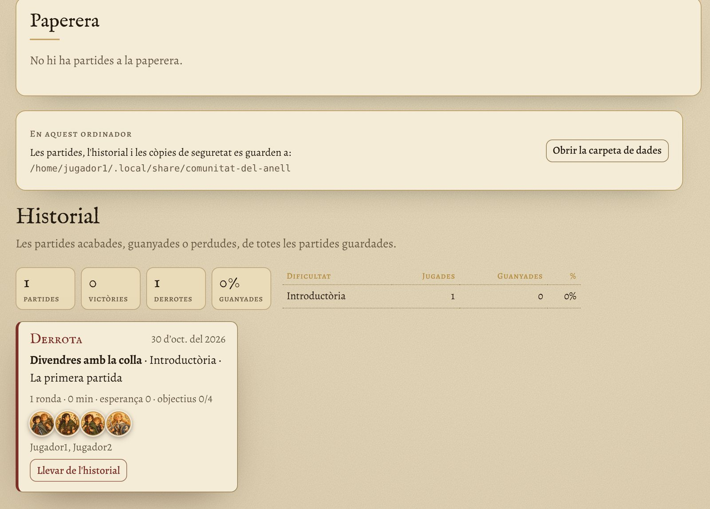

### Còpies de seguretat

La Comunitat fa còpies de cada partida tota sola: una cada vegada que s'obri i, mentre jugueu, una cada mitja hora. Se'n guarden les 15 últimes de cada partida.

El botó **Còpies** de cada partida les mostra amb la data i l'hora. **Restaurar** torna la partida a eixe moment (abans es fa una còpia del que hi havia, per si de cas), i **Fer una còpia ara** en fa una a mà, per exemple abans de provar alguna cosa.

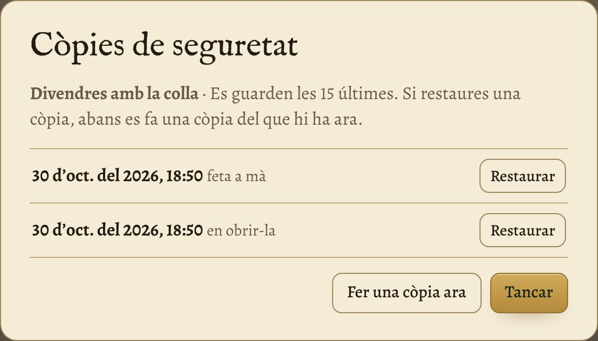

**A l'ordinador**, tot es guarda a la **carpeta de dades**, que s'obri amb el botó **Obrir la carpeta de dades** de la pestanya Partides. Dins hi ha la carpeta `partides`, la carpeta `copies`, `historial.json` (les partides acabades) i `comunitat.json` (quina partida estava oberta). Per a guardar-ho tot a part, o per a passar-ho tot a un altre ordinador, tanca La Comunitat i copia eixa carpeta sencera. La [guia d'instal·lació](guia-installacio.md) diu on és en cada sistema.

**A Android i al navegador**, les partides es guarden dins de l'app. Si desinstal·les l'app o esborres les dades del navegador, es perden: exporta les que vulgues conservar.

## Mòbil, mapa, idioma i tema

### Al mòbil

En vertical, l'app es posa en una sola columna: dalt les pistes i, si baixes, el mapa, les eines i el torn.

Les finestres de tirades i cartes ocupen gairebé tota l'amplada, amb botons fàcils de tocar.

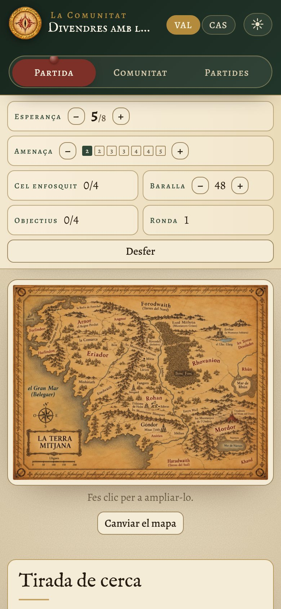

### Canviar el mapa

Al principi es veu el mapa d'exemple. Per a posar el teu, prem **Canviar el mapa**, davall del mapa, i tria una imatge. Es fa servir en totes les partides d'aquest aparell. **Tornar al mapa d'exemple** el lleva.

A l'ordinador també val la manera de les versions anteriors: copiar la imatge a la carpeta de dades amb el nom `mapa.jpg` (o `mapa-val.jpg` i `mapa-es.jpg`, un per idioma).

Fes servir imatges que pugues usar: si comparteixes el programa, no hi poses mapes d'altres persones sense permís.

### Idioma

L'app està en valencià i en castellà. Els botons **VAL** i **CAS**, dalt a la dreta, canvien l'idioma. El registre, els objectius i el mapa d'exemple també canvien.

A l'ordinador, els avisos de la finestra (per exemple, en tancar-la) ixen en valencià. Per a tindre'ls en castellà, arranca amb l'opció `--idioma es`.

### Mode fosc

El botó de la lluna (◐ ☀ ☾) canvia entre el tema automàtic (el del sistema), clar i fosc.

## Si alguna cosa no va

| Què passa | Què fer |
|---|---|
| A l'ordinador no s'obri la finestra pròpia, sinó el navegador | A Windows, falta el component **WebView2** de Microsoft, que porten Windows 11 i Windows 10 actualitzat: instal·la «Microsoft Edge WebView2 Runtime» des de la web de Microsoft. A Linux, falten GTK i WebKitGTK: la [guia d'instal·lació](guia-installacio.md) diu com instal·lar-los. Mentrestant, La Comunitat funciona igual al navegador. |
| «La Comunitat ja està oberta» | Ja hi ha una altra Comunitat oberta en aquest ordinador: busca-la a la barra de tasques. |
| Apareix «No es pot contactar amb el programa» | A l'ordinador, La Comunitat s'ha tancat mentre la pàgina estava oberta al navegador. Torna a obrir-la. |
| Al mòbil no trobe una partida que tenia a l'ordinador | Cada aparell té les seues partides. Exporta-la a l'ordinador i importa-la al mòbil. |
| M'he equivocat en algun número | Prem **Desfer**, o corregeix-lo amb els botons − i + de la barra de dalt. |

> **Recorda:** l'app només porta els comptes. Si l'app i el tauler no coincideixen, mana el tauler: corregiu l'app perquè quede igual.

## Llicència

La Comunitat és programari lliure amb llicència GPL-3.0: la podeu usar, copiar, modificar i compartir, i les versions modificades que publiqueu també han de ser lliures. El mapa d'exemple, el logo i els retrats dels personatges s'han generat amb IA, i el programa i aquest manual s'han escrit amb ajuda d'un assistent d'IA. És un projecte de fans no oficial, sense relació amb Z-Man Games, Asmodee ni Middle-earth Enterprises. Per a jugar cal tindre el joc.

> Els textos d’ajuda són redacció pròpia del projecte. Vegeu els avisos de marques i materials de tercers en [NOTICE.md](../NOTICE.md).
