# Manual d'usuari

Guia d'ús de La Comunitat, l'ajudant lliure per a portar les partides d'«El Señor de los Anillos: El Destino de la Comunidad». El tauler i les peces els teniu a la taula; l'app porta els comptes.

Per a instal·lar-la, consulta la [guia d'instal·lació](guia-installacio.md).

## Sala de partida — v2.6.0

**Àlies masculins i femenins:** en escriure un nom, l’app proposa un tipus d’àlies amb una llista local de noms habituals; no fa consultes a Internet. Pots corregir-lo amb **Tipus d’àlies → Masculí / Femení / Neutre**. Els noms desconeguts o ambigus es proposen com a neutres. És una ajuda lingüística per a l’àlies, no una determinació del gènere de la persona. Cada raça té noms inventats diferenciats. La preferència manual es conserva; canviar-la des de **Sala de partida → Editar** genera un altre àlies sense canviar el PIN ni tancar la sessió. Els jugadors antics conserven l’àlies existent fins que el màster el canvie.

L’aplicació arranca sense cap partida carregada. Tria **Crear partida**, escriu el nom de la partida i els noms i les races dels participants, i prepara-la. En confirmar, els jugadors s’incorporen automàticament a **Sala de partida**, amb àlies i PIN. Els PIN nous es mostren una sola vegada al màster. Si un nom ja correspon a un jugador registrat, es reutilitza la seua identitat i el PIN existent. Els noms dels participants d’una mateixa partida no es poden repetir, ignorant accents, majúscules i espais sobrants.

**Obrir partida guardada** recupera la partida i incorpora els seus jugadors a la sala sense duplicar-los. Les partides noves guarden UID, nom, raça i àlies, però no el PIN ni el seu hash dins del fitxer de partida. Els PIN i sessions continuen en la configuració local. Si importes una partida a un altre ordinador o recuperes jugadors eliminats, el màster haurà de generar-los PIN nous. Les partides antigues recuperen els jugadors pel nom. No s’obri l’última partida en reiniciar; l’opció explícita de terminal `--partida` continua disponible.

El màster obri l’app en el PC amb `http://localhost:8766` (o el port triat). El botó **Sala de partida** permet crear jugadors amb nom i raça, editar-los, generar un altre àlies, eliminar-los, regenerar el PIN i desvincular sessions. Les accions destructives demanen una segona pulsació. Els àlies són inventats; no són personatges del joc.

En crear o regenerar un PIN de quatre dígits, anota’l i comunica’l al jugador: només es mostra una vegada i després apareix com **••••**. Es guarda amb salt aleatori i PBKDF2-HMAC-SHA256 (200.000 iteracions), sense PIN en clar. Regenerar-lo revoca la sessió anterior.

El jugador escaneja el QR comú de la taula, tria **Qui eres? → jugador → PIN → Entrar**. Només apareixen jugadors amb PIN i sense vinculació. Un jugador té una sessió autoritzada; el navegador la recorda i reconnecta després de recarregar, d’un tall de wifi o de reiniciar el servidor. **Eixir** revoca la sessió; tancar una pestanya no la desvincula. Si es perd el dispositiu o les dades del navegador, el màster ha de prémer **Desvincular**. La possessió del token autoritza la sessió: no el compartisques.

**Bloquejar noves connexions** impedeix noves vinculacions; les sessions autoritzades poden continuar i reconnectar. El panell mostra connexió SSE, vinculació i última petició autenticada. Sense partida preparada, el jugador espera. Les jugades continuen sent cooperatives; l’administració de jugadors, partides i historial correspon al màster local. En mode de sondeig, un dispositiu pot aparéixer desconnectat encara que continue autoritzat; consulta també l’última connexió.

En actualitzar des de v2.5 o anteriors es conserven partides, configuració i UID. Els noms duplicats reben un sufix, els àlies antics se substitueixen prudentment i es revoquen les sessions sense autenticació. El màster ha de generar PIN per als jugadors migrats. Fes una còpia de la carpeta de dades abans d’actualitzar. La sala de jugadors és comuna a les partides guardades, com en la v2.5.

Funciona en una LAN de confiança amb HTTP; el PIN i els tokens viatgen sense xifrat de transport. No exposes el port a Internet. Després de cinc intents de PIN fallits per IP en un minut, cal esperar. El màster només s’autoritza des de loopback amb Host local i es rebutgen escriptures entre orígens.

## Què és i què necessites

La Comunitat és una pàgina web que funciona a casa, sense Internet. Un ordinador fa de servidor i la resta de la taula hi entra des del navegador del mòbil, la tauleta o el portàtil. Tots veuen el mateix al moment: si algú perd esperança o passa el torn, els altres ho veuen de seguida.

L'app no substitueix el joc. Les cartes, les tropes, els natzguls i l'Ull de Sauron continuen al tauler de cartó. L'app s'encarrega dels comptes que s'oblidaven o feien perdre temps:

- l'esperança, l'amenaça, les cartes de la baralla i quantes vegades s'ha enfosquit el cel;
- els passos de cada torn i quantes cartes d'Ombra s'han de resoldre;
- quants daus s'han de tirar en una cerca o en una batalla, i què es perd amb el resultat;
- els objectius, la preparació del tauler i un registre de tot el que passa, amb un botó per a desfer.

| Pestanya | Què hi ha |
|---|---|
| **Partida** | Les pistes, les eines de tirades, el mapa i el torn pas a pas. |
| **Comunitat** | La preparació del tauler, qui porta cada personatge i el resum. |
| **Partides** | Les partides guardades i l'historial de les acabades. |

**Què cal:**

- **L'ordinador servidor:** Windows 10 o 11, o Linux. Vegeu la [guia d'instal·lació](guia-installacio.md).
- **Els jugadors:** qualsevol dispositiu amb navegador, connectat a la mateixa wifi que el servidor. No han d'instal·lar res.

## Arrancar La Comunitat

Obri **La Comunitat** des del menú Inici (Windows) o des del menú d'aplicacions (Linux). L'app s'obri en **una finestra pròpia**, sense navegador: aquest ordinador és el «principal», el que fa de servidor, i des d'ací es pot jugar igual que des d'un mòbil.

- Mentre la finestra estiga oberta, La Comunitat funciona. Quan la tanques, et pregunta si vols tancar-la, ho guarda tot i els jugadors es desconnecten.
- El botó **Convida**, dalt a la dreta, mostra l'adreça per als altres, per exemple `http://192.168.1.40:8766`, i el **codi QR** que la porta dins.
- A la pestanya **Partides**, l'apartat **En aquest ordinador** diu on es guarda tot i té el botó **Obrir la carpeta de dades**.

> Si en aquest ordinador no es pot obrir la finestra pròpia (vegeu [Si alguna cosa no va](#si-alguna-cosa-no-va)), s'obri una finestreta amb l'adreça, el QR i la partida oberta, i l'app al navegador. També la pots triar a propòsit amb l'opció `--navegador`. I en un ordinador sense pantalla, la mateixa informació, amb el QR, ix al terminal. Vegeu les opcions a la [guia d'instal·lació](guia-installacio.md).

## Entrar des dels dispositius

1. Amb la càmera del mòbil, escaneja el QR del botó **Convida** de l'ordinador principal. També pots escriure al navegador l'adreça per als altres, per exemple `http://192.168.1.40:8766`.
2. Selecciona el jugador creat pel màster, escriu el seu PIN i prem **Entrar**.
3. El navegador recorda qui eres. La pròxima vegada entraràs directament.

El màster pot canviar el teu nom des de **Sala de partida**.

Si arriba algú amb la partida començada, prem el botó del QR de dalt a la dreta (a l'ordinador principal, **Convida**): mostra el codi en gran perquè l'escanege.

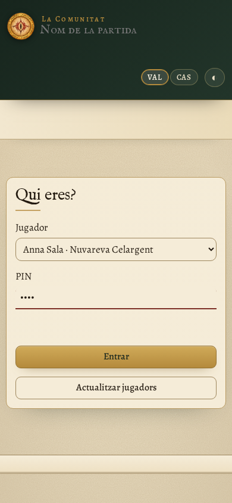

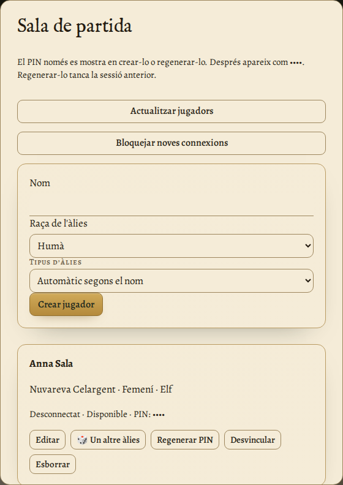

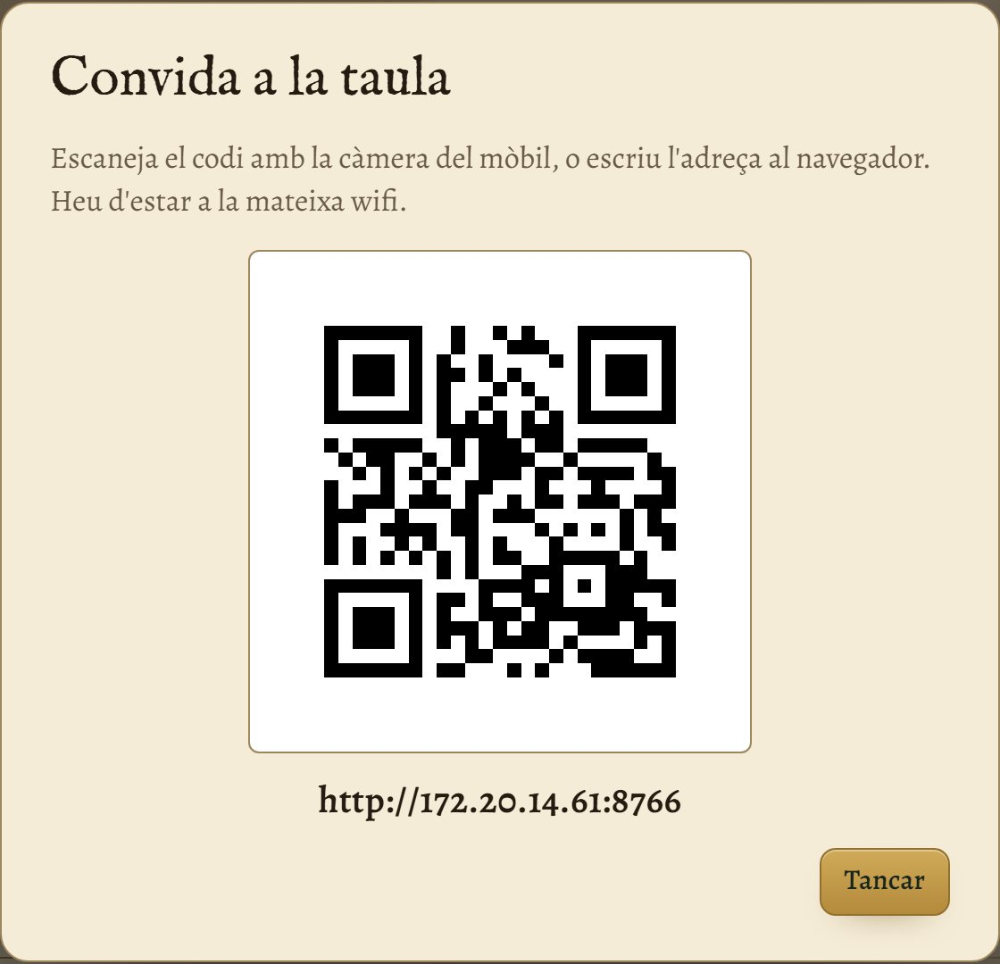

> **Truc:** al mòbil, afig la pàgina a la pantalla d'inici des del menú del navegador. Així s'obri com si fóra una aplicació.

## Preparar una partida

La primera vegada, l'app mostra el formulari de preparació. Ompli'l i prem **Començar la partida**.

### Dificultat

| Nivell | Cel enfosquit | Objectius |
|---|---|---|
| Introductòria | 4 | 4 |
| Estàndard | 5 | 4 |
| Heroica | 5 | 5 |
| Èpica | 6 | 5 |
| Llegendària | 6 | 6 |

Els objectius inclouen sempre «Destruir l'Anell Únic», que s'afegeix sol.

### Participants i personatges

Cada participant porta 2 personatges, i al costat de cada desplegable es veu el retrat del triat. Algú ha de portar Frodo i Sam. Les propostes que hi ha per defecte són les que suggereix el manual del joc per a la primera partida. En solitari portes Frodo i Sam i 4 personatges més.

### Objectius

Tria'ls de la llista o fes servir un escenari suggerit del manual del joc («La primera partida», «Genets de Rohan»…), que els omple tots alhora.

### La llista de preparació

En acabar, l'app passa a la pestanya **Comunitat**. Allí trobaràs els 10 passos de preparació del manual del joc, amb les tropes de cada lloc, els natzguls i on comença cada personatge. Ves marcant-los a mesura que prepareu el tauler.

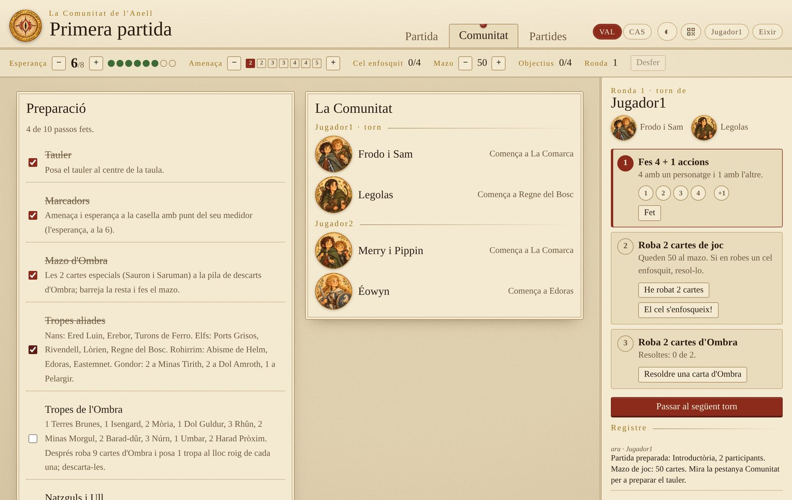

## La pantalla de joc

La barra de dalt porta les pistes:

| Pista | Què és |
|---|---|
| **Esperança** | Comença en 6, el màxim és 8. Si arriba a 0, perdeu. Els botons − i + la corregeixen a mà. |
| **Amenaça** | La casella marcada diu quantes cartes d'Ombra es roben en cada torn (2, 2, 3, 3, 4, 4, 5). Puja sola amb *El cel s'enfosqueix*. |
| **Cel enfosquit** | Quantes cartes d'*El cel s'enfosqueix* han eixit, del total que hi ha a la baralla. |
| **Baralla** | Les cartes que queden a la baralla de joc. Baixa sola quan robeu i es pot corregir. |
| **Objectius** | Completats del total. |
| **Desfer** | Anul·la l'últim canvi. Pots desfer fins a 30 passos enrere. |

Al mapa del centre, fes clic per a veure'l en gran.

## Un torn, pas a pas

La columna de la dreta (al mòbil, just davall de les pistes) segueix l'ordre de joc del manual. El pas actual es marca en roig.

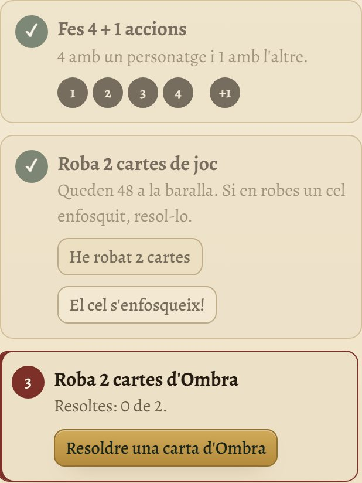

1. **Fes 4 + 1 accions.** Toca els cercles per a portar el compte: 4 amb un personatge i 1 amb l'altre. Quan acabes, prem **Fet**.
2. **Roba 2 cartes de joc.** Prem **He robat 2 cartes**: la baralla baixa 2. Si no en queden prou, resta 1 d'esperança per cada carta que falta.
3. Si robes *El cel s'enfosqueix*, prem el botó del mateix nom (vegeu més avall).
4. **Roba les cartes d'Ombra.** Resol-les al tauler i prem **Resoldre una carta d'Ombra** per a cada una. El comptador diu quantes en falten.
5. **Passa al següent torn.** Si encara queden cartes d'Ombra, el botó t'avisa i has de prémer-lo dues vegades.

### Carta d'Ombra

La finestra recorda com es resol cada mitat de la carta:

- **Bandera roja:** Avançar.
- **Bandera negra:** Reforçar, amb les tres ordres especials.

Si s'ha perdut un refugi, o no quedaven tropes de l'Ombra a la reserva, marca-ho ací i l'app restarà l'esperança que toca.

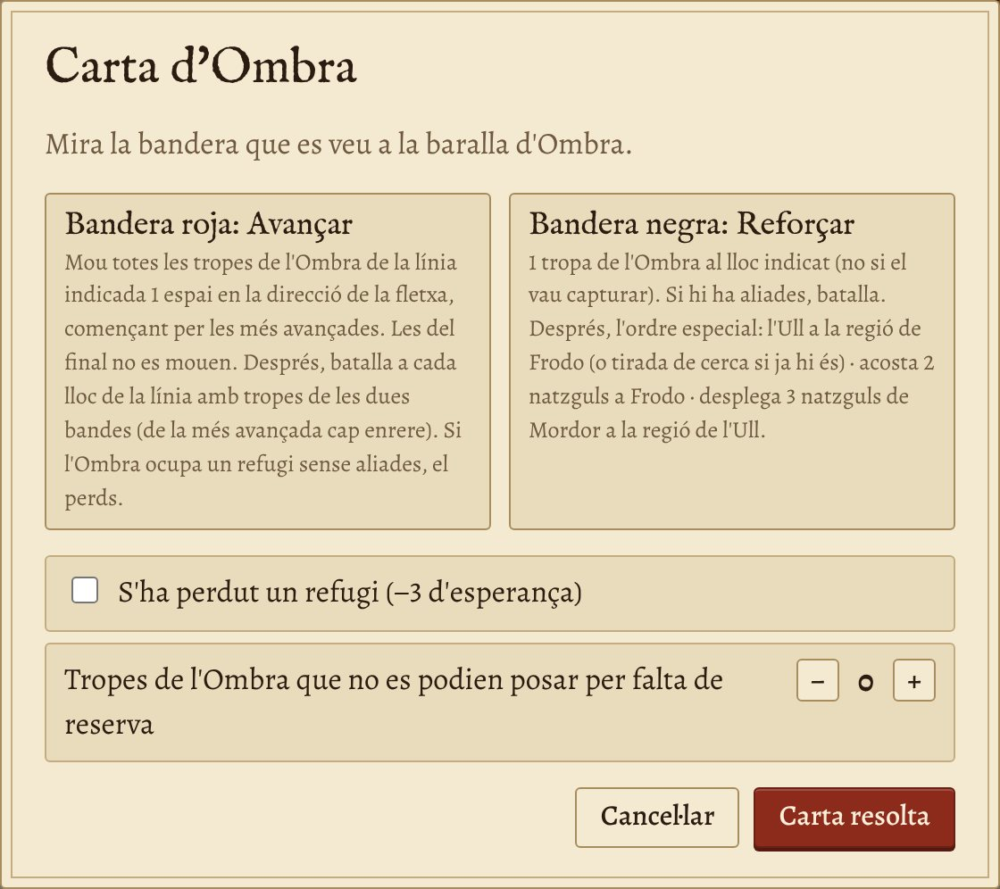

### El cel s'enfosqueix

Fa els quatre passos de la carta:

- Puja l'amenaça.
- **Et veig!** Contesta si l'Ull de Sauron ja és a la regió de Frodo: si ho és, resta 2 d'esperança.
- Si a l'hora de posar les 3 tropes de l'Ombra en falten a la reserva, resta 1 per cada una.
- Et recorda barrejar els descarts d'Ombra.

Si al lloc de la carta hi ha tropes aliades, fes després una tirada de batalla «La provoca l'Ombra».

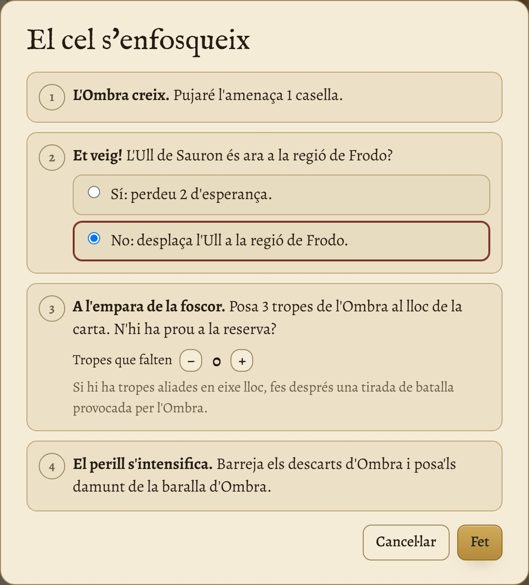

## Les tirades

Els daus els tireu de veritat. L'app diu quants n'heu de tirar i, quan hi anoteu el resultat de cada dau, aplica l'efecte. Les tornades a tirar amb Destí, feu-les abans d'anotar res: anoteu només el resultat final.

### Tirada de cerca

Indica quants natzguls hi ha a la regió de Frodo i quantes tropes de l'Ombra hi ha al seu lloc. L'app diu quants daus has de tirar: 1 per cada un, fins a un màxim de 7.

Marca si Frodo és en un refugi (s'ignora «Al descobert») o a Mordor (s'ignora «Convocatòria»).

**Frodo es posa l'Anell** resta 1 d'esperança i fa la cerca sense comptar les tropes.

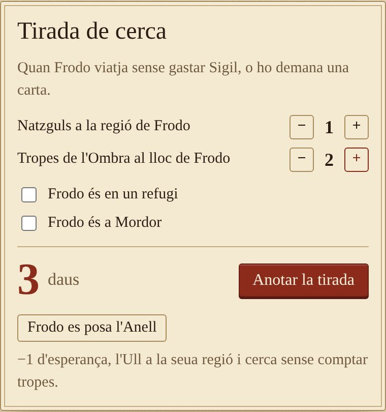

Anota quants daus han eixit de cada cara i prem **Aplicar**.

### Tirada de batalla

Tria si és un atac d'un personatge o si la provoca l'Ombra, i indica les tropes de cada bàndol al lloc.

- **Atac:** fins a 1 dau per tropa aliada (mínim 1, màxim 3). Pots tirar-ne menys. Recorda desplaçar l'Ull a la regió.
- **La provoca l'Ombra:** 1 dau per tropa de l'Ombra, màxim 3.

Marca si hi ha natzguls a la regió i si el lloc és un refugi. En anotar els resultats, hi pots afegir el **Valor** que gasteu: cada valor retira 1 tropa de l'Ombra.

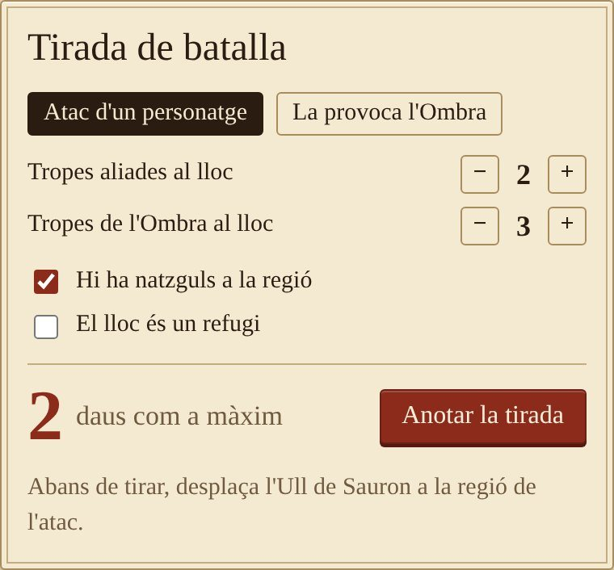

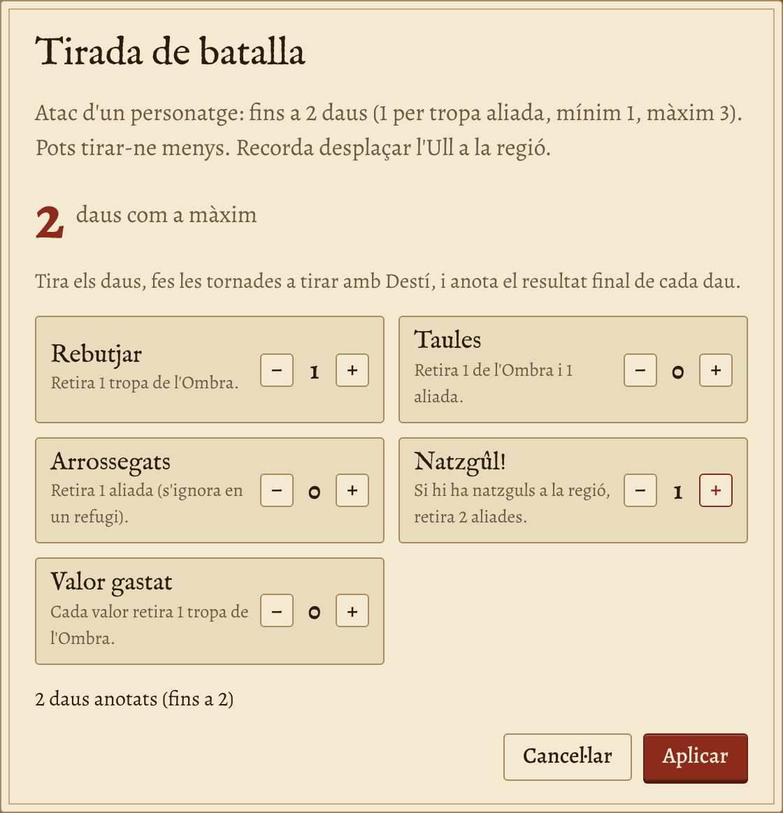

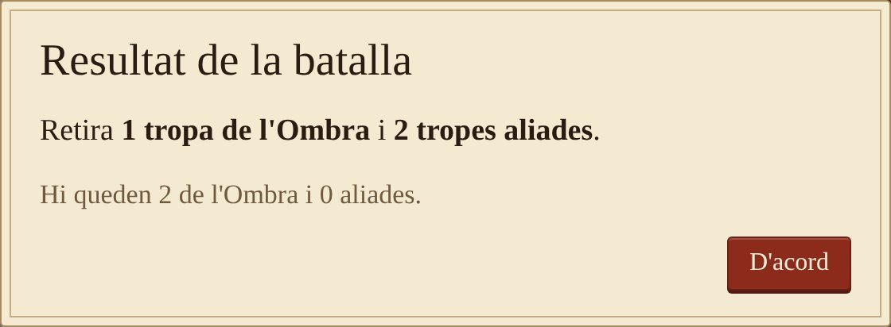

Si després de la batalla l'Ombra es queda sola en un refugi, l'app t'avisa que l'has perdut i resta les 3 d'esperança.

### Destruir l'Anell Únic

Només es pot intentar quan la resta d'objectius estan completats i Frodo és a la Muntanya del Destí, gastant 5 de Destí.

Els daus són els de la cerca, més 1 per cada casella que hi ha per damunt de l'esperança, fins a un màxim de 7. Si després de la tirada l'esperança és 1 o més, guanyeu.

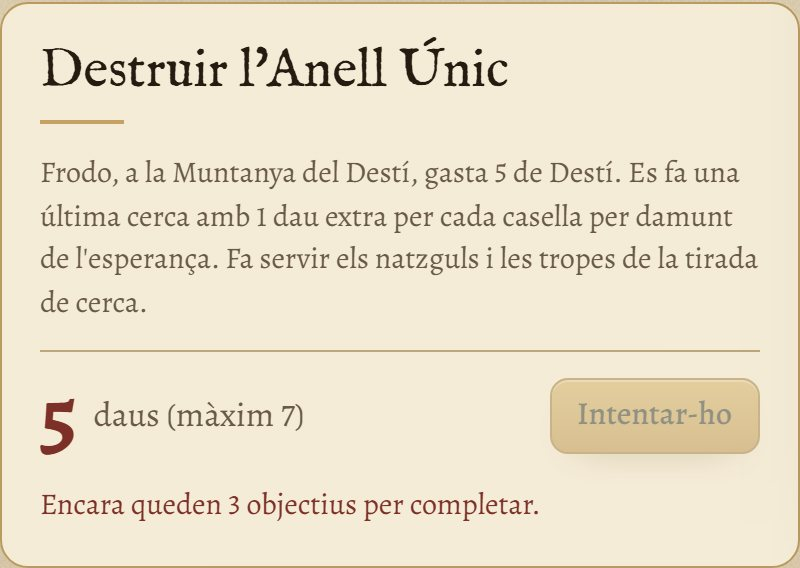

## Esperança, objectius i resum

### Botons d'esperança

Per als casos més habituals, amb el motiu, que queda apuntat al registre:

| Motiu | Esperança |
|---|---|
| Refugi perdut | −3 |
| Fortalesa capturada | +2 |
| Falta una tropa de l'Ombra | −1 |
| Falta una carta de joc | −1 |
| Altres (objectius, habilitats) | ±1 |

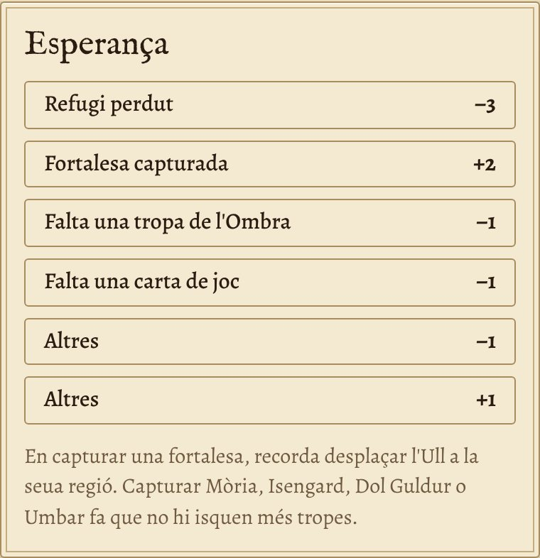

### Objectius

Marca'ls quan els completeu. L'app no aplica sola el text «En completar-lo» de cada carta: fes-ho amb els botons d'esperança o al tauler. «Destruir l'Anell Únic» es marca sol quan guanyeu.

### Desfer i registre

Tot el que passa queda al registre, amb l'hora i qui ho ha fet. Les pèrdues d'esperança surten en roig i els guanys, en verd.

Si algú s'equivoca, **Desfer** torna enrere l'últim canvi, siga de qui siga. Es pot prémer diverses vegades.

> **Compte:** Desfer només canvia l'app. Si ja havíeu mogut peces al tauler, torneu-les a posar com estaven.

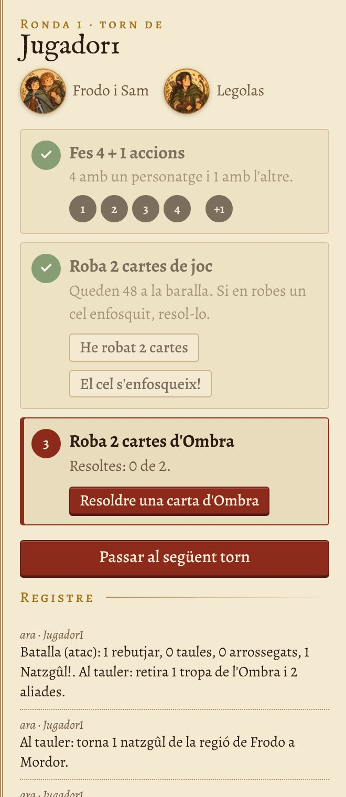

### En acabar: el resum

Quan guanyeu o perdeu, l'app mostra a tothom el resum de la partida:

- rondes jugades i quant de temps ha durat;
- l'esperança final i on s'ha perdut o guanyat;
- quantes tirades de cerca, batalles, cels enfosquits i cartes d'Ombra hi ha hagut;
- els objectius completats.

Es pot tornar a obrir amb el botó **Veure el resum** de la franja de dalt, i també apareix a la pestanya Comunitat.

## Partides i historial

A la pestanya **Partides** pots tindre totes les que vulgues guardades:

- **Crear** i obrir una de nova.
- **Obrir** una altra. Tots els que estan connectats hi passen sols.
- **Duplicar**, per a provar alguna cosa sense tocar l'original.
- **Còpies**: les còpies de seguretat de la partida, per a tornar a una d'abans (vegeu més avall).
- **Exportar**: guarda la partida en un fitxer `.json`, per a passar-la a un altre ordinador o guardar-la a part.
- **Esborrar.** No es perd: va a la carpeta `partides/esborrades/` de la carpeta de dades i es pot recuperar movent el fitxer a `partides/`.

Amb **Importar → Triar el fitxer…** s'afig una partida exportada, d'aquest o d'un altre ordinador. Es crea com a partida nova: no en substitueix cap.

El nom de la partida es canvia escrivint directament al títol de dalt.

### Guardat i canvis simultanis

L'avís **Guardant…** passa a **Guardat** quan el servidor ha escrit la jugada en disc. Cada jugada guarda alhora els comptadors, el registre i els passos per a desfer. Durant el guardat, espera que acabe abans de fer una altra acció.

Si dos jugadors actuen sobre la mateixa versió de la partida, s'accepta el primer canvi i l'altre dispositiu carrega la partida actualitzada. Revisa-la i repeteix l'acció si encara cal. Si apareix **Canvis pendents**, mantín la pàgina oberta, comprova la connexió i prem **Tornar a provar**; el reintent no duplica una jugada que ja s'haja guardat.

### Paperera

Les partides esborrades apareixen a **Partides → Paperera**. Prem **Recuperar** per a tornar-les a les partides guardades. Recuperar no canvia la partida oberta i, si el nom del fitxer ja existeix, es crea un fitxer diferent.

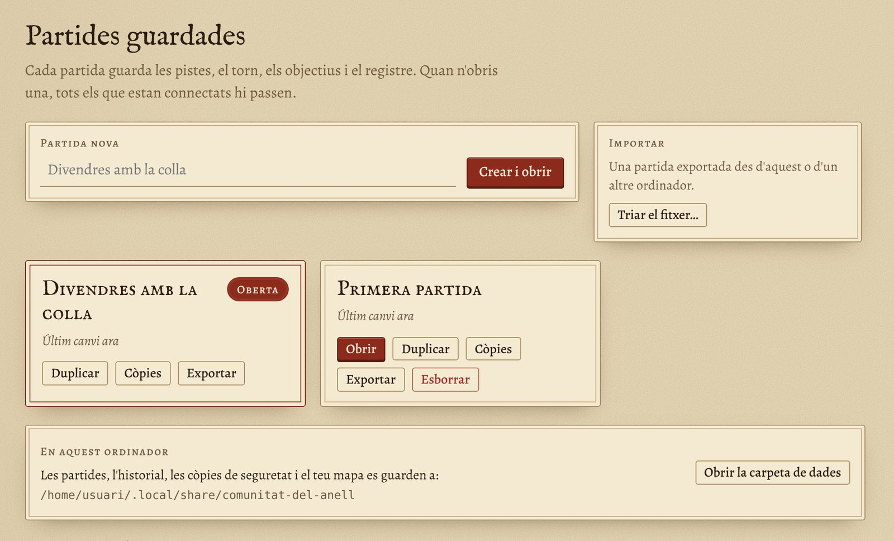

### Historial

Davall de les partides guardades hi ha l'historial: totes les partides acabades, de qualsevol partida guardada, amb el resultat, la dificultat, l'escenari, qui hi jugava i amb quins personatges. Dalt tens el total de victòries i derrotes, i una taula per dificultat.

Si una partida s'ha apuntat per error, **Llevar de l'historial** l'esborra. Si desfeu la jugada que l'ha acabada, també desapareix sola.

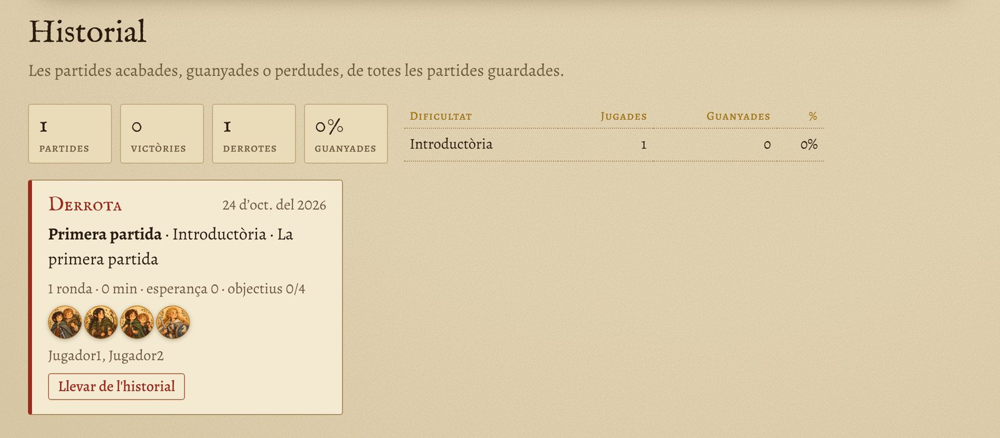

### Còpies de seguretat

La Comunitat fa còpies de cada partida tota sola: una cada vegada que s'obri i, mentre jugueu, una cada mitja hora. Se'n guarden les 15 últimes de cada partida.

El botó **Còpies** de cada partida les mostra amb la data i l'hora. **Restaurar** torna la partida a eixe moment (abans es fa una còpia del que hi havia, per si de cas), i **Fer una còpia ara** en fa una a mà, per exemple abans de provar alguna cosa.

Tot es guarda a la **carpeta de dades**, que s'obri amb el botó **Obrir la carpeta de dades** de la pestanya Partides, a l'ordinador principal. Dins hi ha la carpeta `partides`, la carpeta `copies`, el fitxer `comunitat.json` (els jugadors) i `historial.json` (les partides acabades). Per a guardar-ho tot a part, o per a passar-ho tot a un altre ordinador, copia eixa carpeta sencera. La [guia d'instal·lació](guia-installacio.md) diu on és en cada sistema.

## Mòbil, mapa, idioma i tema

### Al mòbil

En vertical, l'app es posa en una sola columna: dalt les pistes, després el torn i, si baixes, el mapa i les eines. Així, qui té el torn el pot portar des del mòbil.

Les finestres de tirades i cartes ocupen gairebé tota l'amplada, amb botons fàcils de tocar.

### Canviar el mapa

Al principi es veu el mapa d'exemple. Per a posar el teu, copia la imatge a la carpeta de dades amb el nom `mapa.jpg` (també val `mapa.png`) i recarrega la pàgina. No cal tancar La Comunitat.

Si tens el mapa en dos idiomes, anomena'ls `mapa-val.jpg` i `mapa-es.jpg`: cadascú veurà el del seu idioma.

Fes servir imatges que pugues usar: si comparteixes el programa, no hi poses mapes d'altres persones sense permís.

### Idioma

L'app està en valencià i en castellà. Els botons **VAL** i **CAS**, dalt a la dreta, canvien l'idioma només en el teu dispositiu; cada jugador pot tindre el seu. El registre, els objectius i el mapa també canvien.

Els avisos de la finestra (per exemple, en tancar-la) ixen en valencià. Per a tindre'ls en castellà, arranca amb l'opció `--idioma es`.

### Mode fosc

El botó de la lluna (◐ ☀ ☾) canvia entre el tema automàtic (el del sistema), clar i fosc. Com l'idioma, es recorda en cada dispositiu.

## Si alguna cosa no va

| Què passa | Què fer |
|---|---|
| No s'obri la finestra pròpia, sinó la finestreta del QR i el navegador | A Windows, falta el component **WebView2** de Microsoft, que porten Windows 11 i Windows 10 actualitzat: instal·la «Microsoft Edge WebView2 Runtime» des de la web de Microsoft. A Linux, falten GTK i WebKitGTK: la [guia d'instal·lació](guia-installacio.md) diu com instal·lar-los. Mentrestant, La Comunitat funciona igual al navegador. |
| Els altres no hi poden entrar | Han d'estar a la mateixa wifi que el servidor. Revisa el tallafoc: a Windows, permet La Comunitat a «Xarxes privades» i comprova que la wifi està configurada com a privada. A Linux, `sudo ufw allow 8766/tcp`. Algunes xarxes de convidats no deixen que els dispositius es vegen entre ells. |
| «El port ja està en ús» | Ja hi ha una altra Comunitat oberta. Tanca-la, o arranca en un altre port: `--port 9001`. |
| Apareix «S'ha perdut la connexió amb el servidor» | La Comunitat s'ha tancat o l'ordinador s'ha adormit. Quan tornes a obrir-la, la pàgina es reconnecta sola i no es perd res. |
| Apareix «Mode de prova» | S'ha obert la pàgina sense el programa (per exemple, la prova de la web). Res no es guarda: entra amb l'adreça de la finestra. |
| M'he equivocat en algun número | Prem **Desfer**, o corregeix-lo amb els botons − i + de la barra de dalt. |
| Un jugador vol entrar amb un altre nom | Demana al màster que edite el jugador. |

> **Recorda:** l'app només porta els comptes. Si l'app i el tauler no coincideixen, mana el tauler: corregiu l'app perquè quede igual.

## Llicència

La Comunitat és programari lliure amb llicència GPL-3.0: la podeu usar, copiar, modificar i compartir, i les versions modificades que publiqueu també han de ser lliures. El mapa d'exemple, el logo i els retrats dels personatges s'han generat amb IA, i el programa i aquest manual s'han escrit amb ajuda d'un assistent d'IA. És un projecte de fans no oficial, sense relació amb Z-Man Games, Asmodee ni Middle-earth Enterprises. Per a jugar cal tindre el joc.

> Els textos d’ajuda són redacció pròpia del projecte. Vegeu els avisos de marques i materials de tercers en [NOTICE.md](../NOTICE.md).
