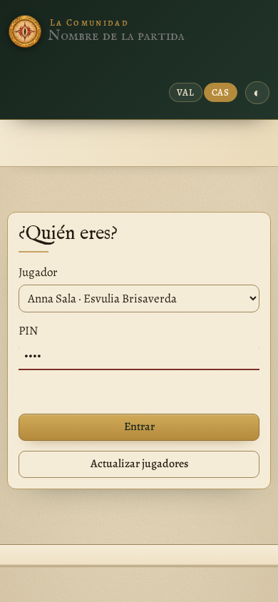
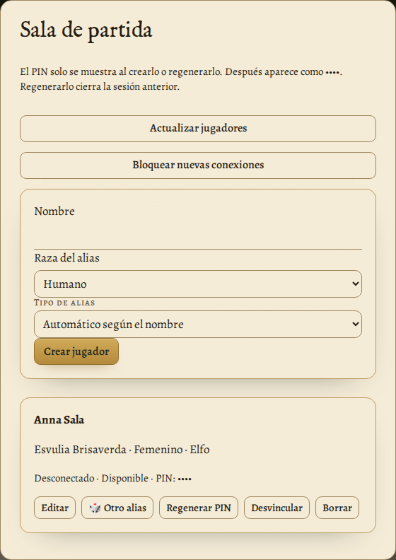
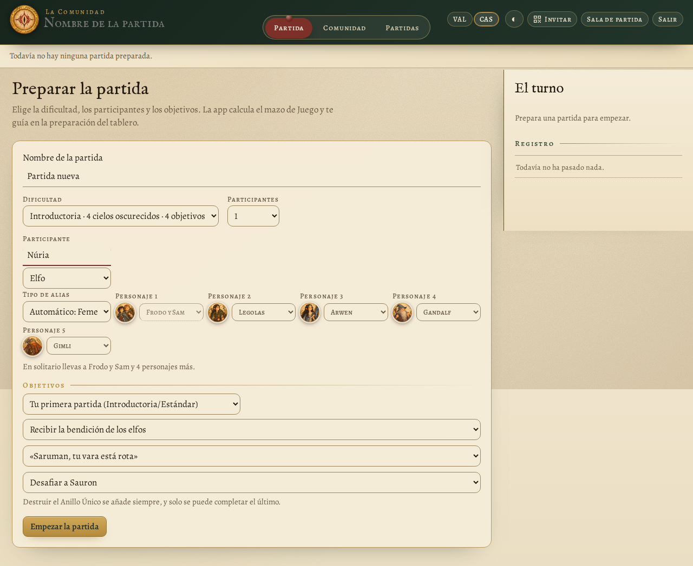

# Manual de usuario

Guía de uso de La Comunidad, el ayudante libre para llevar las partidas de «El Señor de los Anillos: El Destino de la Comunidad». El tablero y las piezas las tenéis en la mesa; la app lleva las cuentas.

Para instalarla, consulta la [guía de instalación](guia-instalacion.md).

## Guardados y recuperación — v2.7.0

La partida activa, identidades, hashes de PIN, sesiones e historial se confirman juntos en **`comunitat.sqlite3`**, mediante transacciones SQLite. Los JSON existentes siguen como copias compatibles de partidas, configuración e historial. Las partidas inactivas y sus copias siguen en JSON; esta versión refuerza el guardado conjunto del estado activo.

La primera lectura importa configuración e historial existentes sin eliminarlos. Cuando existe SQLite, es la fuente del último estado confirmado: no edites manualmente sus JSON de configuración, historial o partida activa; utiliza importar y restaurar. Si falla la proyección JSON, la jugada confirmada sigue en SQLite y se recupera al iniciar. Si falla la transacción, la app no confirma la jugada. Los datos corruptos no se sustituyen silenciosamente por datos vacíos.

Antes de recuperar un inicio, se guarda una copia coherente de SQLite en **`copies/estat/comunitat.sqlite3`**. Para una copia completa, cierra la app y copia **toda la carpeta de datos**, incluyendo base, JSON, partidas y copias. La copia de estado contiene credenciales y sesiones: consérvala en privado. Para volver a una versión anterior, cierra la app y trabaja sobre una copia de la carpeta; los JSON deben estar actualizados. No se permiten dos servidores en la misma carpeta de datos, aunque utilicen puertos distintos.

Si una base queda dañada, cierra la app, conserva toda la carpeta y restaura una copia coherente de `comunitat.sqlite3`; después la app recuperará sus JSON. La copia de estado corresponde al anterior inicio correcto, no necesariamente a la última jugada. Las copias de partida y la exportación JSON siguen disponibles.

## Sala de partida — v2.6.0

**Alias masculinos y femeninos:** al escribir un nombre, la app propone un tipo de alias mediante una lista local de nombres habituales; no consulta Internet. Puedes corregirlo con **Tipo de alias → Masculino / Femenino / Neutro**. Los nombres desconocidos o ambiguos se proponen como neutros. Es una ayuda lingüística para el alias, no una determinación del género de la persona. Cada raza tiene nombres inventados diferenciados. La preferencia manual se conserva; cambiarla desde **Sala de partida → Editar** genera otro alias sin cambiar el PIN ni cerrar la sesión. Los jugadores antiguos conservan su alias hasta que el máster lo cambie.

La aplicación arranca sin ninguna partida cargada. Elige **Crear partida**, escribe el nombre de la partida y los nombres y razas de los participantes, y prepárala. Al confirmar, los jugadores se incorporan automáticamente a **Sala de partida**, con alias y PIN. Los PIN nuevos se muestran una sola vez al máster. Si un nombre ya corresponde a un jugador registrado, se reutilizan su identidad y PIN existente. Los nombres de los participantes de una misma partida no pueden repetirse, ignorando acentos, mayúsculas y espacios sobrantes.

**Abrir partida guardada** recupera la partida e incorpora sus jugadores a la sala sin duplicarlos. Las partidas nuevas guardan UID, nombre, raza y alias, pero no el PIN ni su hash dentro del archivo de partida. Los PIN y sesiones siguen en la configuración local. Si importas una partida en otro ordenador o recuperas jugadores eliminados, el máster debe generarles PIN nuevos. Las partidas antiguas recuperan los jugadores por el nombre. No se abre la última partida al reiniciar; la opción explícita de terminal `--partida` sigue disponible.

El máster abre la app en el PC mediante `http://localhost:8766` (o el puerto elegido). **Sala de partida** permite crear jugadores con nombre y raza, editarlos, generar otro alias, eliminarlos, regenerar el PIN y desvincular sesiones. Las acciones destructivas requieren una segunda pulsación. Los alias son inventados; no son personajes del juego.

Al crear o regenerar un PIN de cuatro dígitos, anótalo y comunícalo al jugador: solo se muestra una vez y después aparece como **••••**. Se guarda con sal aleatoria y PBKDF2-HMAC-SHA256 (200.000 iteraciones), sin PIN en claro. Regenerarlo revoca la sesión anterior.

El jugador escanea el QR común, sigue **¿Quién eres? → jugador → PIN → Entrar**. Solo aparecen jugadores con PIN y sin vinculación. El navegador recuerda la sesión y reconecta después de recargar, de un corte de wifi o de reiniciar el servidor. **Salir** revoca la sesión; cerrar una pestaña no la desvincula. Si se pierde el dispositivo o los datos del navegador, el máster debe pulsar **Desvincular**. La posesión del token autoriza la sesión: no lo compartas.

**Bloquear nuevas conexiones** impide nuevas vinculaciones; las sesiones autorizadas pueden continuar y reconectar. El panel muestra conexión SSE, vinculación y última petición autenticada. Sin partida preparada, el jugador espera. Las jugadas siguen siendo cooperativas; el máster local administra jugadores, partidas e historial. Con sondeo, un dispositivo puede aparecer desconectado aunque siga autorizado; consulta también la última conexión.

Al actualizar desde v2.5 o anteriores se conservan partidas, configuración y UID. Los nombres duplicados reciben un sufijo, se sustituyen prudentemente los alias antiguos y se revocan las sesiones sin autenticación. El máster debe generar PIN para los jugadores migrados. Haz una copia de la carpeta de datos antes de actualizar. La sala es común a las partidas guardadas, como en la v2.5.

Funciona en una LAN de confianza con HTTP; el PIN y los tokens viajan sin cifrado de transporte. No expongas el puerto a Internet. Tras cinco intentos de PIN fallidos por IP en un minuto hay que esperar. El máster solo se autoriza desde loopback con Host local y se rechazan escrituras entre orígenes.

## Qué es y qué necesitas

La Comunidad es una página web que funciona en casa, sin Internet. Un ordenador hace de servidor y el resto de la mesa entra desde el navegador del móvil, la tableta o el portátil. Todos ven lo mismo al momento: si alguien pierde Esperanza o pasa el turno, los demás lo ven enseguida.

La app no sustituye al juego. Las cartas, las Tropas, los Nazgûl y el Ojo de Sauron siguen en el tablero de cartón. La app se encarga de las cuentas que se olvidaban o hacían perder tiempo:

- la Esperanza, la Amenaza, las cartas del mazo y cuántas veces se ha oscurecido el cielo;
- los pasos de cada turno y cuántas cartas de Sombra hay que resolver;
- cuántos dados hay que tirar en una búsqueda o en una batalla, y qué se pierde con el resultado;
- los objetivos, la preparación del tablero y un registro de todo lo que pasa, con un botón para deshacer.

| Pestaña | Qué hay |
|---|---|
| **Partida** | Los marcadores, las herramientas de tiradas, el mapa y el turno paso a paso. |
| **Comunidad** | La preparación del tablero, quién lleva cada personaje y el resumen. |
| **Partidas** | Las partidas guardadas y el historial de las terminadas. |

**Qué hace falta:**

- **El ordenador servidor:** Windows 10 u 11, o Linux. Consulta la [guía de instalación](guia-instalacion.md).
- **Los jugadores:** cualquier dispositivo con navegador, conectado a la misma wifi que el servidor. No tienen que instalar nada.

## Arrancar La Comunidad

Abre **La Comunidad** desde el menú Inicio (Windows) o desde el menú de aplicaciones (Linux). La app se abre en **una ventana propia**, sin navegador: este ordenador es el «principal», el que hace de servidor, y desde aquí se puede jugar igual que desde un móvil.

- Mientras la ventana esté abierta, La Comunidad funciona. Cuando la cierras, te pregunta si quieres cerrarla, lo guarda todo y los jugadores se desconectan.
- El botón **Invitar**, arriba a la derecha, muestra la dirección para los demás, por ejemplo `http://192.168.1.40:8766`, y el **código QR** que la lleva dentro.
- En la pestaña **Partidas**, el apartado **En este ordenador** dice dónde se guarda todo y tiene el botón **Abrir la carpeta de datos**.

> Si en este ordenador no se puede abrir la ventana propia (consulta [Si algo no funciona](#si-algo-no-funciona)), se abre una ventanita con la dirección, el QR y la partida abierta, y la app en el navegador. También la puedes elegir a propósito con la opción `--navegador`. Y en un ordenador sin pantalla, la misma información, con el QR, sale en el terminal (en valenciano). Consulta las opciones en la [guía de instalación](guia-instalacion.md).

## Entrar desde los dispositivos

1. Con la cámara del móvil, escanea el QR del botón **Invitar** del ordenador principal. También puedes escribir en el navegador la dirección para los demás, por ejemplo `http://192.168.1.40:8766`.
2. Selecciona el jugador creado por el máster, escribe su PIN y pulsa **Entrar**.
3. El navegador recuerda quién eres. La próxima vez entrarás directamente.

El máster puede cambiar tu nombre desde **Sala de partida**.

Si llega alguien con la partida empezada, pulsa el botón del QR de arriba a la derecha (en el ordenador principal, **Invitar**): muestra el código en grande para que lo escanee.

> **Truco:** en el móvil, añade la página a la pantalla de inicio desde el menú del navegador. Así se abre como si fuera una aplicación.

## Preparar una partida

La primera vez, la app muestra el formulario de preparación. Rellénalo y pulsa **Empezar la partida**.

### Dificultad

| Nivel | Cielo oscurecido | Objetivos |
|---|---|---|
| Introductoria | 4 | 4 |
| Estándar | 5 | 4 |
| Heroica | 5 | 5 |
| Épica | 6 | 5 |
| Legendaria | 6 | 6 |

Los objetivos incluyen siempre «Destruir el Anillo Único», que se añade solo.

### Participantes y personajes

Cada participante lleva 2 personajes, y junto a cada desplegable se ve el retrato del elegido. Alguien tiene que llevar a Frodo y Sam. Las propuestas que hay por defecto son las que sugiere el reglamento para la primera partida. En solitario llevas a Frodo y Sam y 4 personajes más.

### Objetivos

Elígelos de la lista o usa un escenario sugerido del reglamento («Tu primera partida», «Jinetes de Rohan»…), que los rellena todos a la vez.

### La lista de preparación

Al terminar, la app pasa a la pestaña **Comunidad**. Allí encontrarás los 10 pasos de preparación del reglamento, con las Tropas de cada ubicación, los Nazgûl y dónde empieza cada personaje. Ve marcándolos a medida que preparáis el tablero.

## La pantalla de juego

La barra de arriba lleva los marcadores:

| Marcador | Qué es |
|---|---|
| **Esperanza** | Empieza en 6, el máximo es 8. Si llega a 0, perdéis. Los botones − y + la corrigen a mano. |
| **Amenaza** | La casilla marcada dice cuántas cartas de Sombra se roban en cada turno (2, 2, 3, 3, 4, 4, 5). Sube sola con *El cielo se oscurece*. |
| **Cielo oscurecido** | Cuántas cartas de *El cielo se oscurece* han salido, del total que hay en el mazo. |
| **Mazo** | Las cartas que quedan en el mazo de Juego. Baja sola cuando robáis y se puede corregir. |
| **Objetivos** | Completados del total. |
| **Deshacer** | Anula el último cambio. Puedes deshacer hasta 30 pasos atrás. |

En el mapa del centro, haz clic para verlo en grande.

## Un turno, paso a paso

La columna de la derecha (en el móvil, justo debajo de los marcadores) sigue el orden de juego del reglamento. El paso actual se marca en rojo.

1. **Haz 4 + 1 acciones.** Toca los círculos para llevar la cuenta: 4 con un personaje y 1 con el otro. Cuando termines, pulsa **Hecho**.
2. **Roba 2 cartas de Juego.** Pulsa **He robado 2 cartas**: el mazo baja 2. Si no quedan suficientes, resta 1 de Esperanza por cada carta que falta.
3. Si robas *El cielo se oscurece*, pulsa el botón del mismo nombre (más abajo).
4. **Roba las cartas de Sombra.** Resuélvelas en el tablero y pulsa **Resolver una carta de Sombra** por cada una. El contador dice cuántas faltan.
5. **Pasa al siguiente turno.** Si todavía quedan cartas de Sombra, el botón te avisa y tienes que pulsarlo dos veces.

### Carta de Sombra

La ventana recuerda cómo se resuelve cada mitad de la carta:

- **Bandera roja:** Avanzar.
- **Bandera negra:** Reforzar, con las tres órdenes especiales.

Si se ha perdido un Refugio, o no quedaban Tropas de la Sombra en la reserva, márcalo aquí y la app restará la Esperanza que toca.

### El cielo se oscurece

Hace los cuatro pasos de la carta:

- Sube la Amenaza.
- **¡Te veo!** Contesta si el Ojo de Sauron ya está en la región de Frodo: si lo está, resta 2 de Esperanza.
- Si al colocar las 3 Tropas de la Sombra faltan en la reserva, resta 1 por cada una.
- Te recuerda barajar los descartes de Sombra.

Si en la ubicación de la carta hay Tropas Aliadas, haz después una tirada de batalla «La provoca la Sombra».

## Las tiradas

Los dados los tiráis de verdad. La app dice cuántos tenéis que tirar y, cuando anotáis el resultado de cada dado, aplica el efecto. Las repeticiones con Destino, hacedlas antes de anotar nada: anotad solo el resultado final.

### Tirada de búsqueda

Indica cuántos Nazgûl hay en la región de Frodo y cuántas Tropas de la Sombra hay en su ubicación. La app dice cuántos dados tienes que tirar: 1 por cada uno, hasta un máximo de 7.

Marca si Frodo está en un Refugio (se ignora «Al descubierto») o en Mordor (se ignora «Convocación»).

**Frodo se pone el Anillo** resta 1 de Esperanza y hace la búsqueda sin contar las Tropas.

Anota cuántos dados han salido de cada cara y pulsa **Aplicar**.

### Tirada de batalla

Elige si es un ataque de un personaje o si la provoca la Sombra, e indica las Tropas de cada bando en la ubicación.

- **Ataque:** hasta 1 dado por Tropa Aliada (mínimo 1, máximo 3). Puedes tirar menos. Recuerda mover el Ojo a la región.
- **La provoca la Sombra:** 1 dado por Tropa de la Sombra, máximo 3.

Marca si hay Nazgûl en la región y si la ubicación es un Refugio. Al anotar los resultados, puedes añadir la **Heroicidad** que gastéis: cada una retira 1 Tropa de la Sombra.

Si después de la batalla la Sombra se queda sola en un Refugio, la app te avisa de que lo has perdido y resta las 3 de Esperanza.

### Destruir el Anillo Único

Solo se puede intentar cuando el resto de objetivos están completados y Frodo está en el Monte del Destino, gastando 5 de Destino.

Los dados son los de la búsqueda, más 1 por cada casilla que hay por encima de la Esperanza, hasta un máximo de 7. Si después de la tirada la Esperanza es 1 o más, ganáis.

## Esperanza, objetivos y resumen

### Botones de Esperanza

Para los casos más habituales, con el motivo, que queda apuntado en el registro:

| Motivo | Esperanza |
|---|---|
| Refugio perdido | −3 |
| Fortaleza capturada | +2 |
| Falta una Tropa de la Sombra | −1 |
| Falta una carta de Juego | −1 |
| Otros (objetivos, habilidades) | ±1 |

### Objetivos

Márcalos cuando los completéis. La app no aplica sola el texto «Al completarlo» de cada carta: hazlo con los botones de Esperanza o en el tablero. «Destruir el Anillo Único» se marca solo cuando ganáis.

### Deshacer y registro

Todo lo que pasa queda en el registro, con la hora y quién lo ha hecho. Las pérdidas de Esperanza salen en rojo y las ganancias, en verde.

Si alguien se equivoca, **Deshacer** vuelve atrás el último cambio, sea de quien sea. Se puede pulsar varias veces.

> **Cuidado:** Deshacer solo cambia la app. Si ya habíais movido piezas en el tablero, volved a ponerlas como estaban.

### Al terminar: el resumen

Cuando ganáis o perdéis, la app muestra a todos el resumen de la partida:

- rondas jugadas y cuánto ha durado;
- la Esperanza final y dónde se ha perdido o ganado;
- cuántas tiradas de búsqueda, batallas, cielos oscurecidos y cartas de Sombra ha habido;
- los objetivos completados.

Se puede volver a abrir con el botón **Ver el resumen** de la franja de arriba, y también aparece en la pestaña Comunidad.

## Partidas e historial

En la pestaña **Partidas** puedes tener guardadas todas las que quieras:

- **Crear** y abrir una nueva.
- **Abrir** otra. Todos los que están conectados pasan a ella solos.
- **Duplicar**, para probar algo sin tocar la original.
- **Copias**: las copias de seguridad de la partida, para volver a una anterior (más abajo).
- **Exportar**: guarda la partida en un archivo `.json`, para pasarla a otro ordenador o guardarla aparte.
- **Borrar.** No se pierde: va a la carpeta `partides/esborrades/` de la carpeta de datos y se puede recuperar moviendo el archivo a `partides/`.

Con **Importar → Elegir el archivo…** se añade una partida exportada, de este o de otro ordenador. Se crea como partida nueva: no sustituye a ninguna.

El nombre de la partida se cambia escribiendo directamente en el título de arriba.

### Guardado y cambios simultáneos

El aviso **Guardando…** pasa a **Guardado** cuando el servidor ha escrito la jugada en disco. Cada jugada guarda a la vez los contadores, el registro y los pasos para deshacer. Durante el guardado, espera a que termine antes de realizar otra acción.

Si dos jugadores actúan sobre la misma versión de la partida, se acepta el primer cambio y el otro dispositivo carga la partida actualizada. Revísala y repite la acción si aún hace falta. Si aparece **Cambios pendientes**, mantén la página abierta, comprueba la conexión y pulsa **Volver a intentar**; el reintento no duplica una jugada que ya se haya guardado.

### Papelera

Las partidas borradas aparecen en **Partidas → Papelera**. Pulsa **Recuperar** para devolverlas a las partidas guardadas. Recuperar no cambia la partida abierta y, si el nombre del archivo ya existe, se crea uno diferente.

### Historial

Debajo de las partidas guardadas está el historial: todas las partidas terminadas, de cualquier partida guardada, con el resultado, la dificultad, el escenario, quién jugaba y con qué personajes. Arriba tienes el total de victorias y derrotas, y una tabla por dificultad.

Si una partida se ha apuntado por error, **Quitar del historial** la borra. Si deshacéis la jugada que la ha terminado, también desaparece sola.

### Copias de seguridad

La Comunidad hace copias de cada partida ella sola: una cada vez que se abre y, mientras jugáis, una cada media hora. Se guardan las 15 últimas de cada partida.

El botón **Copias** de cada partida las muestra con la fecha y la hora. **Restaurar** devuelve la partida a ese momento (antes se hace una copia de lo que había, por si acaso), y **Hacer una copia ahora** hace una a mano, por ejemplo antes de probar algo.

Todo se guarda en la **carpeta de datos**, que se abre con el botón **Abrir la carpeta de datos** de la pestaña Partidas, en el ordenador principal. Dentro están la carpeta `partides`, la carpeta `copies`, el archivo `comunitat.json` (los jugadores) e `historial.json` (las partidas terminadas). Para guardarlo todo aparte, o para pasarlo todo a otro ordenador, copia esa carpeta entera. La [guía de instalación](guia-instalacion.md) dice dónde está en cada sistema.

## Móvil, mapa, idioma y tema

### En el móvil

En vertical, la app se pone en una sola columna: arriba los marcadores, después el turno y, si bajas, el mapa y las herramientas. Así, quien tiene el turno lo puede llevar desde el móvil.

Las ventanas de tiradas y cartas ocupan casi todo el ancho, con botones fáciles de pulsar.

### Cambiar el mapa

Al principio se ve el mapa de ejemplo. Para poner el tuyo, copia la imagen en la carpeta de datos con el nombre `mapa.jpg` (también vale `mapa.png`) y recarga la página. No hace falta cerrar La Comunidad.

Si tienes el mapa en dos idiomas, llámalos `mapa-es.jpg` y `mapa-val.jpg`: cada uno verá el de su idioma.

Usa imágenes que puedas usar: si compartes el programa, no pongas mapas de otras personas sin permiso.

### Idioma

La app está en castellano y en valenciano. Los botones **CAS** y **VAL**, arriba a la derecha, cambian el idioma solo en tu dispositivo; cada jugador puede tener el suyo. El registro, los objetivos y el mapa también cambian.

Los avisos de la ventana (por ejemplo, al cerrarla) salen en valenciano. Para tenerlos en castellano, arranca con la opción `--idioma es`.

### Modo oscuro

El botón de la luna (◐ ☀ ☾) cambia entre el tema automático (el del sistema), claro y oscuro. Como el idioma, se recuerda en cada dispositivo.

## Si algo no funciona

| Qué pasa | Qué hacer |
|---|---|
| No se abre la ventana propia, sino la ventanita del QR y el navegador | En Windows, falta el componente **WebView2** de Microsoft, que traen Windows 11 y Windows 10 actualizado: instala «Microsoft Edge WebView2 Runtime» desde la web de Microsoft. En Linux, faltan GTK y WebKitGTK: la [guía de instalación](guia-instalacion.md) explica cómo instalarlos. Mientras tanto, La Comunidad funciona igual en el navegador. |
| Los demás no pueden entrar | Tienen que estar en la misma wifi que el servidor. Revisa el cortafuegos: en Windows, permite La Comunidad en «Redes privadas» y comprueba que la wifi está configurada como privada. En Linux, `sudo ufw allow 8766/tcp`. Algunas redes de invitados no dejan que los dispositivos se vean entre ellos. |
| «El puerto ya está en uso» | Ya hay otra Comunidad abierta. Ciérrala, o arranca en otro puerto: `--port 9001`. |
| Aparece «Se ha perdido la conexión con el servidor» | La Comunidad se ha cerrado o el ordenador se ha dormido. Cuando la vuelvas a abrir, la página se reconecta sola y no se pierde nada. |
| Aparece «Modo de prueba» | Se ha abierto la página sin el programa (por ejemplo, la prueba de la web). No se guarda nada: entra con la dirección de la ventana. |
| Me he equivocado en algún número | Pulsa **Deshacer**, o corrígelo con los botones − y + de la barra de arriba. |
| Un jugador quiere entrar con otro nombre | Pide al máster que edite el jugador. |

> **Recuerda:** la app solo lleva las cuentas. Si la app y el tablero no coinciden, manda el tablero: corregid la app para que quede igual.

## Licencia

La Comunidad es software libre con licencia GPL-3.0: la podéis usar, copiar, modificar y compartir, y las versiones modificadas que publiquéis también tienen que ser libres. El mapa de ejemplo, el logo y los retratos de los personajes se han generado con IA, y el programa y este manual se han escrito con ayuda de un asistente de IA. Es un proyecto de fans no oficial, sin relación con Z-Man Games, Asmodee ni Middle-earth Enterprises. Para jugar hay que tener el juego.

> Los textos de ayuda son redacción propia del proyecto. Consulta los avisos de marcas y materiales de terceros en [NOTICE.md](../NOTICE.md).
