# Manual de usuario

Guía de uso de La Comunidad, el ayudante libre para llevar las partidas de «El Señor de los Anillos: El Destino de la Comunidad». El tablero y las piezas las tenéis en la mesa; la app lleva las cuentas.

Para instalarla, consulta la [guía de instalación](guia-instalacion.md).

## Qué es y qué necesitas

La Comunidad lleva las cuentas de una partida de «El Destino de la Comunidad». **Una persona la lleva** desde el ordenador, la tableta o el móvil, y el resto jugáis en el tablero, como siempre. No hace falta Internet ni crear ninguna cuenta.

La app no sustituye al juego. Las cartas, las Tropas, los Nazgûl y el Ojo de Sauron siguen en el tablero de cartón. La app se encarga de las cuentas que se olvidaban o hacían perder tiempo:

- la Esperanza, la Amenaza, las cartas del mazo y cuántas veces se ha oscurecido el cielo;
- los pasos de cada turno y cuántas cartas de Sombra hay que resolver;
- cuántos dados hay que tirar en una búsqueda o en una batalla, y qué se pierde con el resultado;
- los objetivos, la preparación del tablero y un registro de todo lo que pasa, con un botón para deshacer.

| Pestaña | Qué hay |
|---|---|
| **Partida** | Los marcadores, las herramientas de tiradas, el mapa y el turno paso a paso. |
| **Comunidad** | La preparación del tablero, quién lleva cada personaje y el resumen. |
| **Partidas** | Las partidas guardadas, las copias de seguridad y el historial de las terminadas. |

**Dónde funciona:** es la misma app en todas partes. Elige la que mejor te vaya (la [guía de instalación](guia-instalacion.md) explica cada una):

| Dónde | Cómo | Dónde se guardan las partidas |
|---|---|---|
| **Windows 10 u 11** | Instalador o versión portable, en una ventana propia | En la carpeta de datos del ordenador |
| **Linux** | Paquete `.deb` o `.tar.gz`, en una ventana propia | En la carpeta de datos del ordenador |
| **Android** | El `.apk` | Dentro de la app |
| **Cualquier navegador** | La app web, sin instalar nada, también sin conexión | Dentro del navegador |

Las partidas **no pasan solas** de un dispositivo a otro: para seguir una en otro sitio, expórtala e impórtala (ver [Partidas e historial](#partidas-e-historial)).

## Abrir La Comunidad

- **Windows y Linux:** abre **La Comunidad** desde el menú Inicio o desde el menú de aplicaciones. Se abre en **una ventana propia**, sin navegador. Al cerrarla, te pregunta si quieres cerrarla; la partida ya está guardada.
- **Android:** toca el icono de **La Comunidad**. El botón «atrás» de Android cierra la ventana abierta, vuelve a la pestaña Partida y, si ya estabas en ella, sale de la app.
- **Navegador:** abre la dirección de la app web. Desde el menú del navegador, **Añadir a pantalla de inicio** (o **Instalar**) la deja como una app más, que funciona también sin conexión.

La primera vez no hay ninguna partida: pulsa **Crear partida**. Si ya tienes alguna, se abre la última que usaste.

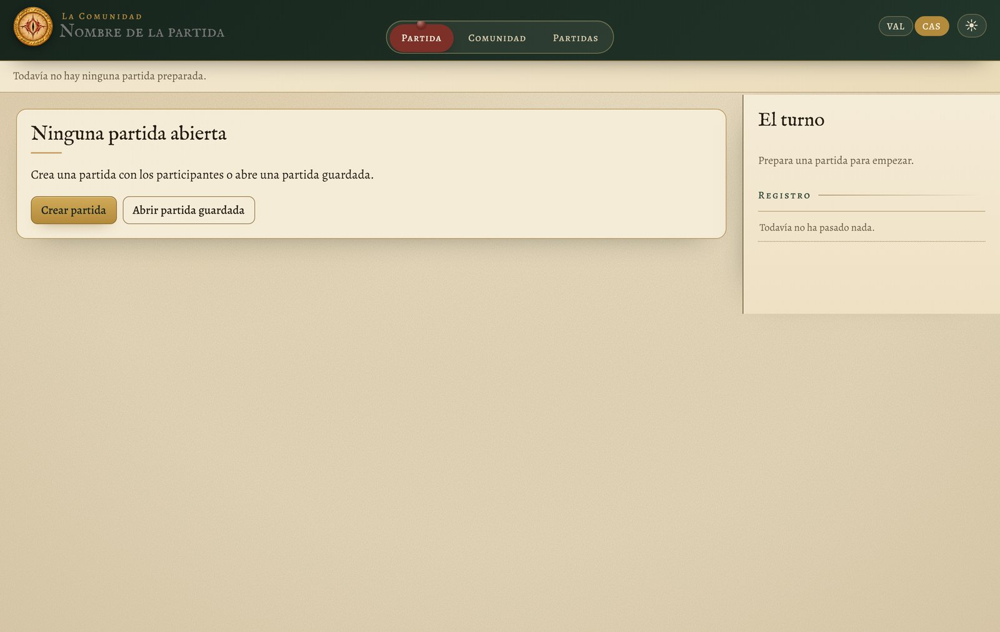

> En el ordenador, si no se puede abrir la ventana propia (ver [Si algo no funciona](#si-algo-no-funciona)), se abre la app en el navegador y una ventanita para cerrarla. También la puedes elegir a propósito con la opción `--navegador`.

## Preparar una partida

Ponle un nombre a la partida (por ejemplo, «Viernes con la cuadrilla»), rellena el formulario y pulsa **Empezar la partida**. Para volver a preparar la partida abierta desde cero, en la pestaña Comunidad está el botón **Preparar una partida nueva**.

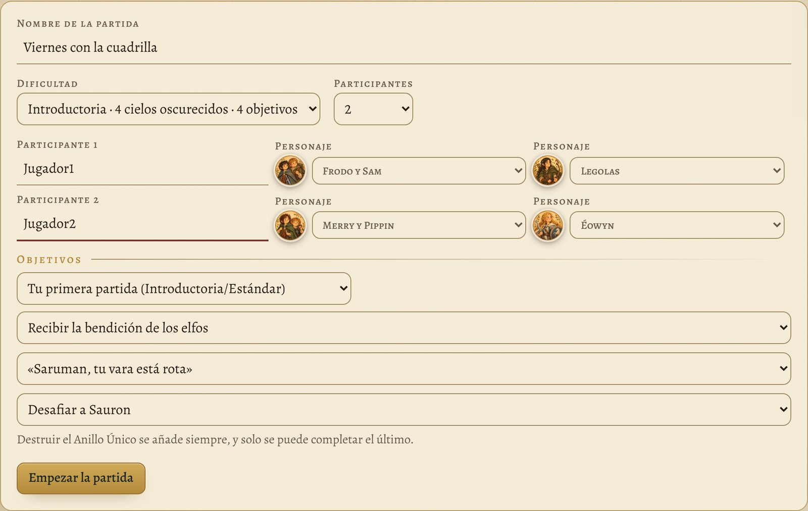

### Dificultad

| Nivel | Cielo oscurecido | Objetivos |
|---|---|---|
| Introductoria | 4 | 4 |
| Estándar | 5 | 4 |
| Heroica | 5 | 5 |
| Épica | 6 | 5 |
| Legendaria | 6 | 6 |

Los objetivos incluyen siempre «Destruir el Anillo Único», que se añade solo.

### Participantes y personajes

Escribe el nombre de cada participante (la app recuerda los últimos que has puesto). Cada participante lleva 2 personajes, y junto a cada desplegable se ve el retrato del elegido. Alguien tiene que llevar a Frodo y Sam. Las propuestas que hay por defecto son las que sugiere el reglamento para la primera partida. En solitario llevas a Frodo y Sam y 4 personajes más.

### Objetivos

Elígelos de la lista o usa un escenario sugerido del reglamento («Tu primera partida», «Jinetes de Rohan»…), que los rellena todos a la vez.

### La lista de preparación

Al terminar, la app pasa a la pestaña **Comunidad**. Allí encontrarás los 10 pasos de preparación del reglamento, con las Tropas de cada ubicación, los Nazgûl y dónde empieza cada personaje. Ve marcándolos a medida que preparáis el tablero.

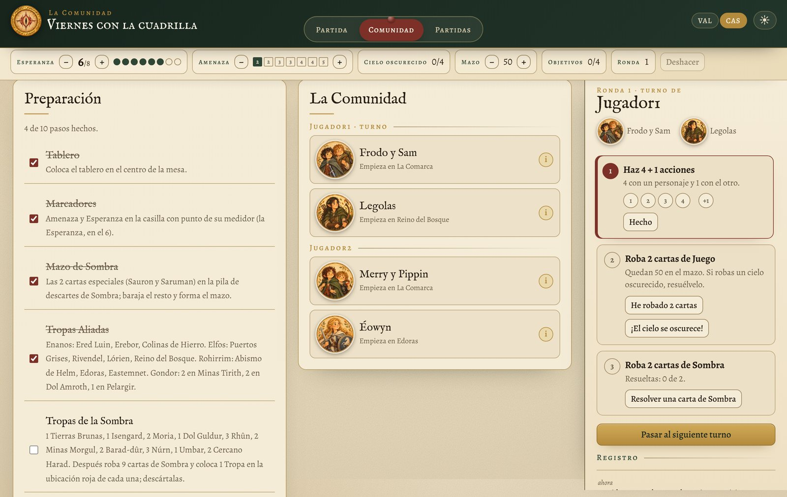

## La pantalla de juego

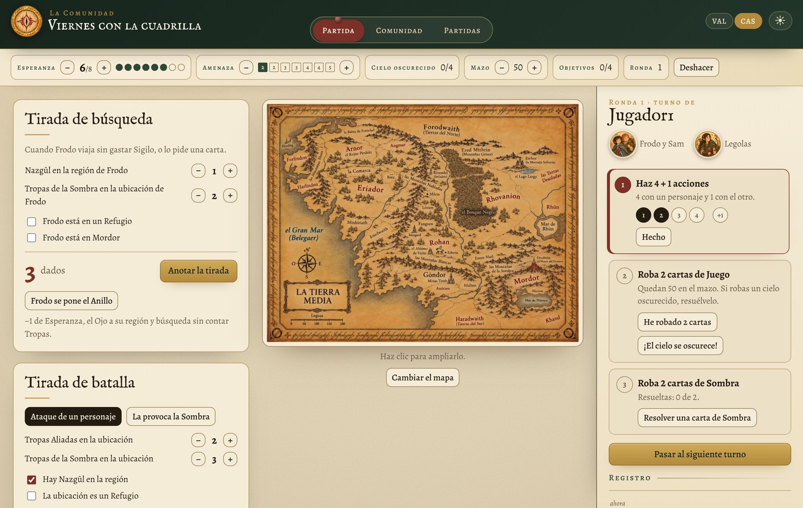

La barra de arriba lleva los marcadores:

| Marcador | Qué es |
|---|---|
| **Esperanza** | Empieza en 6, el máximo es 8. Si llega a 0, perdéis. Los botones − y + la corrigen a mano. |
| **Amenaza** | La casilla marcada dice cuántas cartas de Sombra se roban en cada turno (2, 2, 3, 3, 4, 4, 5). Sube sola con *El cielo se oscurece*. |
| **Cielo oscurecido** | Cuántas cartas de *El cielo se oscurece* han salido, del total que hay en el mazo. |
| **Mazo** | Las cartas que quedan en el mazo de Juego. Baja sola cuando robáis y se puede corregir. |
| **Objetivos** | Completados del total. |
| **Deshacer** | Anula el último cambio. Puedes deshacer hasta 30 pasos atrás. |

En el mapa del centro, haz clic para verlo en grande.

## Un turno, paso a paso

La columna de la derecha (en el móvil, justo debajo de los marcadores) sigue el orden de juego del reglamento. El paso actual se marca en rojo.

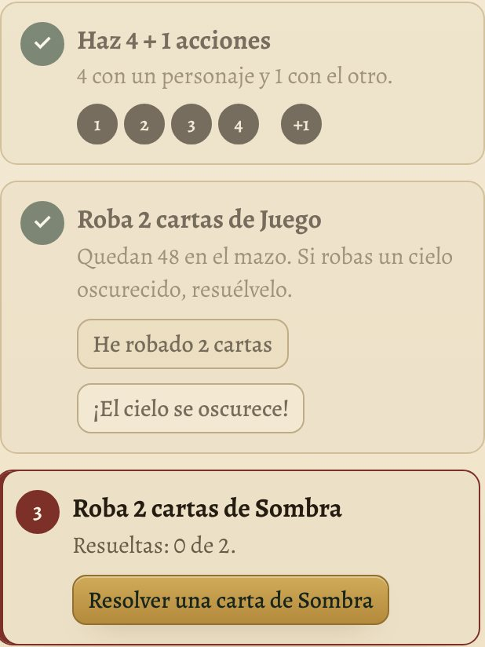

1. **Haz 4 + 1 acciones.** Toca los círculos para llevar la cuenta: 4 con un personaje y 1 con el otro. Cuando termines, pulsa **Hecho**.
2. **Roba 2 cartas de Juego.** Pulsa **He robado 2 cartas**: el mazo baja 2. Si no quedan suficientes, resta 1 de Esperanza por cada carta que falta.
3. Si robas *El cielo se oscurece*, pulsa el botón del mismo nombre (más abajo).
4. **Roba las cartas de Sombra.** Resuélvelas en el tablero y pulsa **Resolver una carta de Sombra** por cada una. El contador dice cuántas faltan.
5. **Pasa al siguiente turno.** Si todavía quedan cartas de Sombra, el botón te avisa y tienes que pulsarlo dos veces.

### Carta de Sombra

La ventana recuerda cómo se resuelve cada mitad de la carta:

- **Bandera roja:** Avanzar.
- **Bandera negra:** Reforzar, con las tres órdenes especiales.

Si se ha perdido un Refugio, o no quedaban Tropas de la Sombra en la reserva, márcalo aquí y la app restará la Esperanza que toca.

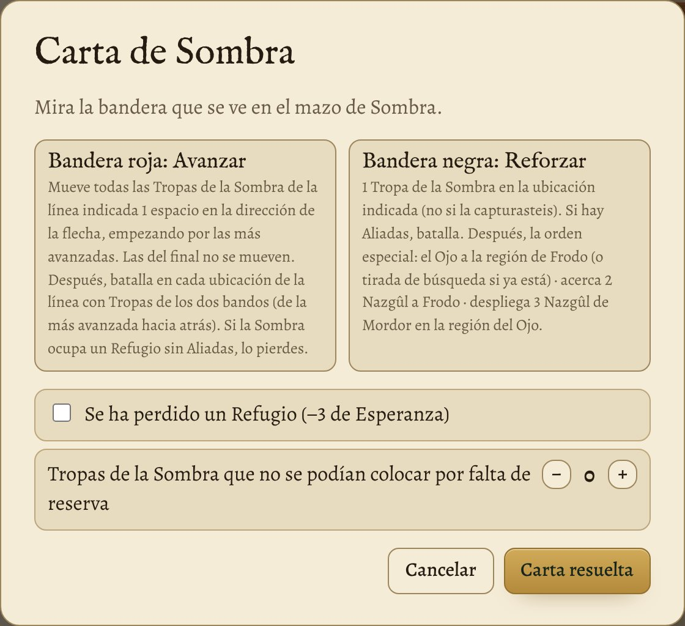

### El cielo se oscurece

Hace los cuatro pasos de la carta:

- Sube la Amenaza.
- **¡Te veo!** Contesta si el Ojo de Sauron ya está en la región de Frodo: si lo está, resta 2 de Esperanza.
- Si al colocar las 3 Tropas de la Sombra faltan en la reserva, resta 1 por cada una.
- Te recuerda barajar los descartes de Sombra.

Si en la ubicación de la carta hay Tropas Aliadas, haz después una tirada de batalla «La provoca la Sombra».

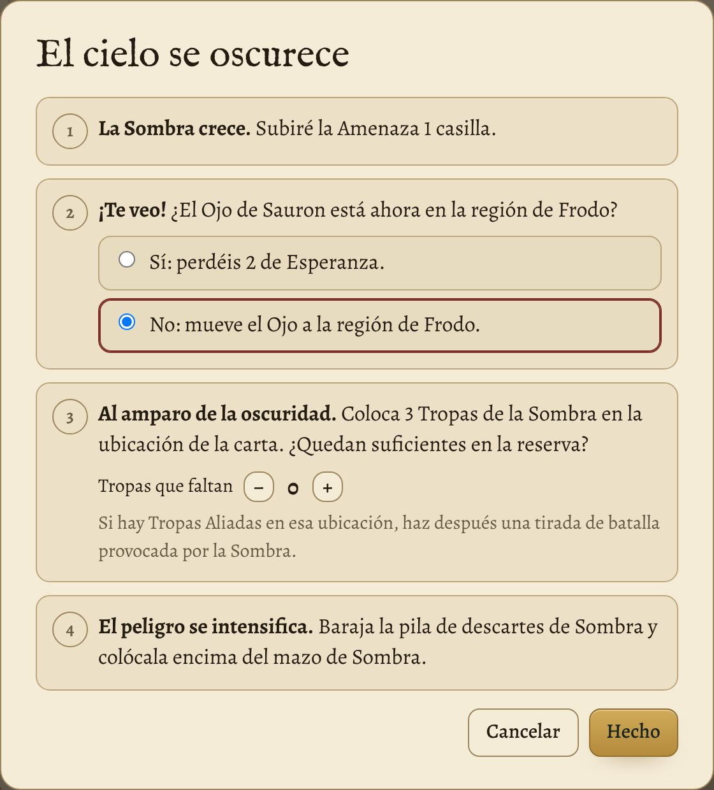

## Las tiradas

Los dados los tiráis de verdad. La app dice cuántos tenéis que tirar y, cuando anotáis el resultado de cada dado, aplica el efecto. Las repeticiones con Destino, hacedlas antes de anotar nada: anotad solo el resultado final.

### Tirada de búsqueda

Indica cuántos Nazgûl hay en la región de Frodo y cuántas Tropas de la Sombra hay en su ubicación. La app dice cuántos dados tienes que tirar: 1 por cada uno, hasta un máximo de 7.

Marca si Frodo está en un Refugio (se ignora «Al descubierto») o en Mordor (se ignora «Convocación»).

**Frodo se pone el Anillo** resta 1 de Esperanza y hace la búsqueda sin contar las Tropas.

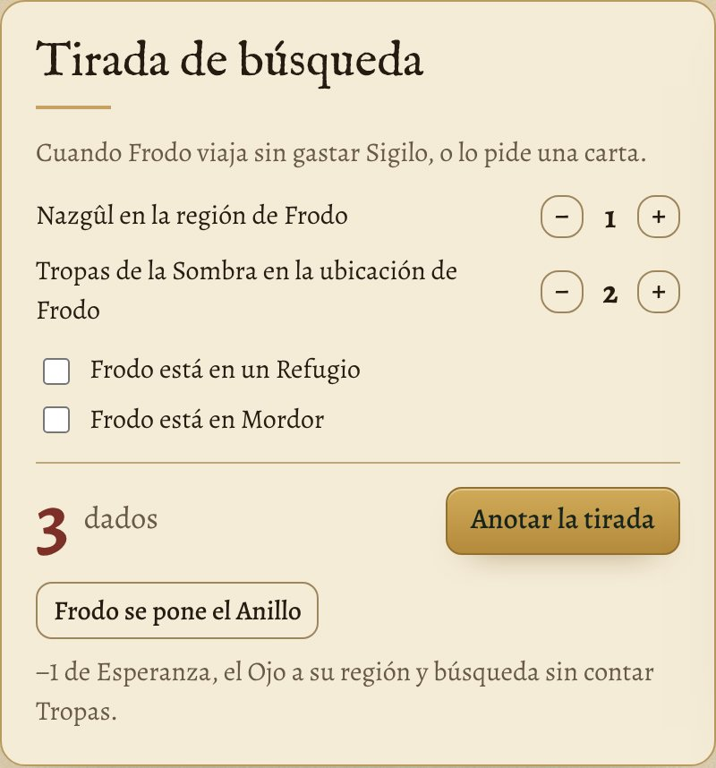

Anota cuántos dados han salido de cada cara y pulsa **Aplicar**.

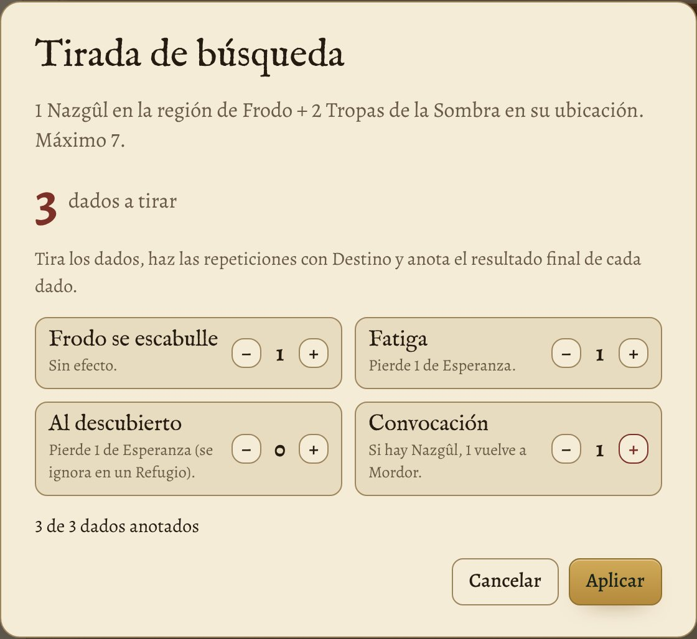

### Tirada de batalla

Elige si es un ataque de un personaje o si la provoca la Sombra, e indica las Tropas de cada bando en la ubicación.

- **Ataque:** hasta 1 dado por Tropa Aliada (mínimo 1, máximo 3). Puedes tirar menos. Recuerda mover el Ojo a la región.
- **La provoca la Sombra:** 1 dado por Tropa de la Sombra, máximo 3.

Marca si hay Nazgûl en la región y si la ubicación es un Refugio. Al anotar los resultados, puedes añadir la **Heroicidad** que gastéis: cada una retira 1 Tropa de la Sombra.

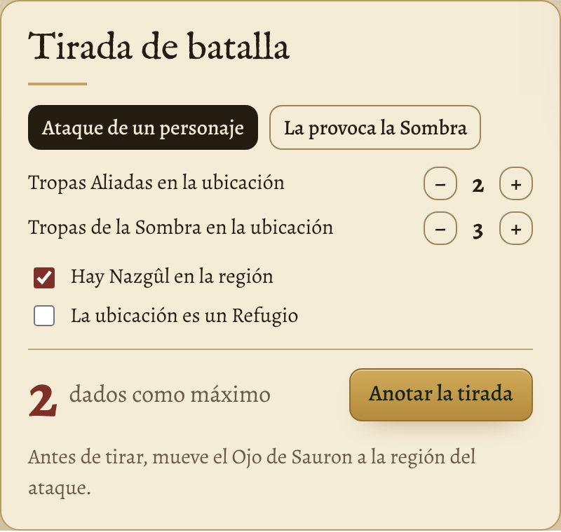

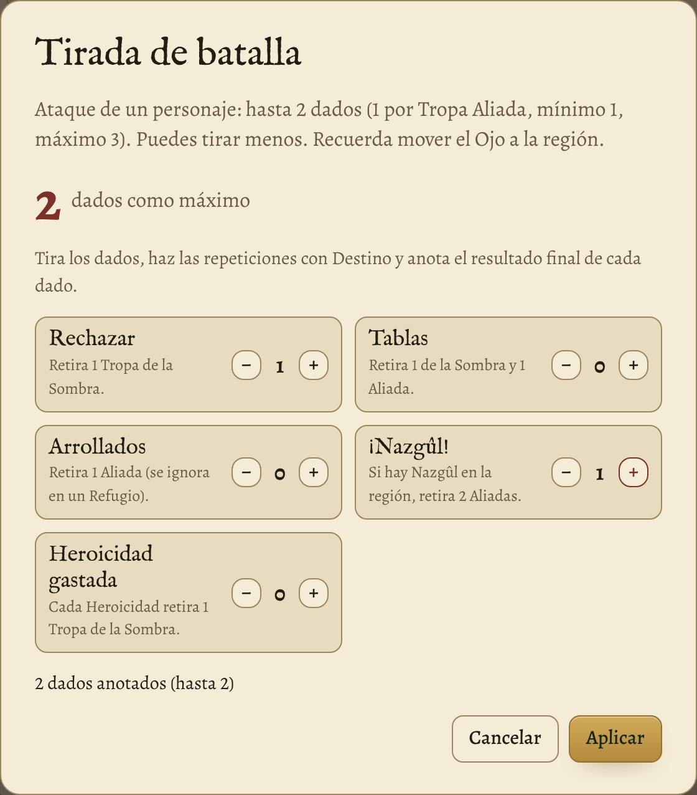

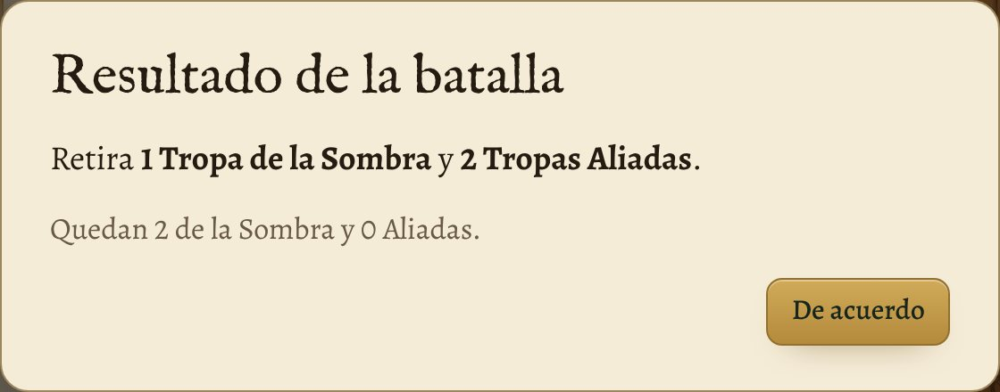

Si después de la batalla la Sombra se queda sola en un Refugio, la app te avisa de que lo has perdido y resta las 3 de Esperanza.

### Destruir el Anillo Único

Solo se puede intentar cuando el resto de objetivos están completados y Frodo está en el Monte del Destino, gastando 5 de Destino.

Los dados son los de la búsqueda, más 1 por cada casilla que hay por encima de la Esperanza, hasta un máximo de 7. Si después de la tirada la Esperanza es 1 o más, ganáis.

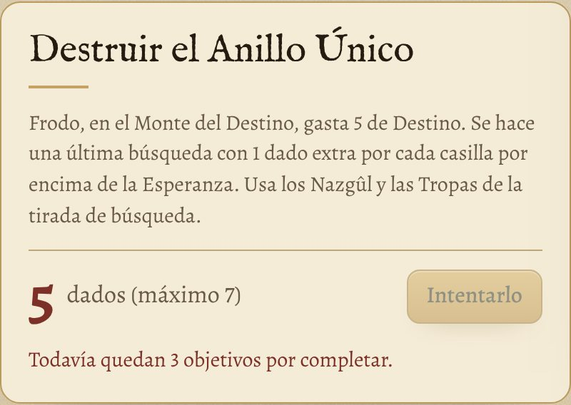

## Esperanza, objetivos y resumen

### Botones de Esperanza

Para los casos más habituales, con el motivo, que queda apuntado en el registro:

| Motivo | Esperanza |
|---|---|
| Refugio perdido | −3 |
| Fortaleza capturada | +2 |
| Falta una Tropa de la Sombra | −1 |
| Falta una carta de Juego | −1 |
| Otros (objetivos, habilidades) | ±1 |

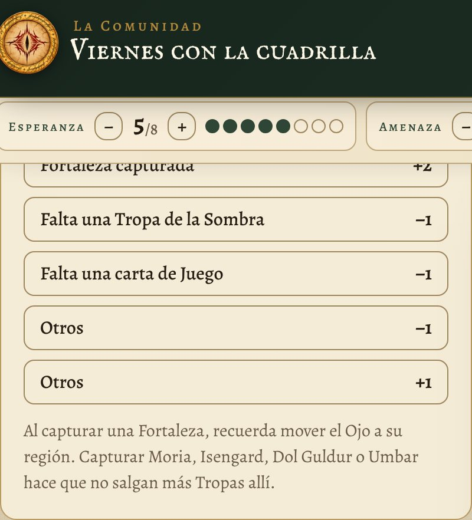

### Objetivos

Márcalos cuando los completéis. La app no aplica sola el texto «Al completarlo» de cada carta: hazlo con los botones de Esperanza o en el tablero. «Destruir el Anillo Único» se marca solo cuando ganáis.

### Deshacer y registro

Todo lo que pasa queda en el registro, con la hora. Las pérdidas de Esperanza salen en rojo y las ganancias, en verde.

Si te equivocas, **Deshacer** vuelve atrás el último cambio. Se puede pulsar varias veces.

> **Cuidado:** Deshacer solo cambia la app. Si ya habíais movido piezas en el tablero, volved a ponerlas como estaban.

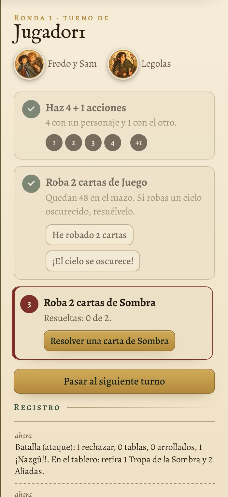

### Al terminar: el resumen

Cuando ganáis o perdéis, la app muestra el resumen de la partida:

- rondas jugadas y cuánto ha durado;
- la Esperanza final y dónde se ha perdido o ganado;
- cuántas tiradas de búsqueda, batallas, cielos oscurecidos y cartas de Sombra ha habido;
- los objetivos completados.

Se puede volver a abrir con el botón **Ver el resumen** de la franja de arriba, y también aparece en la pestaña Comunidad.

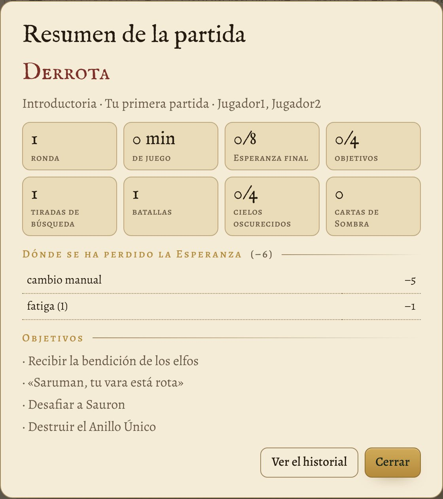

## Partidas e historial

En la pestaña **Partidas** puedes tener todas las que quieras guardadas:

- **Crear y abrir** una nueva.
- **Abrir** otra.
- **Duplicar**, para probar algo sin tocar la original.
- **Copias**: las copias de seguridad de la partida, para volver a una anterior (ver más abajo).
- **Exportar**: guarda la partida en un archivo `.json`, para pasarla a otro dispositivo o guardarla aparte. En el ordenador, va a la carpeta **Descargas**; en Android, se abre el menú **Compartir** para guardarla en Archivos, en Drive, enviarla…; en el navegador, se descarga.
- **Borrar**: va a la **Papelera**, de donde la puedes recuperar. La partida abierta no se puede borrar: abre otra primero.

Con **Importar → Elegir el archivo…** se añade una partida exportada, de este o de otro dispositivo. Se crea como partida nueva: no sustituye a ninguna. También se pueden importar los archivos de las carpetas `partides` y `copies` de la carpeta de datos.

El nombre de la partida se cambia escribiendo directamente en el título de arriba.

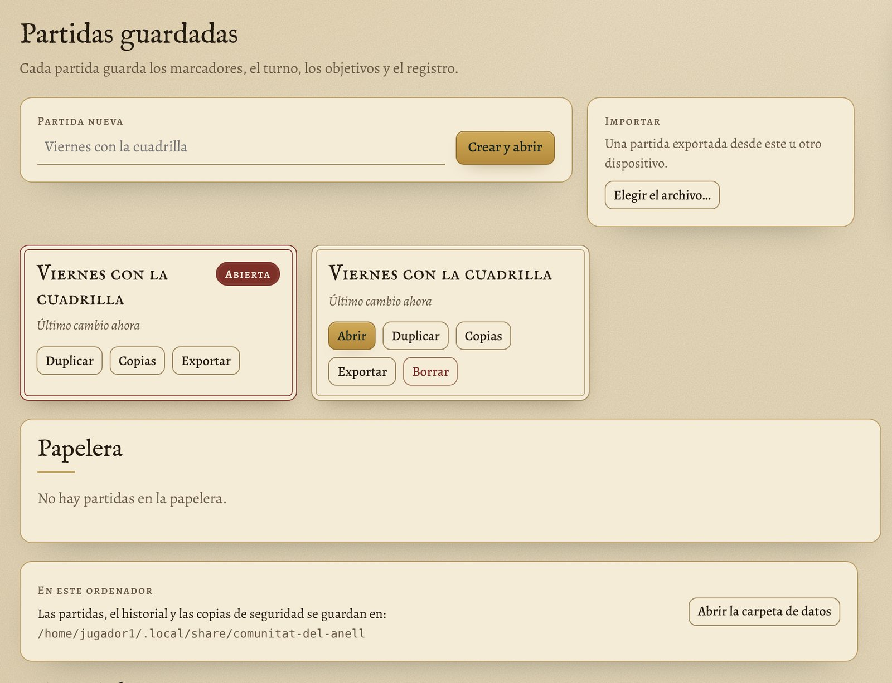

### Guardado

Cada cambio se guarda solo al momento: los contadores, el registro y los pasos para deshacer. Puedes cerrar la app cuando quieras y seguir otro día. Si alguna vez no se puede guardar (por ejemplo, si el disco está lleno), arriba aparece un aviso con el botón **Volver a intentar**.

### Papelera

Las partidas borradas aparecen en **Partidas → Papelera**. Pulsa **Recuperar** para devolverlas a las partidas guardadas.

### Historial

Debajo de las partidas guardadas está el historial: todas las partidas terminadas, de cualquier partida guardada, con el resultado, la dificultad, el escenario, quién jugaba y con qué personajes. Arriba tienes el total de victorias y derrotas, y una tabla por dificultad.

Si una partida se ha apuntado por error, **Quitar del historial** la borra. Si deshacéis la jugada que la ha terminado, también desaparece sola.

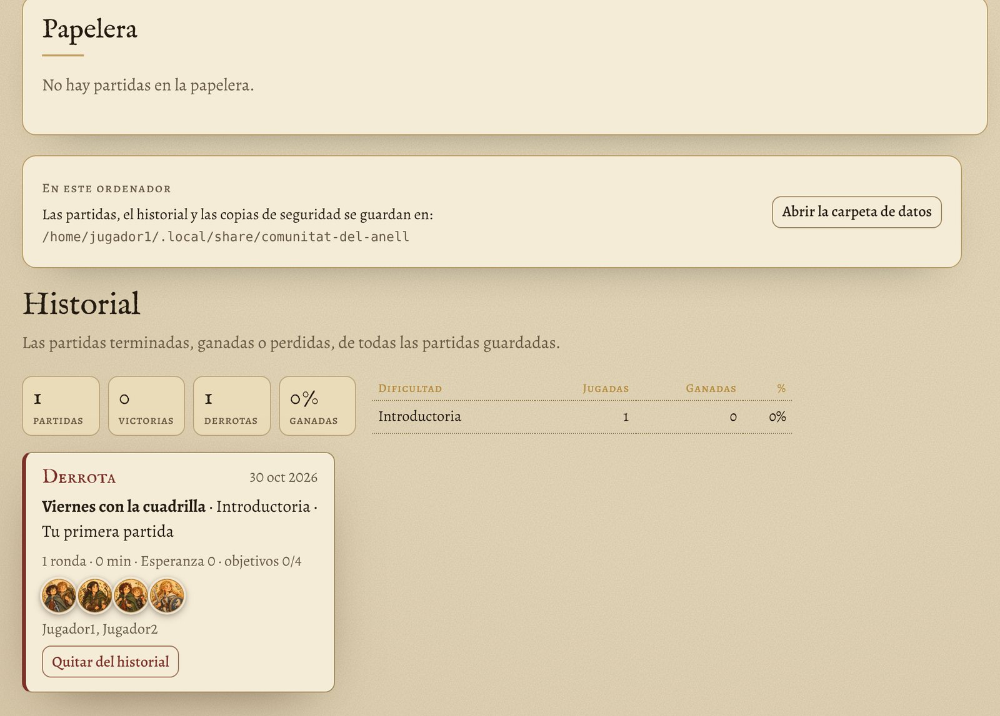

### Copias de seguridad

La Comunidad hace copias de cada partida ella sola: una cada vez que se abre y, mientras jugáis, una cada media hora. Se guardan las 15 últimas de cada partida.

El botón **Copias** de cada partida las muestra con la fecha y la hora. **Restaurar** devuelve la partida a ese momento (antes se hace una copia de lo que había, por si acaso), y **Hacer una copia ahora** hace una a mano, por ejemplo antes de probar algo.

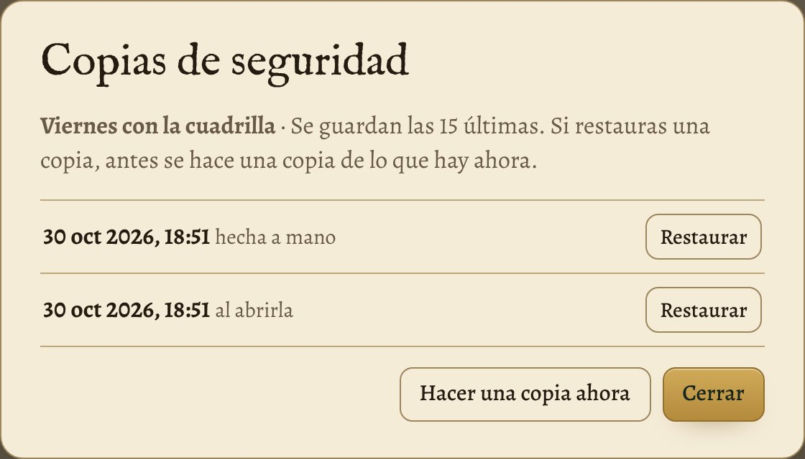

**En el ordenador**, todo se guarda en la **carpeta de datos**, que se abre con el botón **Abrir la carpeta de datos** de la pestaña Partidas. Dentro están la carpeta `partides`, la carpeta `copies`, `historial.json` (las partidas terminadas) y `comunitat.json` (qué partida estaba abierta). Para guardarlo todo aparte, o para pasarlo todo a otro ordenador, cierra La Comunidad y copia esa carpeta entera. La [guía de instalación](guia-instalacion.md) dice dónde está en cada sistema.

**En Android y en el navegador**, las partidas se guardan dentro de la app. Si desinstalas la app o borras los datos del navegador, se pierden: exporta las que quieras conservar.

## Móvil, mapa, idioma y tema

### En el móvil

En vertical, la app se pone en una sola columna: arriba los marcadores y, si bajas, el mapa, las herramientas y el turno.

Las ventanas de tiradas y cartas ocupan casi todo el ancho, con botones fáciles de pulsar.

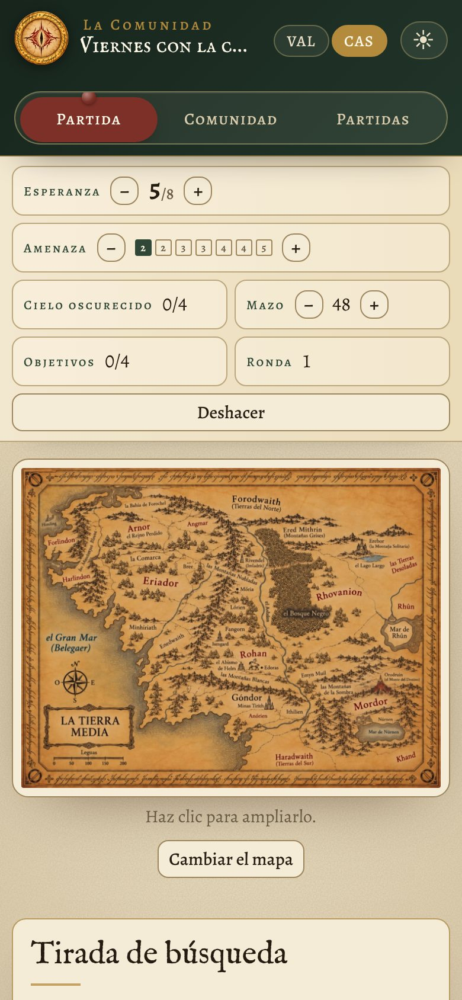

### Cambiar el mapa

Al principio se ve el mapa de ejemplo. Para poner el tuyo, pulsa **Cambiar el mapa**, debajo del mapa, y elige una imagen. Se usa en todas las partidas de este dispositivo. **Volver al mapa de ejemplo** lo quita.

En el ordenador también vale la manera de las versiones anteriores: copiar la imagen en la carpeta de datos con el nombre `mapa.jpg` (o `mapa-es.jpg` y `mapa-val.jpg`, uno por idioma).

Usa imágenes que puedas usar: si compartes el programa, no pongas mapas de otras personas sin permiso.

### Idioma

La app está en castellano y en valenciano. Los botones **CAS** y **VAL**, arriba a la derecha, cambian el idioma. El registro, los objetivos y el mapa de ejemplo también cambian.

En el ordenador, los avisos de la ventana (por ejemplo, al cerrarla) salen en valenciano. Para tenerlos en castellano, arranca con la opción `--idioma es`.

### Modo oscuro

El botón de la luna (◐ ☀ ☾) cambia entre el tema automático (el del sistema), claro y oscuro.

## Si algo no funciona

| Qué pasa | Qué hacer |
|---|---|
| En el ordenador no se abre la ventana propia, sino el navegador | En Windows, falta el componente **WebView2** de Microsoft, que llevan Windows 11 y Windows 10 actualizado: instala «Microsoft Edge WebView2 Runtime» desde la web de Microsoft. En Linux, faltan GTK y WebKitGTK: la [guía de instalación](guia-instalacion.md) dice cómo instalarlos. Mientras tanto, La Comunidad funciona igual en el navegador. |
| «La Comunidad ya está abierta» | Ya hay otra Comunidad abierta en este ordenador: búscala en la barra de tareas. |
| Aparece «No se puede contactar con el programa» | En el ordenador, La Comunidad se ha cerrado mientras la página estaba abierta en el navegador. Vuelve a abrirla. |
| En el móvil no encuentro una partida que tenía en el ordenador | Cada dispositivo tiene sus partidas. Expórtala en el ordenador e impórtala en el móvil. |
| Me he equivocado en algún número | Pulsa **Deshacer**, o corrígelo con los botones − y + de la barra de arriba. |

> **Recuerda:** la app solo lleva las cuentas. Si la app y el tablero no coinciden, manda el tablero: corregid la app para que quede igual.

## Licencia

La Comunidad es software libre con licencia GPL-3.0: la podéis usar, copiar, modificar y compartir, y las versiones modificadas que publiquéis también tienen que ser libres. El mapa de ejemplo, el logo y los retratos de los personajes se han generado con IA, y el programa y este manual se han escrito con ayuda de un asistente de IA. Es un proyecto de fans no oficial, sin relación con Z-Man Games, Asmodee ni Middle-earth Enterprises. Para jugar hay que tener el juego.

> Los textos de ayuda son redacción propia del proyecto. Consulta los avisos de marcas y materiales de terceros en [NOTICE.md](../NOTICE.md).
